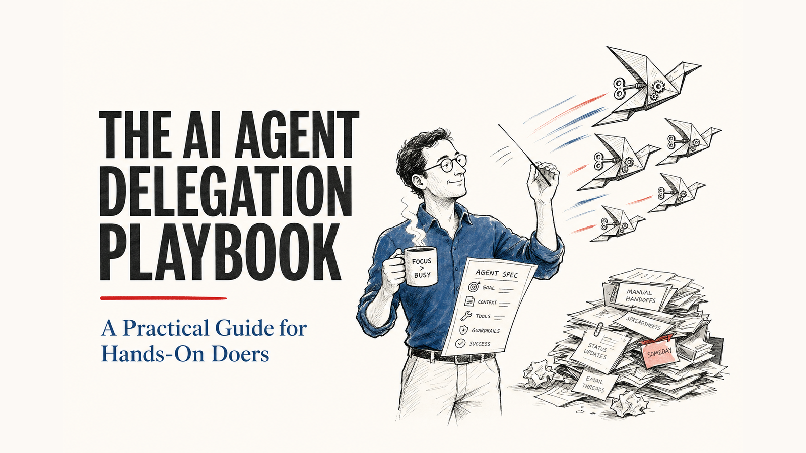

# 평생 비서를 부려본 적 없는 실무자를 위한 AI 에이전트 위임 플레이북

**혼자 다 해치우던 습관을 버리고, 기준을 적고 결과만 검수하는 사람으로 일하는 법**



> **“일의 실행(Execution)은 위임하되, 기준의 설계(Specification)와 검증의 책임(Verification)은 절대 위임하지 마라.”**

- **인터랙티브 웹북 바로 읽기:** **[https://deep-diver.github.io/delegationPlayBook/](https://deep-diver.github.io/delegationPlayBook/)**
- **실전 스타터 킷 내려받기 (.zip):** **[starter-kit.zip](https://deep-diver.github.io/delegationPlayBook/starter-kit.zip)**
- **전 권 합본 원문 내려받기 (.md):** **[full_book.md](https://deep-diver.github.io/delegationPlayBook/full_book.md)**

---

## 왜 일 잘하는 사람일수록 AI에게 일을 못 맡길까

일 잘하는 실무자일수록 남에게 일을 맡기지 못한다. 설명할 시간에 내가 직접 해치우는 게 훨씬 빠르고 결과물도 깔끔하기 때문이다. 문제는 내 하루가 24시간뿐이라는 데 있다. 자료 찾고, 초안 쓰고, 숫자 맞추고, 서식 다듬는 일을 혼자 다 끌어안으면 내가 깨어 있는 시간이 곧 생산성의 천장이 된다.

그래서 큰마음 먹고 AI 에이전트를 켠다. 채팅창에 한 줄 던진다. 돌아온 결과물을 보고 한숨을 쉰다. "역시 아직 멀었네. 그냥 내가 하자."

냉정하게 짚어보자. AI가 멍청해서 망한 게 아니다. 인수인계서 한 장 없이 첫 출근한 인턴에게 "알아서 깔끔하게 해와"라고 던졌기 때문에 망한 것이다. 게다가 브레이크도 안 달아두고 열쇠부터 쥐여줬다가 안 보낼 메일을 보내거나 원본 파일을 날리는 사고를 겪는다.

이 책은 추상적인 프롬프트 요령을 다루지 않는다. 수십 년간 검증된 수석 비서(EA) 운영 원칙(마이클 하얏트의 위임 5단계, 맷 모카리의 초안 전용 원칙, 아테나의 플레이북 교정 루프)을 오늘 당장 내 컴퓨터와 AI 설정창에 심을 수 있는 평문 파일과 안전 잠금장치로 바꾼 실전 매뉴얼이다.

- **비개발 직군 트랙 (기획 · 마케팅 · 리서치 · 운영 · 창업자):** 검은 터미널 창을 열 필요가 없다. 평소 쓰는 Claude, ChatGPT, Notion AI 설정창에 내 일머리를 적은 문서 3장(`USER.md` · `SOUL.md` · `PLAYBOOK.md`)을 올리고, 발송 대신 초안만 쌓이게 만드는 안전한 작업 흐름을 세팅한다.
- **개발 · 엔지니어 트랙 (개발자 · 데이터 분석가 · 테크 리드):** Claude Code, Codex CLI, OpenClaw, MCP 환경에서 저장소 기준 문서(`CLAUDE.md` · `AGENTS.md`)를 하나로 묶고, 말로 조심하라고 타이르는 대신 `settings.json`과 `block_irreversible.py` 훅으로 위험한 명령을 물리적으로 잠근다.

---

## 전체 목차 (`book/`)

모든 원고는 [`book/`](./book/) 폴더에 마크다운 원문으로 들어 있으며, 웹북에서 종이책 감성의 조판과 본문 검색으로 편하게 읽을 수 있다.

| 구분 | 원고 파일 (`book/`) | 웹북 바로가기 | 읽고 나서 손에 남는 것 |
| :--- | :--- | :--- | :--- |
| **서문** | [`book/README.md`](./book/README.md) | [서문 읽기](https://deep-diver.github.io/delegationPlayBook/preface) | 직군별 읽는 순서, 5단계 실전 적용 로드맵, 시작 전 1분 점검표 |
| **Chapter 1** | [`book/01_mental_model.md`](./book/01_mental_model.md) | [Ch 1 읽기](https://deep-diver.github.io/delegationPlayBook/01_mental_model) | 최소 작업 기준표(`MINIMAL_SPEC_PROMPT`), 위임 손익 계산법, 절대 맡기면 안 되는 4가지 일 |
| **Chapter 2** | [`book/02_personal_os.md`](./book/02_personal_os.md) | [Ch 2 읽기](https://deep-diver.github.io/delegationPlayBook/02_personal_os) | 머릿속 일머리를 글로 꺼내는 법, `USER.md` · `SOUL.md` · `PLAYBOOK.md` · `AGENTS.md` 완성본 |
| **Chapter 3** | [`book/03_delegation_gates.md`](./book/03_delegation_gates.md) | [Ch 3 읽기](https://deep-diver.github.io/delegationPlayBook/03_delegation_gates) | 위임 5단계 권한표, 5줄 지시 템플릿, `settings.json` 잠금 설정, 사고 방지 훅 스크립트 |
| **Chapter 4** | [`book/04_setup_and_cases.md`](./book/04_setup_and_cases.md) | [Ch 4 읽기](https://deep-diver.github.io/delegationPlayBook/04_setup_and_cases) | 격리 폴더 세팅, 읽기 전용 연동, 메일 분류·일정 방어·자료 조사·코드 정리 등 10대 실무 레시피 |
| **Chapter 5** | [`book/05_calibration_loop.md`](./book/05_calibration_loop.md) | [Ch 5 읽기](https://deep-diver.github.io/delegationPlayBook/05_calibration_loop) | 10초 오류 원인 찾기 트리, 규칙 두 줄 고치기 프롬프트, 금요일 15분 점검표 |
| **Chapter 6** | [`book/06_quickstart_cheatsheet.md`](./book/06_quickstart_cheatsheet.md) | [Ch 6 읽기](https://deep-diver.github.io/delegationPlayBook/06_quickstart_cheatsheet) | 월요일 오전 30분 세팅 시간표, 책상 앞 한 장 치트시트, 막힐 때 보는 7문 7답 |
| **Appendix** | [`book/appendix_references.md`](./book/appendix_references.md) | [부록 읽기](https://deep-diver.github.io/delegationPlayBook/appendix_references) | 비개발자도 5초 만에 이해하는 18개 핵심 용어 풀이와 검증된 출처 38선 |
| **합본** | [`book/full_book.md`](./book/full_book.md) | [단일 합본 통독](https://deep-diver.github.io/delegationPlayBook/full_book) | 서문부터 부록까지 한 페이지에 이어 붙인 무손실 통합본 (2,860라인) |

---

## 스타터 킷 3분 세팅 (`starter-kit/`)

빈 화면을 띄워놓고 첫 줄을 고민할 필요 없다. [`starter-kit/`](./starter-kit/) 폴더에 바로 복사해 빈칸만 채우면 되는 템플릿과 안전 잠금 스크립트 12종을 담아 두었다. 자세한 순서는 [`starter-kit/README.md`](./starter-kit/README.md)에 적혀 있다.

### 1. 로컬 CLI 에이전트 사용자 (개발 · 데이터 직군)

```bash
# 1) 내 홈 폴더와 분리된 에이전트 전용 작업 방을 만들고 스타터 킷을 복사한다
mkdir -p ~/agent-workspace
cp -R starter-kit/. ~/agent-workspace/

# 2) 위험 명령(삭제·강제 푸시 등)을 실행 직전에 가로채 막는 훅에 실행 권한을 준다
chmod +x ~/agent-workspace/.claude/hooks/block_irreversible.py

# 3) USER.md와 SOUL.md를 열어 대괄호([ ]) 부분만 내 업무 상황에 맞게 채운 뒤 시작한다
```

### 2. 웹·앱 UI 에이전트 사용자 (기획 · 마케팅 · 리서치 · 운영 · 창업자)

1. 자주 쓰는 AI 도구의 프로젝트 지침(Claude Projects, ChatGPT 맞춤 지침, Notion AI)에 [`starter-kit/USER.md`](./starter-kit/USER.md)와 [`starter-kit/SOUL.md`](./starter-kit/SOUL.md)를 올리고 대괄호(`[ ]`) 빈칸을 채운다.
2. [`starter-kit/task_audit_sheet.md`](./starter-kit/task_audit_sheet.md)로 가장 만만하고 되돌리기 쉬운 반복 업무 딱 1개만 고른 뒤, [`starter-kit/PLAYBOOK.md`](./starter-kit/PLAYBOOK.md) 양식에 맞춰 일을 시킨다.
3. 메일 발송이나 원본 삭제 권한은 꺼두고 초안만 받아 30초 만에 눈으로 훑어 승인한다. 실수가 나오면 채팅창에서 화내지 않고 금요일마다 [`starter-kit/WEEKLY_AGENT_AUDIT.md`](./starter-kit/WEEKLY_AGENT_AUDIT.md)를 보며 문서에 규칙 두 줄을 보탠다.

---

## 저장소 구성과 로컬 웹북 실행

```text
delegationPlayBook/
├── book/                  # 전자책 마크다운 원고 (서문, Ch 1~6, 부록, 합본) 및 도식 10종
├── starter-kit/           # 바로 복사해 쓰는 개인 OS 템플릿과 안전 잠금 스크립트 12종
├── scripts/               # 원본을 건드리지 않고 웹북 소스와 starter-kit.zip을 묶는 스크립트
├── site/                  # VitePress 웹북 테마, 한국어 전문 검색, 표지 랜딩 컴포넌트
└── .github/workflows/     # main 브랜치 푸시 시 GitHub Pages로 자동 배포하는 워크플로우
```

내 컴퓨터에서 웹북을 직접 띄워보거나 정적 빌드를 확인하려면 Node.js 22 이상에서 아래 명령을 실행한다.

```bash
npm ci
npm run dev     # 로컬 웹북 서버 실행 (http://localhost:5173/delegationPlayBook/)
npm run build   # 에셋·링크 무결성 검사(--strict) 및 정적 빌드 생성 (site/.vitepress/dist)
```
