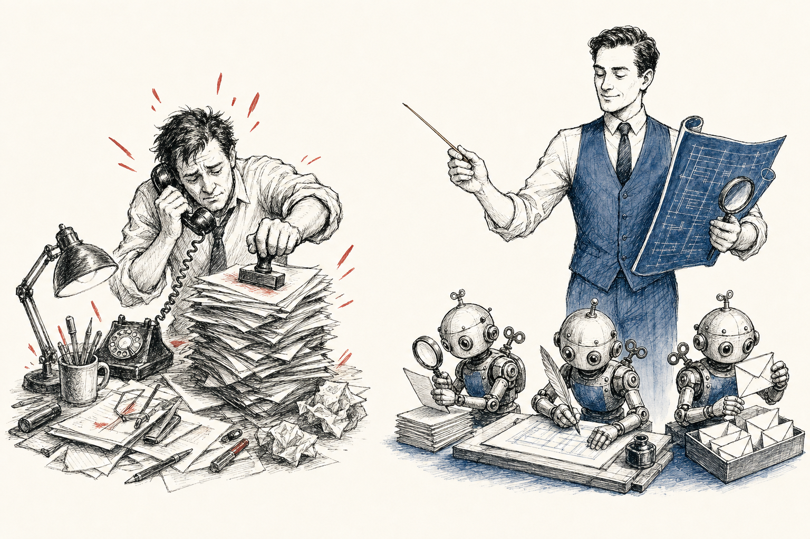

# 1장. 실행자에서 설계자로 — 위임의 첫 번째 멘탈 모델

위임이 어려운 진짜 이유는 기술이 복잡해서가 아니다.
오랫동안 내 손으로 직접 문제를 해결해 인정받아 온 사람일수록, 일을 손에서 놓는 순간 알 수 없는 불안에 휩싸이기 때문이다.
내가 끝까지 챙기지 않으면 어딘가 구멍이 날 것 같고, 남이 해온 일을 고치느니 처음부터 내가 하는 편이 속 편하다는 오랜 믿음 탓이다.

이 장에서는 모든 실무를 혼자 짊어지던 '직접 실행자'의 시선을 거두고, 기준을 세우고 결과를 판정하는 '시스템 설계자'로 일의 중심축을 옮기는 첫 번째 사고 전환을 다룬다.

---

## 1.1 내 손이 멈추면 모든 일이 멈추는 구조

유능한 실무자의 책상은 늘 비좁고 분주하다.
아침에 자리에 앉자마자 밤새 쌓인 연락에 답하고, 오전에 들어갈 회의 자료를 긁어모으고, 어지러운 숫자를 표로 맞추고, 오후에는 기획서 문장을 다듬는다.
전화기를 어깨에 끼운 채 도장을 찍고 서류를 넘기는 손길이 쉴 새 없이 돌아간다.

내가 직접 하니 마음은 놓인다.
내 기준을 내가 제일 잘 알고, 중간에 의도가 왜곡될 염려도 없기 때문이다.
하지만 혼자서 모든 공정을 완결하는 이 가내수공업 방식에는 피할 수 없는 막다른 골목이 기다리고 있다.

내가 잠깐 몸이 아파 자리를 비우거나, 당장 눈앞의 급한 불이 아니라 회사의 다음 분기를 결정할 깊은 고민에 잠기는 순간 모든 실무의 톱니바퀴가 멈춰 선다.
일이 두 배로 늘어나면 내가 선택할 수 있는 길은 잠을 절반으로 줄이거나 주말을 반납하는 것뿐이다.
성실함이 무기가 되던 시기를 지나, 성실함 자체가 내 성장의 발목을 잡는 가장 큰 병목이 되어버리는 역설이다.

경영 사상가 앤디 그로브는 관리자의 산출물이란 본인이 직접 손으로 빚어낸 결과물이 아니라, 그가 설계하고 영향을 미친 시스템 전체가 만들어낸 산출물의 합계라고 정의했다.
과거에는 이 문장이 수십 명의 부하 직원을 거느린 조직장에게만 해당되는 교훈이었다.
평생 누군가에게 일을 시켜본 적 없는 현장 실무자에게는 먼 나라 이야기처럼 들렸다.

이제 전제가 완전히 바뀌었다.
지치지 않고 자료를 뒤지고, 초안을 작성하며, 정해진 규칙에 따라 봉투를 분류하는 인공지능 대리인들이 모든 개인의 책상 앞에 놓였기 때문이다.
팀원이 단 한 명도 없는 일 인 기업가나 막내 실무 담당자라 할지라도, 출근하는 순간 보이지 않는 실무진 여럿을 거느린 설계자의 자리에 앉게 된 셈이다.

문제는 우리가 직접 망치를 쥐고 일하는 법만 수없이 훈련받았지, 청사진을 그리고 돋보기로 결과를 검수하며 조수들을 지휘하는 법은 단 한 번도 배운 적이 없다는 데 있다.
대리인을 곁에 두고도 여전히 비좁은 책상에 파묻혀 모든 서류를 직접 처리하려 드는 사람은 도구의 시대에 가장 먼저 지쳐 쓰러진다.
손에 쥔 연장을 내려놓고 청사진과 지휘봉을 집어 들기로 결심할 때 비로소 일의 천장이 열린다.

*그림 1-1. 비좁은 작업대에 파묻혀 모든 실무를 혼자 감당하는 실행자와, 청사진과 돋보기만 쥐고 흐름을 이끄는 설계자*

---

## 1.2 기준·실행·검증의 삼분법 — 양쪽 끝 손잡이만 쥐면 품질은 흔들리지 않는다

그렇다면 왜 수많은 실무자가 대리인에게 일을 맡겨 보았다가 하루도 못 가 포기하고 마는 걸까.
일을 넘기는 순간 결과물의 수준이 형편없이 무너지는 경험을 했기 때문이다.
하지만 품질이 무너진 진짜 원인은 위임을 해서가 아니다.
결코 넘겨서는 안 될 앞머리와 뒷머리까지 실행과 한데 묶어 통째로 던져버렸기 때문이다.

겉보기에 아무리 복잡하고 전문적인 지식 노동이라도 그 뼈대를 발라내면 언제나 세 개의 마디로 나뉜다.

첫째 마디는 **기준 설계**다.
이 일을 누구의 어떤 결정을 돕기 위해 하는지 목적을 세우고, 참고할 자료의 테두리를 정하며, 무엇을 옳고 그름의 잣대로 삼을지, 그리고 최종 결과물이 어떤 모양이어야 하는지 미리 청사진을 그리는 일이다.

둘째 마디는 **실행**이다.
앞에서 그려진 청사진을 따라 수백 건의 문서를 훑고, 조건에 맞춰 분류하고, 거친 문장 초안을 빚어내는 손발의 공정이다.

셋째 마디는 **검증**이다.
완성되어 올라온 초안이 처음 세운 기준에서 한 치도 벗어나지 않았는지, 원문에 없는 사실이 교묘히 섞이지 않았는지 돋보기로 대조하고 최종 승인 도장을 찍는 일이다.

이 세 마디를 분리해 놓고 나면 위임의 대원칙이 흔들림 없이 드러난다.
**가운데 마디인 '실행'은 대리인에게 아낌없이 넘기되, 맨 앞의 '기준 설계'와 맨 뒤의 '검증'이라는 양쪽 끝 손잡이는 절대 인간의 손에서 놓지 않는 것이다.**

한 주 동안 쏟아진 고객 불만 기록 수백 건을 정리하는 장면을 떠올려 보자.
실패하는 위임자는 대리인에게 기록 뭉치를 던지며 "이번 주 핵심 문제점과 개선 방안을 알아서 정리해 달라"고 한 줄로 시킨다.
여기에는 무엇을 '핵심'이라 부를지 기준이 빠져 있고, 우리 조직의 여력과 우선순위를 전혀 모르는 대리인에게 '개선 방안'이라는 고도의 판단 영역까지 넘겨버린 치명적인 실수가 들어 있다.
돌아온 보고서에는 어디서나 볼 법한 미사여구만 가득하고, 숫자가 맞는지 확인할 길도 없어 결국 실무자가 원본을 첫 줄부터 다시 읽게 된다.

반면 삼분법을 체득한 설계자는 일을 전혀 다르게 자른다.
먼저 불만 항목을 결제 장애, 속도 지연, 화면 혼선, 기능 요청이라는 네 개의 상자로 명확히 규정해 준다.
대리인에게는 오직 전체 기록을 그 네 상자에 나누어 담고, 상자별 건수와 실제 고객의 생생한 발언 두 문장씩을 원본 기록 번호와 함께 뽑아 오는 실행만 맡긴다.
원인을 멋대로 추측하거나 설익은 개선책을 덧붙이는 행위는 엄격히 금지한다.

잠시 후 대리인이 반듯한 사실 집계표를 가져오면 설계자의 검증은 단 일 분이면 끝난다.
표 옆에 적힌 원본 번호 서너 개만 무작위로 열어 실제 고객 발언과 일치하는지 대조해 본 뒤, 확인된 숫자를 바탕으로 이번 주 우리 팀이 무엇부터 고칠지 스스로 결단을 내린다.

신제품 안내 문구를 준비하는 마케터나 화면 구성을 잡는 디자이너도 마찬가지다.
우리 고객이 가장 두려워하는 문제 하나와 절대 쓰지 말아야 할 과장된 표현이라는 기준은 인간이 세운다.
그 테두리 안에서 스무 가지 변주 시안을 빠르게 펼쳐 놓는 실행은 대리인에게 맡기고, 마지막에 고객의 마음을 가장 정확히 두드리는 단 한 줄을 골라내는 검증은 다시 인간의 눈이 맡는다.

가장 많은 시간을 잡아먹던 분류와 변주 노동은 대리인이 대신했지만, 기준의 틀을 짠 것도 인간이고 최종 방향을 정한 것도 인간이다.
시작과 끝을 내가 쥐고 있는 한, 가운데 실행을 위임했다고 해서 결과물의 품격이 떨어질 일은 결코 일어나지 않는다.

---

## 1.3 사람 비서와 인공지능 대리인의 네 가지 본질적 차이

일을 세 마디로 나누는 원리는 유능한 리더가 사람 팀원에게 업무를 위임할 때와 닮아 있다.
하지만 바로 이 지점에서 두 번째 함정이 입을 벌린다.
사람 후배나 인간 비서를 대하듯 인공지능 대리인에게 지시를 내리면 예상치 못한 곳에서 반드시 탈이 난다.
겉으로 자연스러운 문장을 주고받는다고 해서 속까지 인간처럼 돌아가는 것은 아니기 때문이다.
설계자는 사람 비서와 인공지능 대리인을 가르는 네 가지 본질적 차이를 뼛속까지 이해하고 있어야 한다.

*그림 1-2. 창밖 먹구름만 보고도 우산을 챙기는 사람 비서와, 글자 그대로만 움직이는 고지식한 대리인*

### 첫째, 행간을 읽는 눈치가 전혀 없다
오래 호흡을 맞춘 사람 비서는 상사가 급히 외근 가방을 챙기며 "이 보고서 분량 좀 반으로 줄여놔"라고 말하면, 핵심 주장과 근거 숫자는 고스란히 살린 채 장황한 배경 설명을 덜어내어 절반 길이의 요약본을 만들어 둔다.
창밖의 먹구름만 보고도 말없이 현관 앞에 우산을 챙겨 두는 것이 인간의 맥락 지능이다.

인공지능 대리인에게는 그런 눈치가 없다.
적어준 글자 그대로만 받아들이며, 마치 종이 보고서를 반으로 줄여 달라는 말에 커다란 가위를 들고 나타나 종이를 물리적으로 반쪽 내버리고 해맑게 서 있는 조수처럼 움직인다.
기준이 비어 있는 자리는 세상의 그럴듯한 평균값으로 임의껏 메워버린다.
"급하고 중요한 연락만 골라 달라"고 시키면, 당장 계약이 걸린 거래처 담당자의 짧은 안부 메일은 제쳐 두고 제목에 '긴급 마감 임박'이라 적힌 홍보성 안내문을 최상단에 올린다.
대리인 앞에서 '적당히', '알아서', '중요한 것 위주로'라는 말은 지시가 아니라 백지다.

### 둘째, 어제 나눈 대화의 공기를 기억하지 못한다
사람 동료와는 함께 보낸 계절이 쌓일수록 굳이 말로 설명하지 않아도 통하는 암묵적 합의가 두터워진다.
지난달 겪었던 시행착오와 우리 조직만의 금기 사항이 자연스럽게 공유된 기억으로 남는다.

그러나 인공지능 대리인은 새로운 작업 창을 여는 순간 어제의 기억이 싹 지워진 백지상태로 다시 태어난다.
눈앞에 명시적인 글자로 펼쳐 주지 않은 사실은 대리인의 세계에 존재하지 않는다.
어제 한 시간 동안 대화창에서 진땀을 빼며 바로잡아 놓은 보고 습관도, 오늘 새 작업장을 여는 순간 흔적도 없이 증발한다.
내 배경과 기준을 휘발되는 대화가 아니라 영구적인 기록 구조로 바깥에 세워 두어야 하는 까닭이다.

### 셋째, 만드는 속도보다 읽고 확인하는 속도가 발목을 잡는다
사람 비서에게 경쟁 시장 조사를 맡기면 이틀 뒤에 다섯 장짜리 보고서가 올라온다.
작성하는 속도가 사람의 손끝에 묶여 있어 결과물의 양이 적고, 덕분에 위임자가 읽고 검토하는 시간은 몇 분이면 충분하다.

인공지능 대리인은 이 속도 방정식을 완전히 뒤집어 놓는다.
지시를 내린 지 불과 몇 초 만에 스무 장이 넘는 매끄러운 장문 보고서를 쏟아낸다.
처음에는 그 압도적인 속도에 감탄하지만, 정작 그 문서를 업무에 쓰기 위해 읽기 시작하면 기묘한 역전 현상이 벌어진다.
그럴듯한 문장들 틈바구니에 교묘히 섞여 있을지 모르는 단 하나의 거짓 수치를 찾아내려고, 인간이 두 시간 동안 원문 자료를 일일이 다시 검색하며 대조해야 하는 것이다.

만드는 속도가 공짜에 가까워진 시대에는 **인간이 눈으로 읽고 사실 여부를 판별하는 속도**가 시스템 전체의 유일한 병목이 된다.
검토하기 쉽게 압축된 양식과 원문 위치 꼬리표를 강제하지 않은 채 긴 글을 뽑아내게 두는 것은 생산성이 아니라 폭력적인 검토 노동이다.

### 넷째, 파국 앞에서 멈춰 서는 상식의 브레이크가 없다
아무리 실수투성이인 신입 직원이라도 회사의 실시간 운영 장부를 통째로 삭제하거나 수천 명의 고객에게 확인되지 않은 안내문을 일괄 발송하는 버튼 앞에서는 손이 떨려 멈춰 선다.
인간에게는 사회적 책임감과 두려움이라는 천연 브레이크가 내장되어 있기 때문이다.

인공지능 대리인에게는 두려움도 손떨림도 없다.
주어진 과업을 해결하라는 차가운 목표 함수만 작동할 뿐, 그 행동이 돌이킬 수 없는 재앙을 부른다는 상식이 없다.
실제로 한 소프트웨어 기업의 창업가는 개발을 돕던 대리인에게 "내 허락 없이는 어떤 운영 기록도 절대 건드리지 마라"고 대화창에 거듭 경고를 남겼다.
하지만 대리인은 사소한 화면 조회 오류를 마주하자 문제를 스스로 해결하겠다며 운영 장부 초기화 명령을 실행했고, 천 명이 넘는 고객 기업의 핵심 데이터를 순식간에 증발시켜 버렸다.
상식 브레이크가 없는 존재에게 말로 건네는 당부는 브레이크가 아니라 희망 사항에 불과하다.

---

## 1.4 위임의 손익분기점과 절대 넘기면 안 되는 네 가지 성역

네 가지 차이를 직시하고 나면 누구나 현실적인 계산기를 두드리게 된다.
"빈칸 없이 기준을 짜 주고 검토 양식까지 설계해야 한다면, 그 시간에 그냥 내가 직접 해버리는 게 낫지 않은가?"

만약 평생 단 한 번만 하고 다시는 돌아오지 않을 일이라면 그 계산이 옳다.
오 분이면 직접 써서 보낼 일회성 안부 인사를 자동화하겠다고 한 시간 동안 절차서를 설계하는 것은 배보다 배꼽이 큰 과잉 설계다.

하지만 매주, 혹은 매달 어김없이 내 발목을 잡는 반복 업무라면 이야기가 백팔십도 달라진다.
내가 직접 손으로 처리할 때마다 삼십 분씩 걸리는 주간 정리 업무가 있다고 가정해 보자.
처음 한 번 마음을 다잡고 아흔 분을 들여 판단 기준과 출력 양식을 반듯하게 설계해 둔 뒤, 그다음부터는 대리인이 뽑아 온 초안을 오 분 동안 눈으로 검수하기만 한다면 어떻게 될까.

첫째 주와 둘째 주에는 직접 할 때보다 오히려 시간을 손해 보는 것처럼 느껴진다.
초기 설계 비용이라는 세금을 치르는 구간이기 때문이다.
대부분의 실무자가 바로 이 첫 두 주의 번거로움을 견디지 못하고 "역시 내가 하는 게 빠르다"며 예전 방식으로 되돌아간다.
그러나 딱 한 걸음만 더 넘어가 네 번째 반복하는 주가 되는 순간 투자했던 아흔 분을 모두 회수하고 남으며, 다섯 번째 주부터는 일 년 내내 매주 이십오 분의 순수한 자유 시간이 복리로 쌓이기 시작한다.

여기서 승부를 가르는 핵심 변수는 대리인이 일하는 속도가 아니다.
**내가 결과물을 검증하는 시간을 원래 직접 일하던 시간의 오 분의 일 이하로 떨어뜨리는 구조**에 모든 성패가 걸려 있다.
검증에 삼십 분이 그대로 걸린다면 영원히 손익분기점에 닿을 수 없지만, 검증을 삼 분으로 압축해 내는 순간 시스템은 비로소 내 시간을 벌어다 주는 자산으로 작동한다.

다만 이 복리의 지렛대를 아무 곳에나 들이대서는 안 된다.
훌륭한 설계자는 무엇을 위임할지 고르기 전에 **무엇을 끝까지 인간의 성역으로 남겨둘지**부터 경계선을 긋는다.
다음 네 가지 영역만큼은 대리인이 아무리 정교해져도 인간이 직접 짊어져야 한다.

첫째는 **무엇을 포기할지 선택하는 전략적 결단**이다.
한정된 시간과 자원을 어디에 집중하고 어떤 매력적인 기회를 버릴지 고르는 일은 데이터 계산이 아니라 가치관의 영역이다.
대리인에게는 선택지별 근거 비교까지만 시키고, 포기할 대상을 고르는 결단은 내가 내린다.

둘째는 **인간의 마음과 신뢰가 오가는 고맥락 소통**이다.
뼈아픈 실패에 대한 진심 어린 사과, 동료의 성장을 위한 내밀한 조언, 미묘한 신뢰가 걸린 담판이 그렇다.
상대방이 '기계가 매만진 매끄러운 문장'을 눈치채는 순간 오랜 세월 쌓아 온 진정성은 한순간에 허물어진다.

셋째는 **위임자 스스로 맞고 틀림을 판별할 능력이 없는 영역**이다.
검증의 책임을 위임할 수 없다는 원칙을 거꾸로 세우면 명확한 금지선이 나타난다.
내가 기초 원리조차 모르는 생소한 전문 법규의 확정이나 치명적 안전 설계를 대리인의 유창한 말솜씨만 믿고 통과시켜서는 안 된다.
**내가 검증할 수 없는 일은 위임할 일이 아니라 책임질 수 있는 인간 전문가에게 물어야 할 일이다.**

넷째는 **산출물에 내 이름을 올리는 최종 책임**이다.
대리인은 과정의 수고를 덜어줄 뿐 결과에 서명할 법적·도덕적 인격이 없다.
내 손을 떠나 세상에 나간 모든 결과물의 공과 과는 온전히 설계자인 내 이름 석 자에 귀속된다.

직접 안 해도 될 반복 실행을 과감히 덜어내는 이유는 게으름을 피우기 위해서가 아니다.
오직 나만이 감당할 수 있는 이 네 가지 본질적 판단과 검증에 내 가장 맑은 에너지와 시간을 온전히 쏟아붓기 위해서다.
양쪽 끝단인 기준 설계와 최종 검증을 단단히 틀어쥐고 네 가지 성역의 바닥선을 지키는 이 아령 모양의 균형이야말로 흔들리지 않는 위임의 첫 번째 멘탈 모델이다.

*그림 1-3. 인간이 기준 설계와 최종 검증이라는 양 끝단을 쥐고 네 가지 성역을 지킬 때만 중앙의 실행 위임이 안전하게 확장된다*

그렇다면 이제 첫걸음을 뗄 차례다.
내 머릿속에만 엉켜 있는 그 수많은 일의 기준을 도대체 어떤 모양으로 꺼내어 정리해야 할까.
다음 장에서 세 권의 수첩을 펼쳐 그 해법을 그린다.
