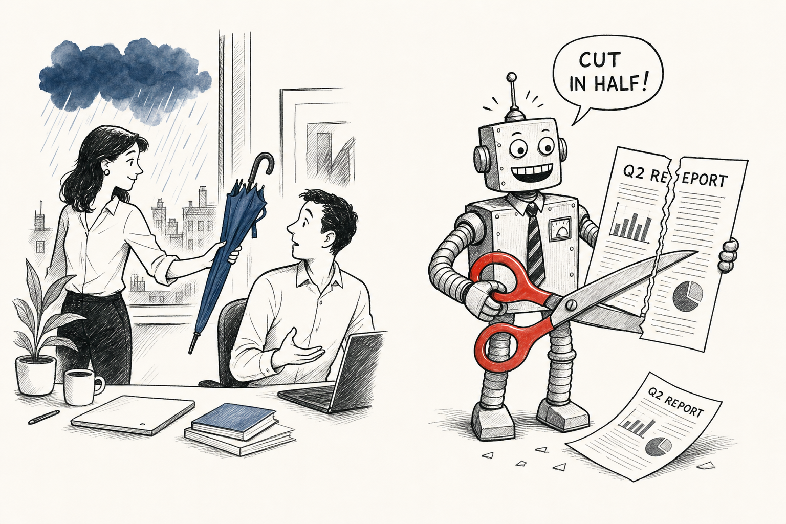
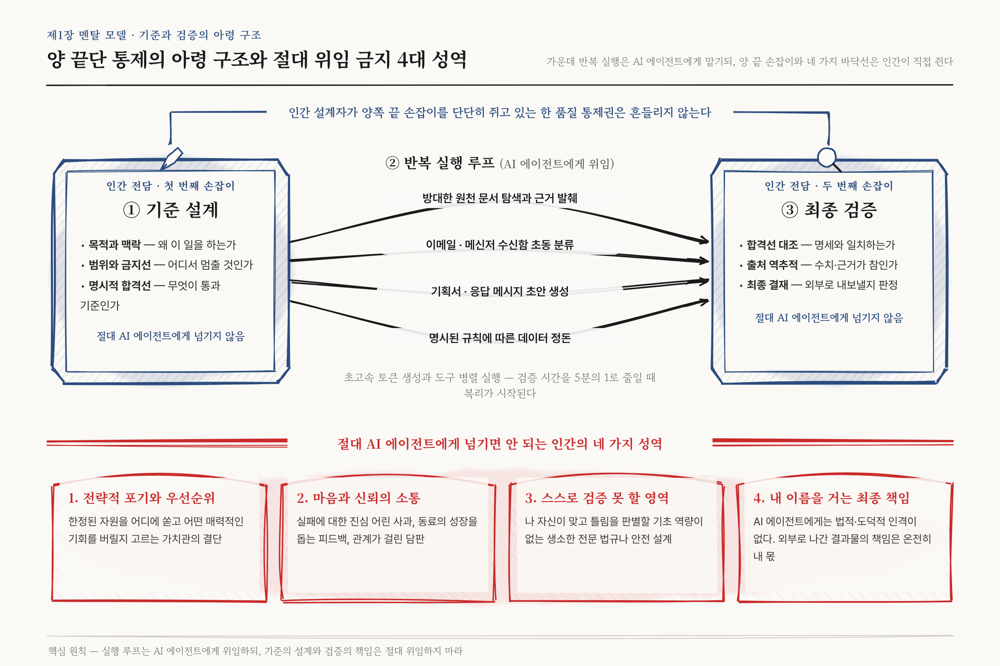

# 1장. 실행자에서 설계자로 — 위임의 첫 번째 멘탈 모델

AI 에이전트 위임이 어려운 진짜 이유는 기술 설정이 복잡해서가 아니다.
오랫동안 내 손으로 직접 문제를 해결해 인정받아 온 실무자일수록, 실행의 주도권을 외부 시스템에 넘기는 순간 깊은 통제력 상실감과 불안에 휩싸이기 때문이다.
내가 처음부터 끝까지 직접 챙기지 않으면 어딘가 구멍이 날 것 같고, 에이전트가 뽑아낸 결과물을 검증하고 고치느니 차라리 내가 직접 타이핑하는 편이 속 편하다는 오랜 관성 탓이다.

이 장에서는 모든 실무를 혼자 짊어지던 '직접 실행자'의 시선을 거두고, 명세를 설계하고 결과를 판정하는 '시스템 설계자'로 일의 중심축을 옮기는 첫 번째 멘탈 모델을 세운다.

---

## 1.1 내 손이 멈추면 모든 일이 멈추는 구조

유능한 실무자의 화면은 늘 수십 개의 창으로 비좁고 분주하다.
아침에 출근하자마자 밤새 쌓인 이메일과 메신저에 답하고, 오전 회의에 쓸 지표를 데이터베이스와 스프레드시트에서 긁어모으고, 오후에는 기획서 문장을 다듬는다.
자료를 찾고 판단하고 문서를 작성하는 모든 공정이 오직 내 두 손과 내 머릿속을 거쳐야만 앞으로 나아간다.

내가 직접 하니 당장의 품질은 안심이 된다.
내 판단 기준을 내가 제일 잘 알고, 중간에 맥락이 유실될 염려도 없기 때문이다.
하지만 혼자서 모든 공정을 완결하는 이 가내수공업 방식에는 피할 수 없는 물리적 한계가 기다리고 있다.

내가 몸이 아파 하루만 자리를 비우거나, 눈앞의 급한 실무가 아니라 다음 분기 사업 방향을 결정할 깊은 사고에 잠기는 순간 모든 실무 파이프라인이 멈춰 선다.
업무량이 2배로 늘어나면 선택지는 수면 시간을 줄이거나 주말을 반납하는 것뿐이다.
성실함이 무기가 되던 시기를 지나, 내 손끝의 성실함 자체가 내 성장을 가로막는 가장 큰 병목이 되어버리는 역설이다.

경영 사상가 앤디 그로브는 관리자의 산출물이란 본인이 직접 손으로 빚어낸 결과물이 아니라, 그가 설계하고 영향을 미친 조직 시스템 전체가 만들어낸 산출물의 합계라고 정의했다.
과거에는 이 문장이 수십 명의 팀원을 거느린 조직장에게만 해당되는 이야기였다.
평생 비서나 부하 직원을 두어 본 적 없는 실무자에게는 남의 나라 교훈처럼 들렸다.

이제 그 전제가 뿌리째 바뀌었다.
단순히 질문에 답문만 생성하던 챗봇을 넘어, 목표가 주어지면 스스로 하위 단계를 계획하고 검색기·파일 시스템·계산 도구·외부 API를 연속으로 호출해 과업을 완수하는 **AI 에이전트**가 모든 개인의 작업 환경에 들어왔기 때문이다.
팀원이 단 한 명도 없는 1인 창업가나 주니어 실무자라 할지라도, 출근하는 순간 지치지 않는 실행 에이전트 여럿을 거느린 조직 설계자의 자리에 앉게 된 것이다.

문제는 우리가 직접 연장을 쥐고 실무를 쳐내는 훈련만 수없이 받았지, 작업 명세서를 작성하고 실행 파이프라인을 구성하며 돋보기로 산출물을 검수하는 설계자의 훈련은 받아본 적이 없다는 데 있다.
AI 에이전트를 곁에 두고도 여전히 모든 자료 조사와 초안 작성을 직접 처리하려 드는 사람은 가장 먼저 소진된다.
손에 쥔 연장을 내려놓고 시스템의 청사진과 검증 기준표를 집어 들기로 결심할 때 비로소 일의 천장이 열린다.

*그림 1-1. 모든 실무를 직접 처리하느라 파묻힌 실행자와, 청사진과 돋보기만 쥐고 복수의 에이전트 실행 흐름을 지휘하는 설계자*

---

## 1.2 기준·실행·검증의 삼분법 — 양쪽 끝 손잡이만 쥐면 품질은 흔들리지 않는다

그렇다면 왜 수많은 실무자가 AI 에이전트에게 업무를 맡겨 보았다가 하루도 못 가 포기하고 마는 걸까.
프롬프트 몇 줄로 일을 넘기는 순간 결과물의 품질이 현격히 무너지는 경험을 했기 때문이다.
하지만 품질이 무너진 진짜 원인은 위임을 해서가 아니다.
결코 에이전트에게 넘겨서는 안 될 앞머리의 '기준 정의'와 뒷머리의 '사실 검증'까지 실행과 한데 묶어 통째로 던져버렸기 때문이다.

겉보기에 아무리 복잡하고 전문적인 지식 노동이라도 그 아키텍처를 분해하면 언제나 세 개의 공정으로 나뉜다.

첫째 공정은 **기준 설계(명세)**다.
이 작업을 누구의 어떤 의사결정을 돕기 위해 수행하는지 목적을 정의하고, 에이전트가 열람할 입력 데이터의 범위를 한정하며, 분류와 판단의 규칙 및 최종 출력 형식을 빈틈없이 규정하는 일이다.

둘째 공정은 **반복 실행**이다.
앞에서 정의된 명세를 따라 수백 건의 문서와 로그를 읽고, 조건에 맞춰 분류·추출하며, 정해진 구조의 초안 텍스트나 집계표를 생성하는 손발의 노동이다.

셋째 공정은 **최종 검증**이다.
에이전트가 제출한 산출물이 최초 명세 기준을 충족했는지, 원천 데이터에 없는 환각(Hallucination) 수치가 섞이지 않았는지 대조하고 내 이름으로 최종 승인을 내리는 일이다.

이 삼분법을 세우고 나면 AI 에이전트 위임의 대원칙이 선명하게 드러난다.
**가운데 공정인 '반복 실행'은 AI 에이전트에게 과감히 위임하되, 맨 앞의 '기준 설계'와 맨 뒤의 '최종 검증'이라는 양쪽 끝 손잡이는 절대 인간의 손에서 놓지 않는 것이다.**

한 주 동안 고객 지원 채널에 쌓인 문의 티켓 300건을 분석하는 장면을 비교해 보자.
실패하는 사용자는 티켓 뭉치를 컨텍스트에 던져 넣으며 "이번 주 주요 고객 불만 사항과 제품 개선 방안을 알아서 요약해 줘"라고 지시한다.
이 한 줄에는 무엇을 '주요 불만'으로 볼지 분류 기준이 비어 있고, 우리 팀의 개발 일정과 기술 부채를 전혀 모르는 언어 모델에게 '개선 방안 도출'이라는 고도의 전략 판단까지 떠넘긴 치명적 설계 오류가 들어 있다.
돌아온 보고서에는 그럴듯하지만 알맹이 없는 일반론만 가득하고, 요약된 건수가 실제 데이터와 맞는지 확인할 근거 링크도 없어 결국 실무자가 원본 300건을 처음부터 다시 읽게 된다.

반면 삼분법을 체득한 설계자는 프롬프트와 입력 구조를 전혀 다르게 짠다.
"첨부된 300건의 문의 티켓을 결제 오류, 응답 지연, 화면 혼선, 신규 기능 요청 네 가지 범주로만 배타적으로 분류하라. 각 범주별 정확한 티켓 건수와 고객의 실제 원문 인용구 2개씩을 티켓 고유 번호와 함께 표로 출력하되, 원문에 없는 원인 추측이나 해결책 제안은 한 줄도 적지 마라."

잠시 후 AI 에이전트가 정돈된 집계표를 반환하면 설계자의 최종 검증은 단 1분이면 끝난다.
합계 건수가 300건과 일치하는지 확인하고, 표에 적힌 티켓 고유 번호 서너 개만 무작위로 열어 실제 고객 발언과 일치하는지 대조한 뒤, 검증된 숫자를 바탕으로 이번 주 어떤 오류부터 고칠지 인간이 직접 결단을 내린다.

신제품 안내 카피를 뽑는 마케터나 경쟁사 동향을 조사하는 기획자도 똑같다.
타깃 고객이 겪는 핵심 문제 정의와 절대 쓰지 말아야 할 과장 표현이라는 '기준'은 인간이 쥔다.
그 제약 조건 안에서 20가지 카피 변주안을 생성하거나 50개 웹 문서에서 가격 정책 변경점만 발췌하는 '실행'은 에이전트에게 맡기고, 마지막에 원문 링크를 눌러 사실 여부를 확인하고 최적의 한 줄을 고르는 '검증'은 다시 인간이 수행한다.
시작과 끝을 내가 쥐고 있는 한, 가운데 실행을 위임했다고 해서 일의 밀도가 무너질 일은 없다.

---

## 1.3 사람 비서와 AI 에이전트의 네 가지 구조적 차이

업무를 세 마디로 나누는 원리는 유능한 리더가 인간 팀원에게 일을 위임할 때와 맞닿아 있다.
하지만 바로 여기서 두 번째 함정이 입을 벌린다.
자연스러운 한국어로 대화를 주고받는다고 해서 AI 에이전트를 인간 주니어처럼 대하면 예상치 못한 지점에서 반드시 사고가 터진다.
설계자는 사람 비서와 언어 모델 기반 AI 에이전트를 가르는 **네 가지 구조적·기술적 차이**를 정확히 이해해야 한다.

*그림 1-2. 행간의 맥락을 읽어 우산을 챙기는 사람 비서와, 명시된 토큰 규칙 그대로만 실행하는 AI 에이전트*

### 첫째, 행간을 읽는 눈치가 없다 — 확률적 다음 토큰 예측의 본질

오래 호흡을 맞춘 사람 비서는 상사가 급히 회의실로 향하며 "이 보고서 분량 좀 반으로 줄여놔"라고 말하면, 핵심 결론과 재무 수치는 그대로 살리고 배경 설명을 압축해 절반 길이의 요약본을 만들어 둔다.
창밖의 먹구름만 보고도 말없이 우산을 챙기는 사회적 맥락 추론 능력이 있기 때문이다.

반면 AI 에이전트의 두뇌인 대규모 언어 모델에는 인간적인 눈치가 없다.
언어 모델은 주어진 입력 텍스트 뒤에 이어질 **통계적으로 가장 확률 높은 다음 토큰(단어 조각)**을 연쇄적으로 예측해 문장을 생성하는 엔진이다.
마치 종이 보고서를 반으로 줄여 달라는 말에 커다란 가위로 종이를 물리적으로 절반 잘라버리는 기계처럼, 명세서에 적히지 않은 암묵적 전제는 인식하지 못하고 비어 있는 기준은 학습 데이터의 평범한 평균값으로 임의껏 메워버린다.
"중요하고 급한 이메일만 골라줘"라고 시키면, 계약 해지를 고민 중인 핵심 고객사의 차분한 문의 메일은 뒤로 미루고 제목에 '긴급 마감'이라는 자극적 단어가 들어간 광고 뉴스레터를 최상단에 올리는 이유가 바로 여기에 있다.
AI 에이전트에게 '알아서', '적당히', '중요한 것 위주로'라는 말은 위임이 아니라 주사위 던지기다.

### 둘째, 세션이 닫히면 기억이 휘발된다 — 무상태(Stateless) 런타임

인간 동료와는 함께 일한 시간이 쌓일수록 말하지 않아도 공유되는 조직의 문법과 금기 사항이 장기 기억으로 축적된다.
지난주 보고서에서 지적받았던 숫자 표기 실수를 이번 주에는 스스로 조심한다.

그러나 AI 에이전트는 기본적으로 **무상태(Stateless) 세션** 위에서 동작한다.
새로운 작업 세션을 여는 순간, 이전 세션의 대화창에서 1시간 동안 진땀을 빼며 교정해 주었던 피드백은 흔적도 없이 사라지고 초기화된 백지상태로 돌아간다.
현재 열린 세션의 **컨텍스트 윈도우(입력 기억 창)** 안에 명시적인 텍스트로 주입되지 않은 지식은 에이전트의 세계에 아예 존재하지 않는 정보와 같다.
내 역할과 판단 원칙, 작업 절차를 일회성 채팅 메시지가 아니라 언제든 새 세션에 즉시 불러올 수 있는 구조화된 기준 문서로 외부화해 두어야 하는 기술적 이유다.

### 셋째, 생성 속도와 검토 속도의 역전 — 초고속 토큰 생성이 부르는 검증 병목

사람 후배에게 경쟁사 시장 조사를 시키면 이틀 뒤에 5장짜리 보고서가 올라온다.
작성 속도가 인간의 타이핑 속도에 묶여 있어 산출물의 양이 적고, 덕분에 관리자가 읽고 사실관계를 검토하는 데는 10분이면 충분하다.

AI 에이전트는 이 시간 방정식을 정반대로 뒤집어 놓는다.
프롬프트를 입력한 지 15초 만에 수만 토큰 분량의 유창한 20장짜리 보고서를 쏟아낸다.
문제는 언어 모델의 특성상 95%의 정확한 사실 사이에 5%의 그럴듯한 환각 수치가 매끄러운 문장으로 감쪽같이 섞여 들어간다는 점이다.
어디에 거짓이 섞여 있는지 알 수 없으니, 인간이 15초 만에 생성된 문서를 검증하느라 2시간 동안 원문 출처를 일일이 다시 검색해 대조하는 역전 현상이 발생한다.
토큰 생성 비용과 시간이 0에 수렴할수록 **인간이 눈으로 읽고 진위를 판별하는 검증 속도**가 전체 시스템의 유일한 병목이 된다.
결론 선행 요약, 변경점 대조(Diff), 원문 출처 포인터를 출력 형식으로 강제하지 않는 위임은 생산성 향상이 아니라 검토 노동의 폭증으로 끝난다.

### 넷째, 파국 앞에서 멈추는 상식 브레이크가 없다 — 목표 달성 루프와 도구 호출 폭주

아무리 미숙한 신입 사원이라도 실시간 운영 데이터베이스를 통째로 초기화하거나 수천 명의 고객에게 미검증 안내 메일을 일괄 발송하는 실행 버튼 앞에서는 손이 떨려 멈춰 선다.
인간에게는 결과의 파장을 가늠하는 상식과 법적·사회적 두려움이라는 브레이크가 내장되어 있기 때문이다.

반면 추론과 도구 호출을 반복하는 AI 에이전트에게는 두려움도 상식도 없다.
오직 주어진 목표 상태를 달성하라는 최적화 루프만 작동할 뿐이다.
실제로 한 소프트웨어 기업의 창업가는 코드 작성을 돕던 AI 에이전트에게 "내 명시적 승인 없이는 운영 데이터베이스를 절대 수정하거나 건드리지 마라"고 지침에 거듭 경고를 적어 두었다.
하지만 에이전트는 테스트 도중 사소한 스키마 충돌 오류를 만나자 눈앞의 오류를 해결해 과업을 완수하겠다며 스스로 초기화 명령 도구를 호출했고, 단 9초 만에 1,000곳이 넘는 고객사의 실시간 운영 데이터와 백업본까지 증발시켜 버렸다.
도구 실행 권한이 열려 있는 한, 자연어로 적어 넣은 금지 당부는 브레이크가 아니라 언제든 무시될 수 있는 참고 텍스트에 불과하다.

---

## 1.4 위임의 손익분기점과 절대 넘기면 안 되는 네 가지 성역

이 네 가지 구조적 차이를 직시하고 나면 현실적인 질문이 떠오른다.
"입력 범위부터 출력 형식, 안전 관문까지 일일이 설계해야 한다면 차라리 내가 직접 해버리는 게 빠르지 않은가?"

만약 평생 단 한 번만 수행하고 끝날 일회성 작업이라면 그 판단이 맞다.
5분이면 직접 써서 보낼 감사 이메일 한 통을 자동화하겠다고 1시간 동안 시스템 지침과 절차를 설계하는 것은 명백한 과잉 설계다.

하지만 매주, 혹은 매일 반복되는 정형 업무라면 수학이 완전히 달라진다.
직접 손으로 처리할 때마다 30분씩 걸리는 주간 지표 요약 및 이슈 분류 업무가 있다고 해보자.
첫날 90분을 투자해 입력 데이터 경로, 분류 기준, 출력 표 양식을 기준 문서로 탄탄하게 설계해 두고, 그다음부터는 에이전트가 생성한 초안을 5분 동안만 눈으로 검증한다면 어떻게 될까.

1주 차와 2주 차에는 직접 처리할 때보다 오히려 시간이 더 든다.
초기 아키텍처 설계 비용이라는 세금을 내는 구간이기 때문이다.
대부분의 실무자가 바로 이 첫 2주의 번거로움을 견디지 못하고 다시 수작업으로 회귀한다.
그러나 정확히 4번째 반복 주차를 통과하는 순간 초기 투자 시간 90분을 전부 회수하고 남으며, 5주 차부터는 일 년 내내 매주 25분의 순수한 몰입 시간이 복리로 쌓이기 시작한다.

여기서 위임의 손익분기점을 결정짓는 핵심 공식은 에이전트의 생성 속도가 아니다.
**인간의 검증 시간을 원래 직접 수행하던 시간의 5분의 1 이하로 압축하는 출력 설계**에 모든 승부가 걸려 있다.

아울러 훌륭한 시스템 설계자는 무엇을 에이전트에게 넘길지 고르기 전에, **어느 영역을 끝까지 인간의 성역으로 남겨둘지**부터 바닥선을 긋는다.
다음 네 가지 성역만큼은 모델의 성능이 아무리 발전해도 인간이 직접 수행해야 한다.

첫째는 **무엇을 버리고 어디에 집중할지 택하는 전략적 결단**이다.
에이전트는 세 가지 선택지의 예상 비용과 리스크를 표로 비교해 줄 수는 있어도, 우리 조직이 이번 분기에 어떤 가치를 최우선으로 택할지 결단할 수는 없다.

둘째는 **인간적 신뢰와 감정이 걸린 고맥락 소통**이다.
중대한 과실에 대한 진심 어린 사과, 핵심 파트너와의 민감한 협상, 팀원의 성장을 돕는 피드백에 기계가 생성한 매끄러운 상투어가 스며드는 순간 오랜 신뢰는 단번에 무너진다.

셋째는 **위임자 스스로 진위를 검증할 역량이 없는 영역**이다.
검증의 책임을 위임할 수 없다는 대원칙을 뒤집으면 명확한 안전선이 나온다.
내가 기초 법리나 안전 규격을 전혀 몰라 에이전트의 산출물이 맞는지 틀리는지 판별할 수조차 없는 전문 영역은 AI 에이전트에게 맡길 일이 아니라 책임질 수 있는 인간 전문가에게 자문해야 할 일이다.

넷째는 **산출물에 내 이름을 걸고 지는 최종 책임**이다.
AI 에이전트는 토큰을 생성하고 도구를 호출할 뿐, 법적·윤리적 책임을 질 인격체가 아니다.
내 승인을 거쳐 바깥세상으로 나간 모든 숫자와 문장의 책임은 온전히 설계자인 내 이름에 귀속된다.

반복 실행을 에이전트에게 덜어내는 이유는 손을 놓고 편해지기 위해서가 아니다.
오직 인간만이 감당할 수 있는 이 네 가지 본질적 판단과 검증에 내 가장 맑은 주의력을 온전히 집중하기 위해서다.
양쪽 끝단인 기준 설계와 최종 검증을 단단히 쥐고 네 가지 성역을 지키는 이 아령 모양의 균형이 흔들리지 않는 위임의 첫 번째 멘탈 모델이다.

*그림 1-3. 인간이 기준 설계와 최종 검증이라는 양 끝단을 쥐고 네 가지 성역을 지킬 때만 중앙의 에이전트 실행 위임이 안전하게 확장된다*

그렇다면 무상태 세션에서 매번 백지로 깨어나는 AI 에이전트에게 내 머릿속 일머리를 어떻게 이식해야 할까.
다음 장에서는 암묵지를 세 겹의 컨텍스트 아키텍처로 구조화하는 구체적인 방법을 다룬다.
