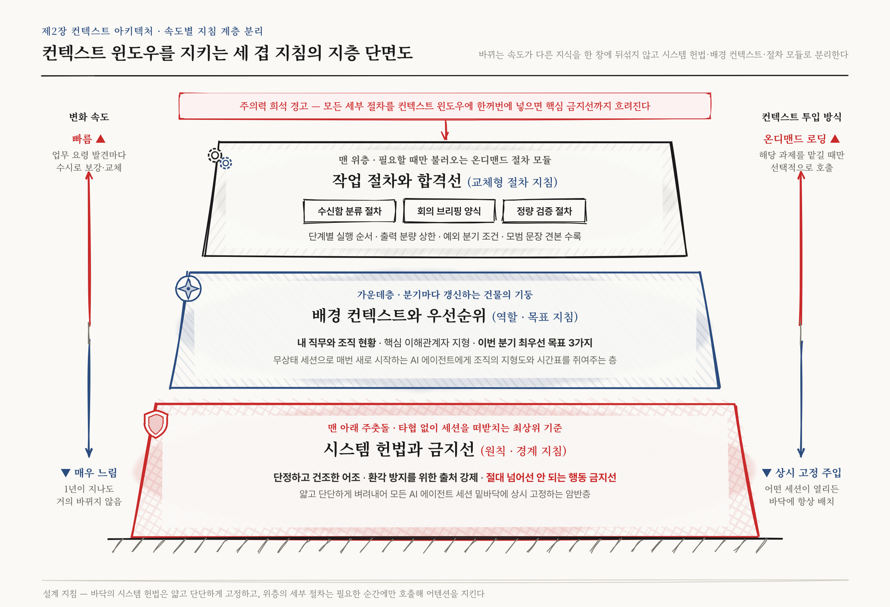

# 2장. 머릿속 일머리의 구조화 — 암묵지를 세 겹의 맥락으로 꺼내는 법

AI 에이전트에게 업무를 맡겼는데 엉뚱한 결과물이 돌아왔을 때, 가장 먼저 점검해야 할 곳은 모델의 성능이 아니라 내 머릿속이다.
오랜 실무 경험으로 다져진 내 판단 기준이 과연 에이전트의 컨텍스트 윈도우(기억 창)가 읽을 수 있는 명시적 텍스트로 구조화되어 있는가.

이 장에서는 알아서 맥락을 짚어주길 바라는 막연한 기대를 거두고, 내 안에 잠자고 있던 암묵적 일머리를 언어 모델의 주의력 구조에 최적화된 세 겹의 컨텍스트 아키텍처로 설계하는 법을 다룬다.

*그림 2-1. 머릿속에 엉켜 있던 암묵적 일머리를 배경 나침반, 시스템 방패, 절차 모듈이라는 세 겹의 기준 문서로 구조화하는 과정*

---

## 2.1 인수인계서 한 장 없이 첫 세션을 연 AI 에이전트에게 화내지 마라

경력이 쌓인 실무자일수록 자기 자신이 얼마나 많은 전제를 '당연하게' 깔고 일하는지 잊어버린다.
인지심리학에서는 이를 지식의 저주라 부르고, 경영학에서는 암묵지라 부른다.
수백 번의 프로젝트와 시행착오를 거치며 몸에 밴 판단 기준은 너무나 자연스러워서, 프롬프트를 입력할 때도 그 전제 조건들을 몽땅 생략한 채 최종 요구사항 한 줄만 툭 던지게 만든다.

방금 새로 열린 무상태(Stateless) 세션의 AI 에이전트에게 아무런 배경 문서도 없이 "이번 주 우리 팀 프로젝트 진행 상황을 한 장으로 깔끔하게 요약해 줘"라고 입력했다고 가정해 보자.
에이전트 앞에는 메신저 스레드 수십 개와 이슈 트래커 목록이 텍스트 조각으로 나열되어 있을 뿐이다.
무엇이 이번 분기 회사의 사활이 걸린 핵심 마일스톤이고 무엇이 단순 운영 잡무인지 가려낼 가중치 정보가 전혀 없다.

결국 에이전트는 텍스트 분량이 많다는 이유만으로 이미 완료된 사소한 수정 작업 10가지를 장황하게 요약해 놓고, 정작 3일째 담당자 응답 없이 멈춰 서 있는 핵심 결제 모듈 일정 지연은 단 한 줄도 적지 않은 채 결과물을 내놓는다.
이때 많은 실무자가 화면을 보며 혀를 찬다.
"아직 AI가 실무 맥락을 이해하려면 멀었군."

하지만 실패의 원인은 모델이 아니라 빠져 있는 명세에 있다.
마감일이 지났거나 72시간 이상 상태 변경 로그가 없는 핵심 과제를 '지연 위험'으로 분류하라는 조건도, 문서 최상단에 분기 핵심 목표 달성률부터 표시하라는 출력 규격도 컨텍스트에 넣어준 적이 없기 때문이다.

고객 인터뷰 녹취록을 분석시킬 때도 마찬가지다.
"녹취록을 읽고 고객이 원하는 신규 기능 아이디어를 추출해 줘"라고 모호하게 지시하면, 언어 모델은 인터뷰 말미에 고객이 예의상 건넨 "나중에 이런 기능도 있으면 좋겠네요"라는 빈말까지 핵심 요구사항으로 부풀려 정리한다.

반면 숙련된 설계자는 문장 하나로 노이즈를 차단한다.
"인터뷰 원문에서 미래 가정형 표현이나 의례적 칭찬은 모두 제외하고, 고객이 최근 3개월 이내에 실제로 시간이나 비용 손실을 겪으며 우회 해결책을 썼던 과거 경험 진술만 타임스탬프와 함께 추출하라."

대외 제안서나 마케팅 카피를 맡길 때도 똑같은 원리가 작동한다.
"전문적이면서도 친근한 톤으로 써 줘"라는 지시는 언어 모델에게 세상의 평균적인 광고 상투어를 뽑아 오라는 말과 다름없다.

내가 원하는 전문성의 실체를 글자로 풀어야 한다.
"수식어와 감탄사를 모두 빼고 한 문장은 50자 이내의 단문으로 끊어 쓰며, 모든 효익 주장은 반드시 고객사의 도입 전후 시간 단축 수치와 짝지어 서술하라."
이렇게 채점 기준을 드러내는 순간 결과물의 결이 단번에 달라진다.

모호한 프롬프트를 던지고 환각 섞인 결과물을 탓하는 악순환을 끊는 길은 단 하나다.
내 머릿속에만 존재하는 보이지 않는 채점표를 꺼내어 AI 에이전트가 매 세션 일관되게 참조할 수 있는 **명시적 컨텍스트 문서**로 세우는 것이다.

암묵지를 명시적 컨텍스트로 옮기는 과정은 단순히 기계를 가르치는 수고가 아니다.
그동안 나조차도 어렴풋한 감각에만 의존해 오던 내 일의 본질을 가장 날카로운 언어로 벼려내는 일이다.
위임의 품질은 채팅창에서 엔터 키를 누른 뒤가 아니라, 그 전에 얼마나 정교한 맥락의 체계를 구축해 두었느냐에서 이미 결정된다.

---

## 2.2 나를 설명하는 세 겹의 컨텍스트 아키텍처

그렇다면 머릿속 일머리를 어떤 구조로 담아야 할까.
초보자들이 가장 흔히 저지르는 실수는 시스템 프롬프트 입력창 하나를 열어 내 직무 소개부터 문체 규칙, 이메일 분류법, 재무 데이터 정제 공식, 어제 거래처 미팅 메모까지 떠오르는 대로 한 통에 뒤섞어 적는 것이다.

처음 20줄일 때는 그럭저럭 작동하지만, 200줄을 넘어가는 순간 그 지침서는 유지보수가 불가능한 스파게티가 된다.
작은 보고 양식 하나만 바뀌어도 문서 전체를 뒤져야 하고, 위쪽에 적은 원칙과 아래쪽에 덧붙인 예외 규칙이 서로 충돌해 에이전트가 예측 불가능한 출력을 내놓기 시작한다.

건축가가 건물을 설계할 때 수십 년을 버틸 기초 기둥과 수시로 배치를 바꾸는 가구를 분리하듯, 에이전트에게 주입할 컨텍스트 역시 **정보가 변하는 주기**와 **세션에 호출되는 방식**에 따라 정확히 세 겹의 계층으로 분리해야 한다.
로컬 파일 폴더에 저장하든, 사내 위키에서 불러오든, 에이전트 도구의 지침 설정에 등록하든 이 3계층 아키텍처는 변하지 않는다.

### 첫 번째 겹: 배경 컨텍스트의 나침반 (역할·관계자·우선순위)

첫 번째 층위는 **"나는 어떤 역할이며 지금 무엇이 가장 중요한가"**를 정의하는 배경 컨텍스트다.
여기에는 내 직무와 의사결정 범위, 이번 분기에 다른 모든 업무에 우선하는 핵심 목표 3가지, 그리고 과감히 후순위로 미뤄야 할 작업 기준이 담긴다.

예를 들어 배경 문서에 "이번 분기 최우선 목표는 신규 기능 확장이 아니라 연간 계약 고객사의 재계약률 95% 방어이며, 모든 수신 안건 분류 시 기존 유료 고객사의 장애 및 일정 이슈를 최상위 긴급도로 배치한다"라는 한 문장이 명시되어 있으면, 에이전트가 아침마다 수십 건의 알림 중 무엇을 맨 위에 올릴지 흔들림 없는 기준점이 생긴다.
함께 일하는 주요 의사결정자의 보고 선호 방식(배경 설명 대신 리스크와 2가지 대안 선행 제시 등)과 하루 중 방해받지 말아야 할 오전 집중 블록 시간대도 이곳에 적는다.
이 층위는 분기에 한 번쯤 목표가 바뀔 때만 갱신하며, 모든 에이전트 세션에 가볍게 상시 주입되어 판단의 중력을 잡아 준다.

### 두 번째 겹: 시스템 헌법의 방패 (원칙·어조·절대 금지선)

두 번째 층위는 **"어떤 태도로 추론하며 어떤 선은 절대 넘지 않는가"**를 규정한 최상위 시스템 지침이자 방패다.
여기서 가장 먼저 버려야 할 나쁜 습관은 프롬프트 첫머리에 "너는 20년 경력의 세계 최고 경영 컨설턴트다" 같은 과장된 역할극 페르소나를 부여하는 일이다.
언어 모델에게 권위적인 전문가 배역을 씌울수록 모델은 모르는 사실도 아는 척 꾸며내야 한다는 확률적 압력을 크게 받고, 본론에 들어가기 전에 화려한 수식어와 아첨성 서론을 길게 생성한다.

진짜 시스템 헌법에는 역할극 대신 건조하고 단호한 추론 규칙과 경계선이 들어가야 한다.
"인사말과 배경 서론을 생략하고 첫 3줄 안에 핵심 결론과 판단 근거부터 제시하라."
"제공된 원문 컨텍스트에서 직접 확인할 수 없는 수치나 사실은 절대 추측하여 메우지 말고 반드시 '근거 데이터 확인 불가'로 명시하라."
"사용자의 가설에 무조건 동조하지 말고, 논리적 비약이나 반례가 존재하면 가장 먼저 지적하라."
"외부 이메일 발송, 원본 데이터베이스 수정, 비용 결제 등 되돌릴 수 없는 도구 호출이 필요한 단계에 도달하면 즉시 실행을 멈추고 변경 예정 내역을 제시한 뒤 인간의 승인을 대기하라."
이 방패 층위는 반년이나 1년이 지나도 거의 변하지 않는 내 시스템의 품질 헌법이다.

### 세 번째 겹: 절차 모듈의 톱니바퀴 (작업 순서와 완료 명세)

세 번째 층위는 **"개별 반복 업무를 어떤 단계로 처리하며 무엇을 합격으로 인정하는가"**를 담은 작업별 절차 모듈이다.
주간 지표 리포트, 수신함 분류, 미팅 전 브리핑, 경쟁사 리서치처럼 반복되는 과업마다 독립된 모듈 문서로 쪼개어 작성한다.

여기서 핵심은 결과만 요구하는 선언적 문장 대신 **입력 소스·분기 조건·출력 규격·검증 체크포인트**라는 네 개의 톱니바퀴를 맞물려 놓는 것이다.
예컨대 재무나 영업 데이터를 다루는 절차 모듈이라면 "매출 집계 스프레드시트와 정산 내역서의 합계가 1원이라도 불일치할 경우 임의로 반올림하거나 평균 내지 말고, 불일치 행 번호와 차액을 별도 표로 분리한 뒤 즉시 작업을 중단하고 보고하라"처럼 예외 처리 분기점까지 정확히 못 박는다.
앞의 두 층위가 에이전트의 시야와 안전선을 고정한다면, 이 세 번째 층위는 매주 실무 현장의 피드백을 흡수하며 가장 기민하게 진화하는 실행 매뉴얼이다.

### 세 겹의 컨텍스트가 한 세션 안에서 맞물리는 순간

월요일 아침, 핵심 고객사로부터 일정 변경과 추가 기능 반영을 요청하는 긴 이메일이 도착했을 때 세 겹의 컨텍스트가 어떻게 협력하는지 살펴보자.

먼저 **배경 나침반**을 읽은 에이전트는 발신자가 이번 분기 핵심 재계약 대상임을 즉시 식별하여 최우선 안건으로 분류하되, 오전 11시까지는 내 몰입 시간 블록이므로 즉시 알림을 울리지 않고 정오 브리핑 큐에 배치한다.
이어서 일정 조율 **절차 모듈**을 불러와 내 캘린더의 오후 가용 시간대와 현재 스프린트 마감 일정을 교차 대조한 뒤, 수용 가능한 일정 대안 2가지를 표로 구성해 회신 초안을 작성한다.
마지막으로 **시스템 헌법**에 따라 개발팀 확인이 안 된 완료 일자를 섣불리 확답하지 않았는지 자체 점검하고, 과장된 인사치레를 걷어낸 뒤, 외부 발송 도구를 호출하는 대신 임시 초안 보관함에 저장하고 멈춰 선다.
구구절절한 채팅 지시 한 줄 없이도 구조화된 세 겹의 맥락이 판단과 실행, 정지를 일관되게 이끌어낸 것이다.

---

## 2.3 백지 앞에서 막막할 때 내 과거 결과물에서 기준을 역추적하는 법

3계층 구조를 이해했더라도 막상 빈 편집기 창을 열고 내 시스템 지침을 첫 줄부터 쓰려 하면 손이 쉽게 떨어지지 않는다.
수년간 무의식적으로 작동하던 실무 감각을 명시적인 문장으로 추출해 본 경험이 없기 때문이다.
이럴 때는 백지에서 추상적인 규칙을 창작하려 애쓰지 말고, 이미 내 손을 거쳐 간 과거의 작업 산출물에서 기준을 역추적해야 한다.

### 첫째, 내가 직접 뜯어고친 초안과 최종본의 차이(Diff)를 대조하라

가장 확실한 방법은 최근 에이전트가 생성했거나 동료가 작성한 초안 중 내가 성에 차지 않아 직접 고쳐 썼던 문서 3편을 나란히 띄워 놓는 것이다.
수정 전 초안과 내가 고친 최종본 사이의 변경 흔적(Diff)을 가만히 살펴보자.

내가 왜 첫 문단의 장황한 시장 배경 설명을 통째로 삭제했는지, 왜 '대폭 상승'이라는 모호한 부사를 지우고 전월 대비 증감률(%)과 절대 수치를 함께 병기했는지, 왜 표의 첫 번째 열을 부서명에서 리스크 등급으로 바꾸었는지 자문해 보라.
그 수정 이유를 한 줄씩 받아 적으면 그대로 살아 있는 시스템 헌법과 절차 규칙이 된다.
머릿속으로 지어낸 이상적인 다짐보다 내가 도저히 참지 못하고 고친 편집 흔적이 내 진짜 품질 기준을 가장 정확하게 드러낸다.

### 둘째, 민감 정보를 가린 모범 산출물(Few-shot 본보기) 3편을 확보하라

언어 모델에게 원하는 문체와 밀도를 수십 줄의 형용사로 설명하는 것보다, 실제 합격선 예시 하나를 보여주는 편이 토큰 효율과 정확도 면에서 압도적으로 뛰어나다.
과거 내가 직접 작성해 의사결정자의 즉각적인 승인을 받았거나 고객사의 긍정적 회신을 이끌어냈던 기획 요약본, 정량 분석 보고서, 정중한 거절 이메일 중 대표작 3편을 추린다.
고객사 실명과 민감한 금액만 일반 기호로 마스킹한 뒤 절차 모듈 하단에 모범 출력 견본으로 첨부해 두면, 에이전트의 출력 밀도와 논리 전개 호흡이 단숨에 내 기준선으로 수렴한다.

### 셋째, 5분 동안 화면을 처리하며 속마음을 소리 내어 구술하라

평소처럼 수신함을 정리하거나 데이터를 검토하면서 딱 5분 동안만 머릿속 판단 과정을 소리 내어 중얼거리며 음성 메모로 기록해 보는 기법이다.
"이 티켓은 유료 요금제 계정에서 발생했으니 먼저 열고, 최근 배포 버전 로그에 동일 에러 코드가 있는지 검색한 다음, 재현 경로가 불명확하니 로그 첨부를 요청하는 회신 초안만 작성해 둔다."
글로 쓰려 하면 당연해서 건너뛰던 조건문(If-Then)들이 입 밖으로 발화하는 순간 명확한 단계별 알고리즘으로 걸러져 나온다.

### 넷째, 좋은 기준이 안 떠오르면 절대 용납 못 할 오답 금지선부터 그어라

정답의 모습을 완벽히 묘사하기 어렵다면 경계선 바깥의 오답부터 소거하라.
출처 링크 없는 시장 통계 인용 금지, 원문에 없는 원인 추측 금지, 한 문단 4문장 초과 금지처럼 내가 실무에서 가장 경계하는 실패 패턴 5가지를 적는 데는 5분이면 충분하다.
오답의 지뢰밭만 명확히 걸러내도 언어 모델의 토큰 탐색 공간은 자연스럽게 고품질 영역으로 좁혀진다.

---

## 2.4 컨텍스트 과부하와 주의력 희석의 함정 — 온디맨드 로딩의 원칙

기준 문서를 구축하기 시작한 설계자들이 두세 달 뒤 어김없이 빠지는 두 번째 함정이 있다.
에이전트가 사소한 실수를 할 때마다 온갖 예외 조항과 업무별 세부 지침을 상시 시스템 프롬프트 한곳에 끝없이 이어 붙여, 수천 줄짜리 거대한 단일 지침서를 만들어 버리는 것이다.
최신 언어 모델의 컨텍스트 윈도우가 수십만 토큰까지 넓어졌으니 모든 매뉴얼을 한꺼번에 다 넣어두어도 괜찮을 것이라 믿는 오해다.

노벨 경제학상 수상자 허버트 사이먼은 정보가 풍부해질수록 정작 고갈되는 자원은 정보를 처리하는 주체의 '주의력(Attention)'이라고 통찰했다.
이 원리는 트랜스포머 기반 언어 모델의 **어텐션 메커니즘**에 글자 그대로 적용된다.
컨텍스트 윈도우라는 물리적 그릇이 아무리 커져도, 입력 토큰 길이가 길어질수록 모델이 개별 지침 문장에 배분하는 어텐션 가중치는 분산되며, 특히 긴 입력의 중간 부분에 위치한 규칙을 놓쳐버리는 **중간 맥락 망각(Lost in the Middle)** 현상이 급격히 심화된다.

1페이지짜리 회의록을 요약하는 세션에까지 재무제표 정산 규칙 150줄, 마케팅 카피 금기어 150줄, 고객 환불 응대 매뉴얼 150줄을 한꺼번에 상시 주입하면 어떤 결과가 벌어질까.
당장 오늘 과업과 무관한 수천 토큰의 노이즈가 어텐션을 갉아먹으면서, 정작 모든 세션에서 절대 어기면 안 될 '미확인 사실 추측 금지'나 '외부 발송 전 승인 대기' 같은 핵심 시스템 헌법의 구속력이 현저히 떨어진다.
불필요한 컨텍스트는 토큰 비용만 낭비하는 것이 아니라 에이전트의 추론 정밀도와 안전성 자체를 훼손한다.

해법은 **상시 고정 주입(Always-on) 컨텍스트와 필요시 호출(On-demand) 모듈을 엄격히 분리하는 계층적 로딩 아키텍처**다.
1계층인 배경 나침반과 2계층인 시스템 헌법은 어떤 작업에서나 즉시 작동해야 하므로 군더더기를 극도로 덜어내어 짧고 선명하게 상시 주입한다.
반면 3계층인 개별 업무 절차 모듈들은 평소에는 파일 목록에 제목과 한 줄 요약만 노출해 두었다가, 해당 과업이 실제로 실행되는 세션에서만 필요한 모듈 딱 하나만 컨텍스트 윈도우로 동적 로딩한다.

필요한 시점에 필요한 최소한의 컨텍스트만 주입하는 절제.
그것이 언어 모델의 어텐션을 가장 날카로운 상태로 유지하고 위임 시스템의 수명을 지키는 컨텍스트 아키텍처의 핵심이다.

*그림 2-2. 바뀌는 속도와 호출 방식에 따라 시스템 헌법(주춧돌), 배경 컨텍스트(기둥), 절차 모듈(온디맨드 연장) 세 겹으로 분리해야 주의력 희석 없이 정밀하게 작동한다*

이제 AI 에이전트의 컨텍스트 창 안에 선명한 나침반과 방패, 절차 모듈이 자리 잡았다.
그렇다면 이제 에이전트에게 어디까지 도구를 호출할 권한을 열어줄 것인가.
다음 장에서는 편리함과 보안 사고 사이를 정밀하게 제어하는 도구 권한의 사다리와 결정론적 하드 게이트를 설계한다.
