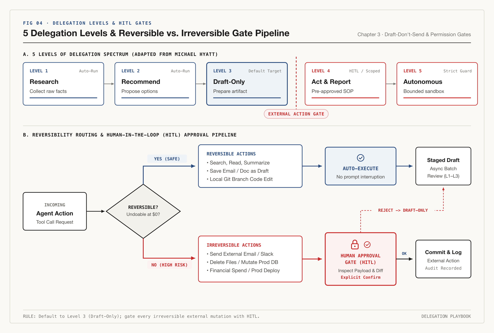

# Chapter 3. 위임의 기술과 게이트 설계

> **이 장의 핵심 요약 (3줄)**
> 1. 에이전트에 부여하는 자율성은 추상적 신뢰가 아니라 물리적인 도구 접근 권한(`Read-Only` / `Draft-Only` / `Scoped Write`)으로 설계해야 하며, 실무 위임의 80%는 인간 승인 게이트가 결합된 Level 3가 최적 구간이다.
> 2. 맷 모카리의 `Draft-Don't-Send`(초안만 작성하고 발송은 인간이 수행) 원칙은 오발송 실수 방지를 넘어 간접 프롬프트 인젝션 공격의 외부 유출 경로(Lethal Trifecta)를 물리적으로 절단하는 핵심 보안 아키텍처다.
> 3. 자연어 프롬프트에 적은 "절대 지우지 마"라는 당부는 보안 통제가 될 수 없으므로, 반드시 런타임 바깥의 설정 파일(`deny`)과 실행 전 차단 훅(`PreToolUse`)으로 하드 게이트를 걸어야 한다.
>
> **이 장의 산출물**
> - 표준 업무 위임 명세서 5요소 카드 (`DELEGATION_BRIEF_TEMPLATE.md`)
> - 최소 권한 설정 파일 (`.claude/settings.json`) 및 결정론적 차단 훅 (`block_irreversible.py`)
> - 사내 보안 정책이 엄격한 기업 환경을 위한 비식별 마스킹 위임 가이드

---

Personal OS 문서(`USER.md`, `SOUL.md`, `PLAYBOOK.md`)를 작성했다고 해서 즉시 모든 도구 권한을 열어주어서는 안 된다.
브레이크 없는 자동차에 가속 페달만 달아주는 격이기 때문이다.

인간 비서에게는 업무가 익숙해질수록 말로 재량권을 넓혀주면 된다.
그러나 상식 브레이크가 없고 외부 프롬프트 인젝션에 노출되는 AI 에이전트에게는 재량권이라는 추상적 개념이 통하지 않는다.
재량권은 반드시 **물리적인 도구 접근 권한(Tool Permissions)**과 **인간 승인 게이트(Human-in-the-Loop, HITL)**로 번역되어야 한다.

이 장에서는 마이클 하얏트(Michael Hyatt)의 고전 '위임 5단계'와 맷 모카리(Matt Mochary)의 'Draft-Don't-Send' 원칙을 엔지니어링 권한 체계로 재해석하고, 설정 파일과 실행 훅, 그리고 기업 보안 환경 규칙으로 사고 가능성을 원천 차단하는 방법을 다룬다.

---

## 3.1 마이클 하얏트 위임 5단계의 AI 에이전트 권한 매핑

위임이 실패하는 가장 흔한 원인은 위임자와 수임자가 '어디까지 알아서 결정할 것인가'를 서로 다르게 상상하는 데 있다.
경영 사상가 마이클 하얏트는 이 모호함을 없애기 위해 위임의 수준을 Level 1부터 Level 5까지 다섯 단계로 명문화했다.

원래 하얏트의 5단계는 주니어 직원의 숙련도에 맞춰 결정권을 넓혀가는 인사 관리 프레임워크다.
이를 AI 에이전트 환경에 이식할 때는 기준을 바꾸어야 한다.
에이전트의 지능이 아니라 **작업의 실패 비용과 런타임에 허용할 물리적 도구 범위(`Read / Draft / Gated Write / Auto Write`)**에 맞춰 5단계를 1:1로 매핑한다.

| 위임 단계 | 고전 인간 비서(EA) 원전 의미 | AI 에이전트 재해석 역할 | 부여할 물리적 도구 권한 (Tool Scope) | 대표 적용 업무 |
| :---: | :--- | :--- | :--- | :--- |
| **Level 1**<br>조사 및 보고 | 사실과 원시 정보만 조사해 보고하라. 결정은 내가 한다. | 출처 기반 팩트 수집 및 원문 발췌만 수행. 해석·추천 유보. | **`Read-Only`**<br>웹 검색, 로컬 문서 읽기, 조회 전용(`SELECT`) API | 경쟁사 가격표 발췌, 고객 VOC 건수 집계, 로그 검색 |
| **Level 2**<br>대안 제시 및 추천 | 선택지를 분석하고 최선의 추천안 1개를 가져와라. | 옵션 2~3개의 장단점 비교표와 근거 기반 추천안 리포트 작성. | **`Read + Report`**<br>읽기 전용 조회 + 로컬 분석 마크다운 생성 | 솔루션 벤더 비교, 캠페인 카피 3안 비교, 아키텍처 Plan 수립 |
| **Level 3**<br>초안 승인 후 실행 | 실행 계획을 세워 내 승인을 받은 뒤 실행하라. | 최종 반영 직전 상태(답장 초안, 코드 패치)까지 완비 후 정지. | **`Draft-Only + HITL Gate`**<br>임시보관함/격리 브랜치 쓰기 + 최종 실행 전 강제 멈춤 | 이메일 답장 초안, PR 생성, 캘린더 조율 문안, 티켓 답변 |
| **Level 4**<br>선 실행 후 보고 | 스스로 결정해 실행하고 결과만 사후 보고하라. | 정해진 규칙 범위 내 즉시 실행 후 전체 변경 로그(Diff) 요약 보고. | **`Scoped Reversible Write`**<br>격리 폴더 파일 생성, 내부 태그 분류, 로컬 브랜치 커밋 | 회의 사전 브리핑 노트 생성, 정기 동향 모니터링 요약 |
| **Level 5**<br>완전 일임 | 보고할 필요 없이 전권을 가지고 독립 수행하라. | 예외(에러) 발생 시에만 인간 호출, 평시 무인 백그라운드 가동. | **`Verified Full Automation`**<br>결정론적 자동 테스트 통과 및 복구 비용 0인 작업 한정 | 포맷터 자동 정렬(`PostToolUse`), 정형 로그 백업 |

### 왜 실무 위임의 80%는 Level 3에 머물러야 하는가
많은 실무자가 AI 에이전트를 도입할 때 처음부터 인간 개입이 전혀 없는 **Level 5(완전 자동화)**를 꿈꾼다.
예를 들어 마케터가 SNS 계정 발행 API를 에이전트에 직결해 매일 자동으로 홍보글을 올리게 하거나, 운영 담당자가 고객 환불 처리를 무인 자동화하는 식이다.
그러나 비결정론적 언어 모델에 대외 발송·결제 전권을 부여하면 단 한 번의 시사 이슈 오판이나 규정 오해석으로 브랜드 치명상을 입는다.

실무 생산성이 가장 극대화되는 핵심 구간(Goldilocks Zone)은 **Level 3(초안 승인 후 실행)**와 **격리된 Level 4(내부 가역 쓰기)**다.
자료를 뒤지고 문장을 다듬고 코드를 타이핑하는 시간의 90%는 에이전트가 백그라운드에서 처리하되, 외부로 발사되는 마지막 방아쇠(전송·발행·병합·결제 버튼)만 인간이 10초 동안 확인하고 당기는 구조다.
이것만으로도 실무자의 작업 시간은 5분의 1 이하로 줄어들면서 대형 사고 확률은 0%로 수렴한다.

### [나쁜 지시 vs 좋은 지시] 위임 단계 모호성 — 권한 범위 미지정 지시 vs 위임 레벨 명시 지시

> **[나쁜 지시 — 위임 레벨이 빠져 오발송 사고를 부르는 지시]**
> "오늘 들어온 고객 불만 티켓들 확인해서 환불 규정대로 알아서 처리해 줘."
>
> - **실패 원인:** '처리해 줘'가 Level 1(현황 파악)인지, Level 3(답변 초안 작성)인지, Level 4(실제 결제 취소 API 호출 및 고객 메일 발송)인지 정의되지 않았다. 에이전트에 헬프데스크 관리자 토큰이 연결되어 있다면 규정 예외 고객에게까지 임의로 환불 확답 메일을 발송해 돌이킬 수 없는 금전 손실을 만든다.

> **[좋은 지시 — Level 3 경계와 승인 멈춤 지점을 못 박은 지시]**
> "`[위임 수준: Level 3 — Draft & Internal Note Only]`
> 오늘 접수된 미처리 고객 불만 티켓을 조회해 아래 범위까지만 수행하고 멈춰라.
> 1. **자동 수행 허용:** 티켓 본문 열람, 주문 DB 조회(`SELECT`), `PLAYBOOK.md`의 환불 규정 조항 대조.
> 2. **산출물 저장 방식:** 고객에게 직접 답장(`Public Reply`)하지 말고, 반드시 상담원 전용 **`Internal Note(내부 메모)`**에만 `[환불 적격 판정 근거 + 고객 발송용 답장 초안]`을 등록하라.
> 3. **절대 금지 및 멈춤 지점:** 결제 취소 API 호출 및 고객 외부 메일 발송은 금지한다. 전체 티켓 메모 작성이 끝나면 건수 요약표를 출력하고 내 승인을 대기하라."

새로운 업무를 에이전트에게 넘길 때마다 위임 레벨과 멈춤 지점을 빠뜨리지 않으려면 아래 5요소 카드(`starter-kit/DELEGATION_BRIEF_TEMPLATE.md` 수록)를 표준 브리핑 양식으로 사용한다.

```markdown
# DELEGATION_BRIEF_TEMPLATE.md — 표준 업무 위임 명세서 5요소 카드

## 1. 위임 레벨 선언
- **적용 단계:** [Level 1 (조사 보고) / Level 2 (대안 추천) / Level 3 (초안 후 승인 대기) / Level 4 (선 실행 후 로그 보고)]

## 2. 작업 목표 및 의사결정 맥락
- **최종 목적:** [이 결과물로 내가 내릴 결정 또는 해결할 문제 1줄]
- **참조 컨텍스트:** `@USER.md`, `@SOUL.md`, `@playbooks/[해당_SOP_파일명.md]`

## 3. 허용 도구 및 금지 경계 (Scope & Boundaries)
- **읽기 허용 소스:** [조회할 폴더 경로 / URL / DB 뷰]
- **쓰기 허용 위치:** [`./drafts/` 폴더 / 임시보관함 / 피처 브랜치명]
- **절대 금지 행위:** [외부 발송 / 원본 수정 / 유료 API 다량 호출 등]

## 4. 완료 정의(Definition of Done) 및 출력 규격
- **필수 포함 항목:** [표 컬럼 구성 / 원문 인용 ID / 실행 검증 스크립트 통과 로그]
- **분량 및 형식 상한:** [최대 N줄 이내 / 마크다운 표 고정]

## 5. 승인 게이트 멈춤 지점 (HITL Checkpoint)
- **정지 조건:** [예: 1페이지 개요 완성 직후 / 답장 초안 생성 완료 직후 / 예상 비용 $1 초과 직전]에 즉시 실행을 멈추고 승인 요청 요약을 출력할 것.
```

---

## 3.2 가역적(Reversible) vs 비가역적(Irreversible) 작업 분류 매트릭스

어떤 업무를 Level 4(자동 실행 후 사후 보고)로 풀어주고 어떤 업무를 Level 3(사전 인간 승인 필수)로 잠가야 할까.
판단 기준은 단 하나, **가역성(Reversibility)**이다.

아마존 창업자 제프 베이조스(Jeff Bezos)는 의사결정을 두 가지로 분류했다.
한 번 통과하면 돌이킬 수 없는 단방향 문(Type 1, One-way Door)과, 결과가 마음에 들지 않으면 언제든 문을 열고 원래 상태로 돌아올 수 있는 양방향 문(Type 2, Two-way Door)이다.

AI 에이전트 운영에서 발생하는 대형 사고의 99%는 **단방향 문(비가역적 액션)을 양방향 문처럼 취급해 자동 승인(Auto-accept)을 걸어두었을 때** 일어난다.
로컬 폴더에 마크다운 요약 파일 하나를 잘못 만들었다면 삭제 명령으로 1초 만에 지우면 그만이다.
그러나 고객사 전체에 잘못된 견적 메일을 이미 발송(`Send`)했거나, 공식 SNS에 오보 게시물을 발행했거나, 운영 테이블을 `DROP`했다면 되돌릴 방법이 없다.

도구 권한을 세팅하기 전에 내 실무 액션을 아래 매트릭스에 대입해 두 영역으로 분리한다.

| 업무 도메인 | 가역적 액션 (Type 2 — 자동 실행 허용 구간) | 비가역적 액션 (Type 1 — 물리적 HITL 승인 게이트 필수 구간) |
| :--- | :--- | :--- |
| **이메일 · 메신저** | 수신함 조회, 중요도 분류 라벨 초안, **임시보관함(`Draft`) 저장**, 내 개인 알림 채널에 요약 전송 | 외부 수신자·전체 공지 채널로 실제 메시지 발송(`Send`), 스레드 영구 삭제 |
| **기획 · 마케팅 · 문서** | 원본 폴더 읽기(`Read`), 격리된 `drafts/` 폴더에 초안 생성, 노션 임시 하위 페이지 작성, 광고 문안 비교표 작성 | 원본 데이터(`raw/`) 덮어쓰기·삭제, 팀 공용 위키 본문 직접 교체, 공식 블로그·SNS·광고 캠페인 라이브 발행(`Publish`) |
| **코드 · 개발 환경** | 코드베이스 검색, 정적 분석·단위 테스트 실행, 격리된 로컬 피처 브랜치 수정, Draft PR 생성 | `main` 브랜치 병합(Merge), `git push --force`, 외부 패키지 설치, 프로덕션 서버 배포 |
| **데이터 · DB** | 읽기 전용 복제본(Replica) 대상 `SELECT` 조회, 로컬 Python 분석 스크립트 작성 및 차트 생성 | 운영 DB `INSERT / UPDATE / DELETE / ALTER / DROP`, 고객 개인정보 외부 API 전송 |
| **일정 · 재무 · 운영** | 빈 시간대 계산, 조율 답장 문구 생성, 장바구니 담기, 티켓 내부 메모(`Internal Note`) 작성 | 공유 캘린더 초대장 확정 발송, 카드 결제·송금 실행, 고객 티켓 강제 종료(`Close`) |


*그림 3-1. 작업의 가역성(Reversibility)에 따른 자동 실행 경로와 Human-in-the-Loop(HITL) 승인 게이트 분기 구조*

규칙은 예외 없이 단순하다.
왼쪽 열(가역적 액션)은 에이전트가 멈추지 않고 연속 수행하도록 허용해 속도를 뽑아낸다.
오른쪽 열(비가역적 액션)로 넘어가는 경계선에는 반드시 물리적 자물쇠(승인 게이트)를 채운다.

---

## 3.3 맷 모카리의 'Draft-Don't-Send' 원칙과 외부 공격(프롬프트 인젝션) 방어

실리콘밸리 최고경영자 코치 맷 모카리(Matt Mochary)가 정리한 EA 운영 매뉴얼에는 인박스 관리의 황금률이 등장한다.
비서가 상사의 이메일함을 정리할 때 수신 메일을 네 가지 상태(`초안 작성 완료 / 상사 추가 판단 필요 / 서명 필요 / 긴급`)로 분류하되, 답장은 반드시 **임시보관함(Draft)까지만 작성하고 전송(Send) 버튼은 절대 누르지 않는다(`Draft, Don't Send`)**는 원칙이다.
상사는 하루 두 번 정해진 시간 블록에 임시보관함을 열어 10초씩 눈으로 훑고 직접 전송 버튼을 누른다.

인간 비서 시대에 이 규칙은 미묘한 어조 실수를 막는 품질 관리 장치였다.
그러나 AI 에이전트 시대에 **`Draft-Don't-Send`는 외부 해킹으로부터 내 시스템을 지키는 가장 강력한 보안 아키텍처**가 된다.

### 왜 선량한 내 에이전트가 기밀 유출범으로 돌변하는가 (간접 프롬프트 인젝션)
내가 직접 위험한 명령을 내리지 않아도, 에이전트가 외부에서 들어온 이메일, 웹페이지, 이력서 PDF, 공개 이슈 티켓을 읽는 순간 공격자의 지시에 감염될 수 있다.
이를 **간접 프롬프트 인젝션(Indirect Prompt Injection)**이라 부른다.

실제 엔터프라이즈 현장에서 발생한 두 건의 보안 사고가 그 파급력을 명확히 보여준다.

1. **Microsoft 365 Copilot 'EchoLeak' 사건 (CVE-2025-32711, 2025년 6월):** 외부 공격자가 평범한 업무 문서처럼 위장해 숨겨진 프롬프트 인젝션 명령이 담긴 이메일을 피해자에게 보냈다. 피해자는 그 이메일을 열어보지도 않았다(Zero-click). 며칠 뒤 피해자가 Copilot에게 일상적인 사내 업무 질문을 던지자, 에이전트가 메일함을 검색하는 과정에서 악성 이메일을 읽어들였고 공격자의 지시에 따라 사내 기밀 정보를 수집해 외부 공격자 서버를 가리키는 마크다운 이미지 URL 파라미터로 몰래 전송했다.
2. **GitHub MCP 비공개 코드 유출 사건 (2025년 5월):** 공개(Public) 저장소의 이슈를 자동으로 읽고 처리하던 코딩 에이전트에 비공개(Private) 저장소까지 접근 가능한 단일 토큰이 연결되어 있었다. 공격자가 공개 이슈 게시판에 악성 지시문을 심어두자, 이슈를 읽은 에이전트가 비공개 저장소의 핵심 소스 코드를 읽어 공개 Pull Request 본문으로 그대로 유출했다.

### 사이먼 윌리슨의 '치명적 삼중주(Lethal Trifecta)' 절단 설계
보안 연구자 사이먼 윌리슨(Simon Willison)은 에이전트에게 아래 세 가지 조건이 동시에 부여될 때 데이터 유출 사고는 막을 수 없는 필연이 된다고 정의했다.

| 치명적 삼중주 3요소 | 실무 환경에서의 예시 |
| :--- | :--- |
| **1. 사적·민감 데이터 접근 권한** | 내 개인 이메일함, 사내 위키, 로컬 계약서 폴더, 비공개 소스 코드 열람 가능 |
| **2. 신뢰할 수 없는 외부 콘텐츠 노출** | 외부인이 보낸 수신 이메일, 웹 검색 페이지, 공개 이슈 게시판 읽기 수행 |
| **3. 외부 통신·전송 수단 보유** | 이메일 발송(`Send`), 외부 웹훅/URL 호출(`curl`), 외부 마크다운 이미지 렌더링, 공개 PR 생성 가능 |

유일하고 확실한 방어법은 **세 개의 다리 중 최소 하나를 물리적 권한 레벨에서 절단**하는 것이다.
이메일을 트리아지하는 에이전트는 1번(내 메일함 접근)과 2번(외부인 수신 메일 읽기)을 수행해야만 일을 할 수 있다.
그렇다면 **3번 다리(외부 전송 수단)를 물리적으로 잘라내면 된다.**
OAuth 토큰 발급 시 전송(`gmail.send`) 스코프를 아예 제외하고 조회·초안 저장(`gmail.readonly`, `gmail.compose`) 권한만 부여하며, 임의 외부 네트워크 호출을 차단한다.
설령 악성 이메일에 감염되어 에이전트가 기밀 데이터를 첨부한 답장을 쓰더라도 외부로 전송되지 못한 채 내 임시보관함(`Drafts`)에 갇히게 되고, 배치 검수 시간에 인간의 눈에 즉시 발각되어 폐기된다.

---

## 3.4 왜 자연어 당부는 보안 장치가 될 수 없는가 — 물리적 하드 게이트 구현

많은 사용자가 `SOUL.md`나 채팅창에 `"주의: 절대 원본 파일을 지우거나 외부로 전송하지 마"`라고 적어두면 안전하다고 믿는다.
그러나 자연어 지시는 작업 품질을 높이는 **소프트 가드레일(Soft Guardrail)**일 뿐, 보안 통제 수단이 될 수 없다.
구조적인 이유는 세 가지다.

1. **명령과 데이터의 평면 비분리 (Instruction-Data Conflation):** 운영체제의 커널 모드와 사용자 모드 같은 하드웨어 권한 계층과 달리, 언어 모델의 컨텍스트 창 안에서는 위임자의 시스템 프롬프트와 외부 이메일 본문이 똑같은 텍스트 토큰 시퀀스로 섞여 처리된다.
2. **목표 지향적 우회 압력 (Goal-Seeking Override):** 에이전트는 주어진 과업을 완수하도록 훈련되어 있다. 작업 도중 에러나 권한 장애물을 만나면(Chapter 1의 Replit·PocketOS 삭제 사고처럼), 당면한 문제를 해결하려는 추론 압력이 초반에 입력된 자연어 금지 당부를 덮어버린다.
3. **장문 컨텍스트 희석 (Context Dilution):** 작업이 길어져 도구 호출 결과와 파일 본문이 수만 토큰씩 쌓이면, 세션 맨 앞에 적혀 있던 금지 조항에 대한 모델의 주의 가중치(Attention)가 급격히 떨어진다.

따라서 비가역적 사고를 막는 브레이크는 반드시 모델의 확률적 추론 바깥에서 작동하는 **결정론적 하드 가드레일(Hard Guardrail)**이어야 한다.
실무 환경에서는 ① 기본 읽기 전용 모드(`Plan Mode`), ② 설정 파일의 `deny → ask → allow` 권한 평가(Claude Code에서 `deny` 규칙은 어떤 자동 모드보다 최우선 적용되어 무조건 차단된다), ③ 도구 실행 직전 프로세스를 강제 중단시키는 `PreToolUse` 스크립트 3중 잠금을 적용한다.

### [나쁜 지시 vs 좋은 지시] 안전장치 설계 — 자연어 금지 당부 vs 설정 파일 기반 하드 차단

> **[나쁜 지시 — 전체 권한을 열어두고 프롬프트로만 조심하라고 당부하기]**
> 터미널에서 `claude --dangerously-skip-permissions`로 모든 승인 창을 끈 뒤 채팅창에 입력:
> "레거시 로그 파일들이랑 안 쓰는 임시 테이블 좀 정리해 줘. **주의: 절대 중요한 운영 설정 파일(`.env`)이나 실제 고객 데이터 지우지 않게 정말 조심해서 신중하게 작업해.**"
>
> - **실패 원인:** 에러 해결 루프에 빠지는 순간 자연어 주의사항은 무력화된다. 에이전트가 디스크 정리를 위해 `rm -rf` 범위를 넓히거나 `.env` 안의 운영 DB 주소를 읽어 정리를 시도할 때 이를 막아줄 물리적 장벽이 없다.

> **[좋은 지시 — 간결한 작업 지시 + 런타임 설정 파일(`settings.json` & `Hook`) 이중 차단]**
> 프롬프트 지시: "`./logs/archive_2025/` 폴더 내 90일 경과 로그 목록만 조회해 삭제 대상 리스트를 `./drafts/cleanup_plan.md`로 작성하라."
> 동시에 런타임 바깥 `.claude/settings.json`에서 `.env` 열람과 `rm -rf`를 `deny`로 잠그고, `PreToolUse` 파이썬 훅으로 파괴적 명령 감지 시 종료 코드 `2`를 반환해 실행 자체를 원천 취소시킨다.

아래 설정 파일과 차단 스크립트(`starter-kit/.claude/` 수록)를 작업 폴더에 그대로 배치해 하드 가드레일을 활성화한다.

### (1) 최소 권한 및 승인 게이트 설정 파일 (`.claude/settings.json`)

```json
{
  "defaultMode": "plan",
  "permissions": {
    "allow": [
      "Read(**)",
      "Write(./drafts/**)",
      "Bash(ls:*)",
      "Bash(git status)",
      "Bash(git diff:*)",
      "Bash(git log:*)",
      "Bash(pytest:*)",
      "Bash(npm run test:*)"
    ],
    "ask": [
      "Write(./src/**)",
      "Edit(./src/**)",
      "Bash(git commit:*)",
      "Bash(git push:*)",
      "Bash(curl:*)"
    ],
    "deny": [
      "Read(./.env)",
      "Read(./.env.*)",
      "Read(./raw/**/*.secret*)",
      "Read(~/.ssh/**)",
      "Read(~/.aws/**)",
      "Write(./raw/**)",
      "Bash(rm -rf:*)",
      "Bash(git push --force:*)",
      "Bash(git push -f:*)",
      "Bash(DROP TABLE:*)",
      "Bash(TRUNCATE TABLE:*)"
    ]
  },
  "hooks": {
    "PreToolUse": [
      {
        "matcher": "Bash",
        "hooks": [
          {
            "type": "command",
            "command": "python3 .claude/hooks/block_irreversible.py"
          }
        ]
      }
    ]
  }
}
```

### (2) 비가역 명령어 사전 차단 결정론적 훅 스크립트 (`.claude/hooks/block_irreversible.py`)

런타임은 `Bash` 도구를 호출하기 직전 아래 스크립트의 표준 입력(`stdin`)으로 인자 JSON을 전달한다.
위험 패턴이 감지되면 종료 코드 `2`(`sys.exit(2)`)를 반환하여 명령 실행을 물리적으로 중단시키고, 표준 에러(`stderr`) 메시지를 에이전트에게 돌려주어 인간 승인을 요청하도록 강제한다.

```python
#!/usr/bin/env python3
# 파일 위치: .claude/hooks/block_irreversible.py
# 실행 권한 부여: chmod +x .claude/hooks/block_irreversible.py

import json
import re
import sys

def main() -> None:
    try:
        payload = json.load(sys.stdin)
    except json.JSONDecodeError:
        sys.exit(0)

    tool_name = payload.get("tool_name", "")
    if tool_name != "Bash":
        sys.exit(0)

    command = payload.get("tool_input", {}).get("command", "")

    blocked_rules = [
        (r"\brm\s+-[a-zA-Z]*r[a-zA-Z]*f\b", "재귀 강제 삭제(rm -rf) 명령"),
        (r"\bgit\s+push\s+.*(--force|-f)\b", "원격 브랜치 강제 푸시(force push)"),
        (r"\bgit\s+reset\s+--hard\b", "커밋되지 않은 로컬 작업 강제 초기화(reset --hard)"),
        (r"\b(DROP|TRUNCATE)\s+(TABLE|DATABASE|SCHEMA)\b", "데이터베이스 테이블/스키마 파괴 쿼리"),
        (r"\bterraform\s+(destroy|apply\s+-auto-approve)\b", "인프라 무승인 변경/삭제"),
        (r"\bcurl\b.*(-X\s*(POST|PUT|DELETE)|--data|-d\s|-F\s)", "외부 엔드포인트 데이터 전송 요청"),
    ]

    for pattern, reason in blocked_rules:
        if re.search(pattern, command, re.IGNORECASE):
            sys.stderr.write(
                f"[HARD GATE BLOCKED] 차단 사유: {reason}\n"
                f"감지된 명령어: {command}\n"
                "지침: 이 작업은 비가역적 액션이므로 에이전트가 직접 실행할 수 없습니다. "
                "수행하려는 변경 내역과 영향을 요약하여 인간 위임자에게 수동 실행 또는 승인을 요청하세요.\n"
            )
            sys.exit(2)

    sys.exit(0)

if __name__ == "__main__":
    main()
```

### (3) OS 커널 샌드박스 및 네트워크 물리 격리 설정 (`~/.codex/config.toml`)

OpenAI Codex CLI처럼 운영체제 커널 레벨 샌드박스(macOS `Seatbelt`, Linux `bubblewrap`)를 내장한 도구를 병행할 때는 아래 설정으로 작업 폴더 바깥 쓰기와 외부 네트워크 통신 다리(Lethal Trifecta 3번 요소)를 동시에 절단한다.

```toml
# ~/.codex/config.toml — 커널 샌드박스 및 요청 시 승인 정책
approval_policy = "on-request"
sandbox_mode = "workspace-write" # 단순 코드 리뷰·리서치 세션에서는 "read-only" 지정

[sandbox_workspace_write]
network_access = false
```

---

## 3.5 사내 보안 정책이 엄격한 기업 환경(Enterprise)에서의 게이트 적용 가이드

대기업, 금융권, 의료·공공기관 등 정보보안 규정이 엄격한 조직의 실무자는 개인 노트북처럼 로컬 CLI를 설치하거나 사내 메일함에 외부 MCP 서버를 직접 연결할 수 없다.
그렇다고 해서 보안 규정을 우회해 개인 무료 계정에 사내 기밀을 붙여넣는 비인가 사용(Shadow AI)을 해서는 절대 안 된다.

제약이 강한 기업 환경에서는 오히려 **물리적 단절(Air-Gap) 자체를 천연 하드 게이트로 활용**하는 세 가지 원칙으로 위임 시스템을 운용한다.

1. **사내 승인 엔터프라이즈 샌드박스 한정 운용:** 입력 데이터 학습 제외(Zero Data Retention) 계약이 체결된 사내 공식 도입 도구(ChatGPT Enterprise, Claude Enterprise, M365 Copilot, 사내 구축형 LLM) 내부에서만 `USER.md`와 `PLAYBOOK.md`를 세팅한다.
2. **비식별 마스킹 전처리 게이트 (Sanitization Gate):** 외부 상용 모델에 보고서 구조화나 텍스트 정제를 맡겨야 할 때는 고객 실명, 기업명, 미공개 매출액, 프로젝트 코드명을 `[고객사_A]`, `[지표_X]` 같은 치환 기호로 바꾼 뒤 입력하고, 결과물을 받은 후 내 로컬 PC에서 원래 명칭으로 복원한다.
3. **인간 에어갭(Human Air-Gap) 기반 Level 3 운용:** 사내 ERP나 메일 시스템과 에이전트가 API로 연결되어 있지 않다는 것은 외부 프롬프트 인젝션이나 오발송 사고가 물리적으로 불가능하다는 뜻이다. 비민감 원문 텍스트만 복사해 초안을 생성받고, 사내 시스템 입력과 발송은 인간이 30초 검수 후 직접 붙여넣는다.

### [나쁜 지시 vs 좋은 지시] 기업 보안 환경 — 기밀 원문 무단 입력 vs 비식별 마스킹 후 구조 위임

> **[나쁜 지시 — 사내 감사 적발 및 정보 유출을 부르는 사용]**
> 개인 계정 AI 창에 미공개 계약서 전문을 그대로 붙여넣고 입력:
> "다음 달 인수 예정인 한빛바이오와 우리 회사의 독점 공급 단가 42억 원 조항에 법적 리스크 없는지 검토해 줘."
>
> - **실패 원인:** 미공개 M&A 대상 기업명과 계약 금액이 외부 서버 로그에 그대로 남는다. 사내 정보보안 규정 위반일 뿐 아니라 제3자 유출 시 치명적 법적 분쟁으로 이어진다.

> **[좋은 지시 — 고유 식별자를 토큰화해 논리 구조 검토만 위임]**
> 로컬 메모장에서 고유명사와 핵심 수치를 치환 기호로 바꾼 뒤 사내 승인 AI에 입력:
> "아래 공급 계약 조항 초안에서 `[공급사_A]`와 `[수요사_B]` 간의 손해배상 상한 및 해지 조건 문구에 상호 모순이나 모호한 표현이 있는지 표로 지적하라. (금액은 기준액 `100` 대비 비율로만 표기됨)"

---

## 3.6 이 장의 완료 점검표

실전 시나리오 가동(Chapter 4)으로 넘어가기 전에 아래 네 가지 안전장치가 잠겨 있는지 확인한다.

- [ ] 앞으로 맡길 모든 업무 지시문 상단에 **하얏트 위임 레벨(기본값: `Level 3 — Draft Only`)**을 명시하기로 원칙을 세웠다.
- [ ] 내 업무 중 비가역적 액션(메일 `Send`, 원본 삭제, 운영 DB 수정, SNS 발행) 목록을 식별하고 자동 승인 대상에서 완전히 제외했다.
- [ ] 외부 이메일·웹문서를 읽는 에이전트에서 외부 전송 권한을 분리하여 **치명적 삼중주(Lethal Trifecta)** 중 최소 한 다리를 절단했다.
- [ ] 로컬 환경 사용자는 `.claude/settings.json`과 `block_irreversible.py`를 배치했고, 기업 환경 사용자는 사내 승인 도구 확인 및 비식별 마스킹 규칙을 숙지했다.

멘탈 모델(Chapter 1), 개인 운영체제 문서(Chapter 2), 물리적 안전 게이트(Chapter 3)라는 세 개의 기둥이 모두 세워졌다.
이제 준비된 시스템 위에 실제 매일 반복되는 업무를 올릴 차례다.
Chapter 4에서는 로컬·상용 실행 환경을 초기화하고, 이메일 트리아지부터 리서치·데이터 정제·기획서·코드 리팩토링까지 가장 활용도 높은 **실무 위임 시나리오 10선**을 하나씩 구현한다.
