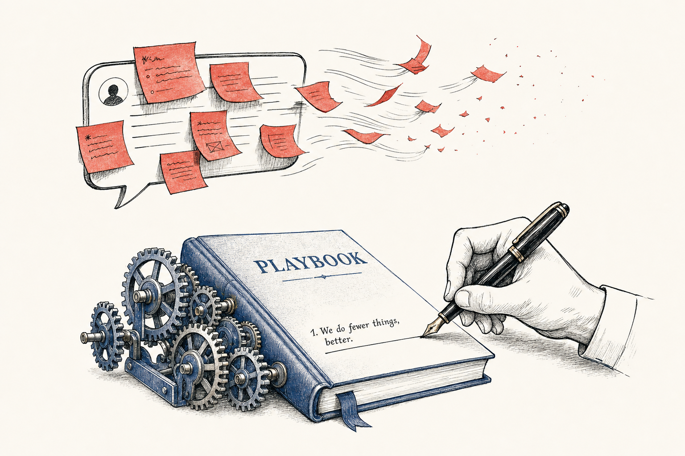
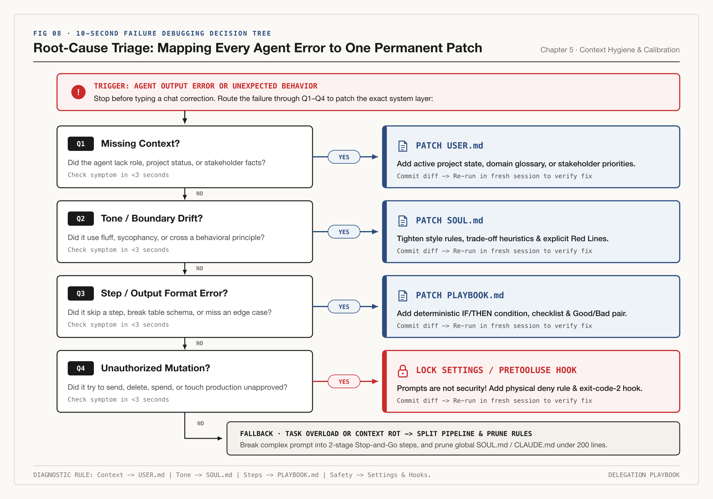

# Chapter 5. 교정과 진화 (Calibration)

> **이 장의 핵심 요약 (3줄)**
> 1. 채팅창에 대고 하는 잔소리는 창을 닫는 순간 날아가는 포스트잇이다. 똑같은 수정 지시를 두 번 치고 있다면 당장 멈추고 **원본 매뉴얼 파일을 고쳐라.**
> 2. AI가 엉뚱한 결과물을 가져왔다고 무조건 지시문을 길게 늘리지 마라. **배경 설명 부족(`USER.md`), 말투·원칙 이탈(`SOUL.md`), 양식 모호(`PLAYBOOK.md`), 선 넘는 행동(`settings.json`), 과식(일감 쪼개기)** 중 어디가 고장 났는지 10초 만에 찾아 그 자리만 수술한다.
> 3. 매뉴얼이 쓰레기통처럼 길어지면 AI도 앞말을 까먹는다. 상시 읽는 문서는 200줄 안쪽으로 가볍게 유지하고, 매주 금요일 **딱 15분만 투자해 성적표를 매기고 권한을 올리거나 깎는다.**
>
> **이 장의 산출물**
> - 왜 틀렸는지 AI 스스로 원인을 찾아 3줄 수리법을 내놓게 하는 커맨드 (`/calibrate`)
> - 금요일 15분 점검표 (`WEEKLY_AGENT_AUDIT.md`) 및 문서 비만도 자동 측정 스크립트 (`audit_health.sh`)

첫날부터 내 마음을 귀신같이 읽고 완벽하게 돌아가는 시스템은 세상에 없다.
아무리 공들여 `USER.md`, `SOUL.md`, `PLAYBOOK.md`를 적어두고 안전벨트를 채웠어도 막상 내 진짜 일감을 넣어 돌려보면 반드시 삐끗하는 순간이 온다.

바로 그 순간, 사람의 반응은 정확히 두 부류로 갈린다.
첫 번째 부류는 혀를 차며 "그럼 그렇지, 설명할 시간에 내가 하고 만다" 하고 창을 닫거나, 채팅창에 대고 똑같은 잔소리를 매일 되풀이한다.
두 번째 부류는 틀린 결과물을 보며 "아, 내 매뉴얼에 이 기준 한 줄이 빠져 있었구나" 하고 원본 파일에 딱 두 줄을 보탠다.

한 달 뒤 두 사람의 퇴근 시간은 완전히 달라진다.
전자는 한 달 뒤에도 똑같은 오타를 손으로 고치고 있고, 후자의 에이전트는 한 번 틀린 실수를 두 번 다시 저지르지 않는다.
이 장에서는 AI의 실수를 내 시스템의 근육으로 바꾸는 **교정 루프(Calibration Loop)**와 매뉴얼 다이어트 비법, 그리고 금요일 15분 루틴을 다룬다.

---

## 5.1 채팅창에 하는 잔소리는 퇴근하면 날아가는 포스트잇이다

에이전트가 보고서 표 모양을 엉망으로 가져왔거나 뺀질거리는 미사여구를 잔뜩 섞어 왔을 때, 열에 아홉은 지금 열려 있는 채팅창에 바로 손가락을 올린다.
`"아니, 서론 빼고 표로만 만들라고 했잖아. 날짜도 2026-11-14 모양으로 맞춰서 다시 뽑아줘."`

그러면 에이전트는 공손하게 사과하며 금세 고쳐진 표를 내놓는다.
당장 급한 불은 껐으니 속이 시원하다. 문제가 해결됐다고 믿는다.
착각이다.

왜 내일 아침에 똑같은 실수를 또 할까?
방금 그 채팅창에서 한 잔소리는 창을 닫거나 새 대화를 여는 순간 연기처럼 사라지기 때문이다.
기억이 매일 아침 백지로 돌아가는 AI에게 채팅창 잔소리는 모니터 옆에 붙였다가 퇴근할 때 떼어 버리는 포스트잇과 같다. 내일 출근해서 새 창을 열면 어제 혼난 기억이 전혀 없는 새 에이전트가 해맑게 똑같은 실수를 저지른다.

수석비서 전문 교육 기업 아테나(Athena)에는 유명한 원칙이 있다.
**"사람을 붙잡고 혼내지 말고, 매뉴얼 문서를 고쳐라(Build the Playbook, Not the Person)."**
비서가 가져온 결과물이 내 마음에 안 든다면 그건 비서가 게을러서가 아니라 내가 건네준 매뉴얼에 빈 구멍이 있었기 때문이라는 뜻이다.
인간 비서에게도 통하는 이 원칙은 AI 에이전트 앞에선 백 퍼센트 물리 법칙이 된다. AI를 바꾸는 건 훈계가 아니라 파일 수정뿐이다.


*그림 5-1. 퇴근하면 바람에 날아가는 채팅창 포스트잇 잔소리와, 매뉴얼 노트에 한 줄씩 새겨 넣는 영구적인 교정 루프*

오늘부터 내 책상 앞에 규칙 하나만 붙여두자.
**똑같은 지적을 채팅창에 두 번째 치고 있다면 그 자리에서 키보드에서 손을 떼라.**
결과물을 내 손으로 직접 고치는 데 3분을 쓰지 마라.
대신 원본 매뉴얼(`PLAYBOOK.md`, 웹·앱 사용자는 프로젝트 지침창)을 열어 기준 한 줄을 보태고, 새 채팅창을 열어 정말 고쳐졌는지 확인하는 데 5분을 써라.
오늘 쓴 그 5분이 앞으로 1년 동안 수백 번 반복될 짜증을 영원히 지워준다.

#### [나쁜 대처 vs 좋은 대처] AI가 틀렸을 때 반응 대조

> **[나쁜 대처: 허공에 날리는 채팅창 잔소리]**
> `"거기 금액 단위는 천 원이 아니라 백만 원으로 바꾸고, 마이너스 숫자는 괄호 말고 빼기(-) 기호로 통일해서 다시 줘. 지난주에도 말했는데 왜 자꾸 틀려."`
> - *왜 제자리걸음일까:* 지금 눈앞의 표 하나만 고쳐졌을 뿐 내 매뉴얼 파일(`PLAYBOOK.md`)은 어제 그대로다. 다음 주 월요일에 보고서를 시키면 귀신같이 또 천 원 단위로 가져온다.
>
> **[좋은 대처: 매뉴얼에 두 줄 박아 넣고 새 창에서 확인]**
> `"방금 생긴 금액 단위 착오와 마이너스 표기 실수가 다음 대화부터 두 번 다시 안 나오도록 `playbooks/PLAYBOOK.md`의 [SOP-06 출력 규격] 칸에 보탤 규칙 두 줄을 먼저 짜와라. 내가 보고 파일에 넣은 다음 새 기준으로 표를 다시 뽑아라."`
> - *왜 통할까:* 오늘 보고서도 고치고 매뉴얼의 구멍도 영구히 메웠다. 앞으로 평생 금액 단위 때문에 잔소리할 일이 사라진다.

---

## 5.2 어디가 고장 났는지 10초 만에 찾는 디버깅 나침반

결과물이 맘에 안 든다고 해서 아무 파일이나 열어 주의사항을 스무 줄씩 덧대면 안 된다.
배가 아픈데 두통약을 먹으면 병만 커지듯, 엉뚱한 파일에 잔소리를 쌓아두면 기존 규칙과 부딪혀서 멀쩡하던 기능까지 고장 난다.

에이전트가 헛발질을 했다면 당황하지 말고 아래 **10초 진단 나침반**을 위에서부터 차례대로 짚어보라. 어느 파일을 열어야 할지 바로 답이 나온다.


*그림 5-2. 에이전트 오류 발생 시 10초 안에 패치 대상 파일을 특정하는 의사결정 트리*

### 5.2.1 네 가지 질문으로 고장 난 부품 찾기

1. **Q1. 내 사정을 몰라서 틀렸나? (`Missing Context?` → `USER.md` 수리)**
   - 일 잘하는 인간 동료에게 똑같은 자료만 주고 시켰어도 우리 팀 약어나 최근 바뀐 목표를 몰라서 틀렸을 문제인가? 그렇다면 규칙 잘못이 아니다. `USER.md`에 최신 현황 한 줄을 업데이트해 주면 끝난다.
2. **Q2. 말투가 느끼해졌거나 금지선을 넘었나? (`Tone / Boundary Drift?` → `SOUL.md` 수리)**
   - 하지 말라던 과장된 수식어를 썼거나, 확실치도 않은 숫자를 아는 척 지어냈다면 에이전트의 기본 태도를 잡는 `SOUL.md`에 구체적인 금지 단어와 숫자 표기법을 박아 넣는다.
3. **Q3. 일하는 순서나 표 모양이 삐뚤어졌나? (`Step / Output Format Error?` → `PLAYBOOK.md` 수리)**
   - 요약이 너무 길거나 예외 상황 처리가 들쑥날쑥하다면 개별 업무 매뉴얼인 `PLAYBOOK.md`를 연다. "적당히 짧게" 같은 흐릿한 말을 지우고 "최대 5줄, 이런 경우엔 이렇게(`IF-THEN`)"라는 정확한 기준과 모범 예시 하나를 넣어준다.
4. **Q4. 허락도 안 받고 파일 삭제·발송·커밋에 손을 댔나? (`Unauthorized Mutation?` → `자물쇠 잠그기`)**
   - 시키지도 않은 다음 단계 버튼을 눌렀다면 문서를 고칠 일이 아니다. 말로 타일러서 고쳐질 버릇이 아니라는 신호다. 앞 장에서 본 Replit 운영 DB 삭제 사고도 사용자가 채팅창에 "절대 건드리지 마"라고 수십 번 외쳤지만 결국 터졌다. 즉시 `.claude/settings.json`의 금지(`deny`) 목록이나 앱 연동 설정으로 가서 아예 그 도구의 플러그를 뽑아버려라.

> **잠깐, 네 군데 다 멀쩡한데 글 뒤쪽으로 갈수록 지시를 줄줄이 빼먹는다면? (한 입에 너무 많이 쑤셔 넣은 과식 상태)**
> 매뉴얼에 이미 똑똑히 적혀 있는데도 에이전트가 긴 문서를 다루다 중반부터 조건을 까먹고 횡설수설할 때가 있다. 이때 "왜 안 지켜"라며 규칙을 열 줄 더 적어 넣으면 오히려 역효과가 난다. 한 번에 시킨 일감 덩어리가 너무 커서 체한 것이다. 규칙을 보태지 말고 일을 **1단계 자료 뽑기 → (새 창 열기 `/clear`) → 2단계 초안 쓰기** 두 토막으로 쪼개라. 거짓말처럼 말귀를 다시 알아듣는다.

| 고장 원인 | 눈앞에 나타나는 증상 | 웹·앱 구독형(UI) 수리법 | 설치형·터미널(CLI) 수리법 |
| :--- | :--- | :--- | :--- |
| **내 사정을 모름** | 취소된 옛날 과제를 진행 중으로 착각, 팀원 직함 틀림 | 프로젝트 지침 속 `USER.md` 현황 칸 최신화 | `context/USER.md` 및 `MEMORY.md` 사실 고치기 |
| **말투·태도 불량** | 홍보성 미사여구 남발, 출처 없는 숫자 멋대로 추정 | 공통 지침(`SOUL.md`)에 금지 단어·출처 표기법 못 박기 | `context/SOUL.md` 금지선(Red Lines) 숫자로 명시 |
| **양식·순서 엉망** | 글이 너무 김, 애매한 건 멋대로 뺌, 표 모양이 매번 바뀜 | 업무별 노션·프롬프트 양식에 `IF-THEN` 규칙과 예시 추가 | `playbooks/PLAYBOOK.md` 해당 매뉴얼 수리 |
| **멋대로 버튼 누름** | 초안만 쓰랬는데 원본 덮어쓰기·메일 발송·커밋 시도 | 외부 쓰기 연동(Send·Edit) 스위치 끄기, 복사본 폴더 사용 | `.claude/settings.json` deny 및 차단 훅(`PreToolUse`) 잠금 |
| **한 번에 과식함** | 뒷부분으로 갈수록 맨 처음에 시킨 조건을 까먹음 | `새 채팅`을 열어 `뼈대 잡기 -> 본문 쓰기` 두 번에 나눠 시키기 | 커맨드 쪼개기 및 단계 사이 `/clear`로 머릿속 비우기 |

### 5.2.2 어디를 어떻게 고칠지 AI에게 직접 물어보는 `/calibrate` 커맨드

막상 매뉴얼을 고치려니 어떤 문장으로 적어야 깔끔할지 고민될 때가 있다.
그럴 땐 고치는 문장조차 내가 머리 싸매고 지어낼 필요 없다.
아래 지시문을 `.claude/commands/calibrate.md`(웹·앱 사용자는 자주 쓰는 메모장)에 넣어두고 부르면, 에이전트가 반성문 대신 어디에 어떤 두 줄을 끼워 넣으면 되는지 깔끔한 수리 도면을 가져온다.

```markdown
# .claude/commands/calibrate.md — 에이전트 오류 원인 진단 및 3줄 수리 도면 추출기

방금 발생한 실수 또는 내 지적 사항: `$ARGUMENTS`

## 지시사항
지금 당장 결과물을 다시 쓰지 마라. 먼저 왜 이런 실수가 나왔는지 원인을 짚고 매뉴얼 수리안부터 내놓아라.

1. **고장 원인 찍기 (택 1):**
   `[1. 내 배경 맥락 부족(USER.md) / 2. 말투·원칙 이탈(SOUL.md) / 3. 절차·양식 모호(PLAYBOOK.md) / 4. 허락 없는 변경 시도(권한 잠금) / 5. 한 번에 너무 큰 작업(단계 쪼개기)]` 중 어디에 해당하는지 고르고 이유를 두 문장 안으로 설명해라.
2. **수리할 파일과 위치:**
   어느 파일의 어느 제목 아래를 고쳐야 하는지 정확히 짚어라.
3. **최소 수리 문구 (`git diff` 또는 변경 전·후 비교):**
   - "절대", "제발", "무조건" 같은 감정 섞인 강조어는 빼라.
   - 기존 문장과 겹치지 않게 **딱 3줄 이내의 명확한 조건문(`어떤 상황이면 -> 어떻게 한다`)**으로 적어라.
   - 만약 4번(허락 없는 변경 시도)이라면 문서 수정 말고 잠가야 할 설정(`deny` 항목이나 연동 해제)을 함께 적어라.
4. 수리안을 보여준 뒤 내 허락을 기다려라.
```

### 5.2.3 실제 매뉴얼 수리 기록 예시 (`git diff`)

내 작업 방 폴더를 Git이나 노션 변경 이력으로 관리해 보면 매주 내 비서가 어떻게 똑똑해졌는지 발자국이 고스란히 남는다.
아래는 실제로 리서치 때 옛날 요금표를 가져온 실수와 내 허락 없이 커밋 버튼을 누른 사고를 겪은 뒤 딱 네 줄로 고친 기록이다.

```diff
--- a/playbooks/PLAYBOOK.md
+++ b/playbooks/PLAYBOOK.md
@@ -42,6 +42,9 @@
 ## SOP-04: 심층 리서치 출처 규칙
 - 기업 공식 문서, 공시 자료, 피어리뷰 논문만 1차 출처로 사용한다.
 - 모든 정량 수치 옆에는 출처 URL과 원문 발췌 문장을 큰따옴표로 병기한다.
+- [패치] 작성·수정일이 오늘 기준 12개월을 넘긴 옛날 문서는 최신 근거로 단독 채택하지 않는다.
+- [패치] 최신 공식 문서가 아예 없을 때는 반드시 숫자 앞에 `[구버전 주의: YYYY-MM 기준]` 꼬리표를 붙인다.

--- a/.claude/settings.json
+++ b/.claude/settings.json
@@ -11,7 +11,6 @@
       "Bash(git status)",
       "Bash(git diff:*)",
-      "Bash(git commit:*)"
+      "Bash(git log:*)"
     ],
     "ask": [
+      "Bash(git commit:*)",
       "Bash(git push:*)"
     ],
```

---

## 5.3 문서가 쓰레기통처럼 길어지면 AI도 앞말을 까먹는다 (문서 다이어트)

매뉴얼 고치는 재미에 빠져 서너 달쯤 쓰다 보면 슬슬 두 번째 병이 찾아온다.
실수할 때마다 밑에 두 줄씩 덧붙이다 보니 어느새 `SOUL.md`와 `CLAUDE.md`가 천 줄짜리 백과사전으로 불어난 것이다.

신입 사원에게 첫날부터 천 페이지짜리 사규집을 던져주며 "토씨 하나 빼먹지 말고 다 외워서 일해"라고 하면 어떻게 될까?
정작 제일 중요한 첫 페이지 원칙까지 머릿속에서 뒤엉켜버린다.
AI도 똑같다. 한 번에 읽을 수 있는 글자 수가 아무리 늘어나도, 동시에 또렷하게 집중할 수 있는 규칙의 개수에는 한계가 있다.
쓸데없는 옛날 규칙과 앞뒤가 안 맞는 지시가 수백 줄 쌓여 에이전트가 멍해지는 현상을 **컨텍스트 부패(Context Rot)**라고 부른다.
게다가 채팅창 하나를 안 닫고 아침부터 저녁까지 온갖 잡다한 일을 이어서 시키면, 오전에 나눈 메일 얘기가 오후 기획서 초안에 끼어드는 대참사가 난다.

내 매뉴얼을 늘 면도날처럼 날카롭고 가볍게 유지하는 세 가지 청소 습관이다.

### 1. 늘 읽는 기본 문서는 150~200줄을 넘기지 마라
대화를 시작할 때마다 무조건 읽어야 하는 기본 문서(`USER.md`, `SOUL.md`, 루트 `CLAUDE.md`·`AGENTS.md`, 앱 공통 지침창)는 각각 **최대 200줄**이 마지노선이다.
모든 일에 공통으로 쓰이는 뼈대 원칙만 남기고, 특정 업무에만 필요한 세세한 주문은 가차 없이 바깥 문서로 빼낸다.

### 2. 그 일을 할 때만 그 매뉴얼을 꺼내 읽혀라
메일 분류할 때 엑셀 수식 규칙을 읽을 필요가 없고, 코드 고칠 때 보고서 인사말 규칙을 알 필요가 없다.
평소에는 서랍에 넣어두었다가 **그 일을 시킬 때만 해당 매뉴얼을 펼쳐 보게(점진적 노출)** 방을 나눈다.
- **설치형 CLI 사용자:** 하위 폴더마다 작은 `CLAUDE.md`를 따로 두거나, 업무별 슬래시 커맨드(`.claude/commands/작업명.md`)로 쪼갠다. Cursor 같은 도구라면 특정 파일 확장자를 만질 때만 규칙이 켜지게(`alwaysApply: false`) 걸어둔다.
- **웹·앱 구독형 사용자:** 프로젝트 방 하나에 만능 비서를 만들지 마라. `[리서치 방]`, `[기획서 방]`, `[데이터 분석 방]`으로 작업실을 깔끔하게 나눈다.
- **주제가 바뀌면 무조건 새 창 열기(`/clear`):** 메일 정리가 끝났는데 그 창에 이어서 기획서를 시키지 마라. 아까워 말고 `/clear`를 치거나 `새 채팅` 버튼을 눌러 책상 위를 싹 치운 다음 새 일을 꺼내라.

### 3. 두 줄을 넣으려면 낡은 두 줄부터 지워라
새 규칙을 적어 넣기 전에 위아래를 훑어보며 이미 끝난 작년 프로젝트 얘기나 똑같은 잔소리가 세 번 적힌 줄부터 지운다. 덜어낼수록 AI의 눈빛이 또렷해진다.

#### [나쁜 규칙 누적 vs 좋은 규칙 정제] 매뉴얼 청소 전후 대조

> **[나쁜 매뉴얼: 화풀이식 잔소리가 겹겹이 쌓인 상태]**
> ```markdown
> - 요약할 때 절대 길게 쓰지 마라.
> - [중요] 지난번에도 보고서를 너무 길게 써서 읽기 힘들었음. 핵심만 짧게 요약할 것.
> - 제발 출처 없는 뇌피셜 수치 쓰지 마라. 출처 꼭 적어라.
> - 서론에 인사말이나 뻔한 배경 설명 넣지 말고 바로 본론부터 시작해라. 무조건 짧게 써라.
> ```
> - *왜 안 먹힐까:* 네 줄 내내 "길게", "짧게", "제발" 같은 감정 섞인 호소만 가득할 뿐, 도대체 몇 줄이 짧은 건지 기준이 하나도 없다. 자리만 차지하는 소음이다.
>
> **[좋은 매뉴얼: 군살을 쫙 빼고 숫자로 못 박은 상태]**
> ```markdown
> ## 보고서 출력 정량 제약
> 1. 서두 인사말·배경 설명 생략, 첫 줄부터 결론 불릿 시작.
> 2. 분량 상한: 섹션당 불릿 최대 5개, 각 불릿 70자 이내.
> 3. 수치 표기: `수치 (출처 URL, YYYY-MM)` 형식 강제. 미확인 시 `'확인 불가'` 표기.
> ```
> - *왜 칼같이 지킬까:* 길이는 반으로 줄었는데 딴소리를 할 틈이 1밀리미터도 없다.

---

## 5.4 매주 금요일 오후 15분 점검과 권한 승진·강등 심사

좋은 위임 시스템은 한 번 깎아놓고 먼지 쌓이게 두는 조각상이 아니다. 매주 기름칠하며 키우는 정원에 가깝다.
매주 금요일 오후(시나리오 10번 주간 회고를 돌린 직후), 내 달력에 **딱 15분짜리 '에이전트 주간 점검'** 일정을 박아두어라.

이 15분 동안 할 일은 거창하지 않다.
이번 주 내 신경을 제일 거슬리게 했던 실수 **딱 한 개만 골라 매뉴얼을 고치는 것**, 그리고 각 업무의 **성적표를 매겨 고삐를 한 칸 풀어줄지(승격), 반대로 조일지(강등) 결정하는 것**이다.

### 5.4.1 기분이 아니라 숫자로 정하는 승진·강등 규칙

"요즘 좀 잘하는 것 같은데 이제 알아서 다 하라고 풀어줄까?"
이런 막연한 기분으로 권한을 풀어주면 그다음 주에 바로 사고가 터진다. 승진과 강등은 철저히 기록으로만 결정한다.

| 심사 구분 | 통과 기준 (숫자로만 판단) | 내가 해줄 조치 |
| :--- | :--- | :--- |
| **한 단계 승진**<br>(예: L2 → L3, L3 → L4) | 1. 같은 매뉴얼로 **최근 10번 연속 내가 손댈 곳 없이 한 방에 통과**<br>2. 실수해도 언제든 되돌릴 수 있는 안전한 작업일 것<br>3. 작업 기록이 폴더에 자동으로 남을 것 | 검문소를 한 칸 뒤로 물린다<br>(예: 매번 초안 보고 저장 허락하기 → 폴더에 알아서 저장해 두고 금요일에 요약만 보기) |
| **만년 대리 유지**<br>(Level 3 영구 고정) | 백 번 연속 잘했더라도 **실제 메일 발송(`Send`), 원본 삭제, 결제, 운영 서버 배포**처럼 한 번 나가면 못 주워 담는 모든 일 | 평생 **Level 3 (`초안까지만 작성` + 마지막 버튼은 내 손으로 클릭)** 상한선 유지 (절대 자동 발송 금지) |
| **즉시 강등**<br>(예: L4 → L3, L3 → L2) | 하지 말란 짓을 했거나 지어낸 숫자를 섞어 넣은 게 **단 한 번이라도 적발된 즉시** | 1. 그 자리에서 권한 한 단계 강등 및 자동 실행 스위치 끄기<br>2. 원인 찾아 매뉴얼·권한 수리(5.2절)<br>3. 낮은 단계에서 **최소 5번 연속 무결점 통과**하기 전엔 복귀 금지 |

### 5.4.2 복붙용 금요일 15분 점검표 (`WEEKLY_AGENT_AUDIT.md`)

아래 양식을 `logs/audit_template.md`(또는 노션 주간 체크리스트)에 복사해 두고 금요일마다 딱 15분만 빈칸을 채운다.

```markdown
# 주간 에이전트 위임 시스템 감사 시트 (Weekly 15-Min Audit)

- 점검 주차: YYYY-WXX
- 점검 소요 시간: 15분 상한 엄수

## 1. 주간 가동 및 품질 지표 점검 (3분)
| 가동 중인 SOP 명칭 | 현재 위임 레벨 | 금주 실행 횟수 | 무수정 통과 횟수 | 반려·수정 발생 사유 (1줄) |
| :--- | :---: | :---: | :---: | :--- |
| SOP-01 인박스 트리아지 | L3 | 회 | 회 | |
| SOP-04 심층 리서치 | L2 | 회 | 회 | |
| SOP-06 데이터 정제 | L3 | 회 | 회 | |

## 2. 반복 오류 1건 영구 패치 (5분)
- [ ] 이번 주 채팅창에서 내가 직접 고쳐 쓰거나 두 번 이상 재지시했던 패턴 **단 1건** 선정:
  - 선정 문제: ___________________________________
- [ ] 원인 분류 확인 (`맥락 부재` / `어조 이탈` / `형식 모호` / `무단 변경` / `작업 과부하`)
- [ ] 타깃 파일(`USER.md` / `SOUL.md` / `PLAYBOOK.md` / `settings.json`) 패치 반영 완료

## 3. 문서 위생 및 보안·비용 점검 (4분)
- [ ] `SOUL.md` 및 루트 `CLAUDE.md`가 200라인 이하로 유지되고 있는가? (초과 시 하위 SOP로 분리·삭제)
- [ ] 종료된 프로젝트 맥락이나 만료된 일정이 `USER.md`에 방치되어 있지 않은가?
- [ ] 금주 API 누적 사용 금액 확인: `$______ / 월 상한 $______` (비정상 루프 징후 유무 확인)
- [ ] `deny` 목록 및 읽기 전용 토큰 경계가 우회 없이 정상 작동 중인가?

## 4. 차주 권한 승격·강등 및 신규 위임 1건 지정 (3분)
- **강등 대상 (오류 1회 이상 발생 건):** _________________ (`L__ -> L__`)
- **승격 대상 (10회 연속 무수정 + 가역 작업):** _____________ (`L__ -> L__`)
- **차주 신규 SOP화 대상 업무 딱 1건:** ___________________ (초기 레벨은 무조건 L1~L3에서 시작)
```

### 5.4.3 문서 비만도와 자물쇠 상태를 1초 만에 재는 스크립트 (`audit_health.sh`)

터미널(CLI) 환경을 쓰는 실무자라면 매주 문서 줄 수를 눈으로 세고 있을 필요도 없다. 아래 스크립트를 작업 방에 넣어두고 돌리면 200줄이 넘은 비만 문서가 있는지, 금지(`deny`) 자물쇠가 풀리진 않았는지 1초 만에 알려준다.

```bash
#!/usr/bin/env bash
# audit_health.sh — 주간 매뉴얼 비만도(200줄 상한) 및 자물쇠 점검기
set -euo pipefail

WORKSPACE="${HOME}/agent-workspace"
MAX_LINES=200

echo "=== [1] 기본 문서 줄 수 점검 (마지노선: ${MAX_LINES}줄) ==="
for f in "${WORKSPACE}/context/USER.md" "${WORKSPACE}/context/SOUL.md" "${WORKSPACE}/CLAUDE.md" "${WORKSPACE}/AGENTS.md"; do
  if [[ -f "$f" ]]; then
    lines=$(wc -l < "$f" | tr -d ' ')
    status="정상"
    [[ "$lines" -gt "$MAX_LINES" ]] && status="경고: 줄 수 초과 (세부 매뉴얼로 분리 필요)"
    printf "  %-45s : %4s 줄 [%s]\n" "$f" "$lines" "$status"
  fi
done

echo ""
echo "=== [2] 물리적 자물쇠(.claude/settings.json) 작동 여부 점검 ==="
SETTINGS_FILE="${WORKSPACE}/.claude/settings.json"
if [[ -f "${SETTINGS_FILE}" ]] && grep -q '"deny"' "${SETTINGS_FILE}"; then
  echo "  [정상] settings.json 금지(deny) 목록이 잠겨 있습니다."
else
  echo "  [위험] settings.json 또는 deny 규칙이 빠졌습니다. 즉시 잠그세요."
fi

if command -v openclaw >/dev/null 2>&1; then
  echo ""
  echo "=== [3] OpenClaw 게이트웨이 보안 점검 실행 ==="
  openclaw security audit --deep || true
fi
```

---

## 5.5 이 장의 완료 점검표

여기까지 왔다면 일회성 프롬프트 재주 부리기가 아니라, 시간이 갈수록 내 손발처럼 진화하는 진짜 개인 운영체제(Personal OS)의 뼈대가 완성됐다. 마지막 장으로 넘어가기 전에 네 가지만 짚어보자.

- [ ] 채팅창에 똑같은 잔소리를 두 번 치는 대신 **원본 매뉴얼 파일(`USER.md` · `SOUL.md` · `PLAYBOOK.md`)을 열어 고치는 습관**을 새겼다.
- [ ] `그림 5-2`의 10초 나침반을 보고 배경 부족, 말투 이탈, 양식 모호, 선 넘는 행동, 일감 과식을 구분해 정확한 약을 처방할 수 있다.
- [ ] 기본 지침 문서를 **200줄 안쪽**으로 날렵하게 유지하고, 일감이 바뀔 때마다 새 창(`/clear`)을 여는 청소 규칙을 익혔다.
- [ ] 내 달력의 매주 금요일 오후에 **15분 주간 점검 일정**을 박아 넣었다.

머리로는 이제 완벽히 이해했다.
그런데 막상 책을 덮고 월요일 아침 책상에 앉으면 묘한 막막함이 밀려온다. "그래서 당장 어디서부터 손을 대야 하지?"
이 질문 앞에서 멈칫거리다 일주일이 지나가면 모든 공부가 물거품이 된다.
마지막 **Chapter 6**에서는 월요일 오전 출근 직후 타이머를 딱 30분에 맞추고 첫 위임을 끝내는 실전 행동 순서표와 모니터 옆에 붙여두는 한 장짜리 치트시트, 그리고 현업에서 가장 많이 막히는 현실적인 질문 일곱 가지에 명쾌한 답을 내놓는다.
