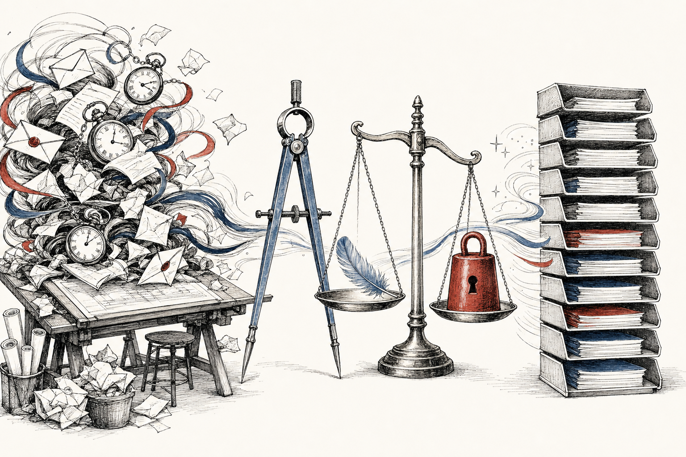

# 5장. 일상의 실무를 재설계하는 열 가지 위임 아키텍처 패턴

직함은 달라도 지식 노동자의 하루가 무너지는 풍경은 놀랍도록 닮아 있다.
쏟아지는 연락에 답장을 고르고, 흩어진 지난 기록을 뒤지고, 수치를 맞추고, 빈 종이 앞에서 첫 문장을 쥐어짜느라 정작 깊은 생각이 필요한 본업은 해가 진 뒤에야 시작된다.

많은 이들이 이 일상을 통째로 대리인에게 떠넘기려다 실패한다.
"알아서 처리해 달라"는 막연한 위임은 사고를 부르고, 반대로 불안해서 모든 과정을 일일이 간섭하면 내가 직접 하는 것보다 더 피곤해진다.
해법은 업무라는 덩어리를 그대로 던지는 것이 아니라, 그 안의 결을 따라 **인간이 쥐어야 할 기준과 검증의 뼈**를 남기고 **대리인이 맡을 실행의 살**만 정교하게 발라내는 데 있다.

앞선 네 개의 장에서 세운 원칙들이 실제 업무의 현장에서 어떻게 맞물려 돌아가는지 열 가지 보편적인 위임 아키텍처 패턴으로 살펴본다.
열 가지 패턴을 들여다볼 때 기억할 나침반은 두 가지 질문이다.
첫째, 이 일이 잘못되었을 때 바깥세상에 돌이킬 수 없는 흔적이 남는가.
둘째, 하루와 한 주 안에 얼마나 자주 내 집중력을 끊어놓는가.

회의 전 맥락 브리핑, 탐색적 조사, 변화 감지, 주기적 회고처럼 내 작업실 안에서만 읽고 요약하는 네 가지 패턴은 실수해도 아무런 외부 피해가 없는 안전지대다.
위임이 낯선 사람일수록 이 안전지대에서 먼저 첫발을 떼어 감각을 익혀야 한다.
반면 수신함 응답, 일정 조율, 수치 정제, 기획서 작성, 구조 변경, 대외 문의 대응처럼 바깥세상이나 원본 자산과 맞닿은 여섯 가지 패턴은 반드시 초안 격리실과 인간의 결재 관문을 세운 뒤에 넓혀 가야 한다.

*그림 5-1. 쏟아지는 날것의 일감들은 가역성과 중요도라는 나침반을 거쳐 안전한 실행 경로와 인간의 결재 관문으로 나뉘어 흐른다*

---

## 5.1 수신함 분류와 응답 초안 — 입구는 넓게 열어 분류하고 출구는 초안함에 가둔다

아침에 출근해 수신함을 여는 순간 우리는 남들이 내 하루의 우선순위를 정하도록 허락하게 된다.
단순 참조용 공지, 정중한 거절이 필요한 제안, 자료 요청, 그리고 내 결단을 기다리는 중대한 질문이 한 바구니에 뒤섞여 있기 때문이다.
봉투를 하나씩 뜯어 읽고 성격을 가려내는 분류 노동만으로도 오전에 쓸 수 있는 가장 맑은 정신력이 바닥난다.

이 영역을 재설계하는 핵심은 **분류와 초안 작성은 대리인에게 활짝 열어주되, 실제 발송이라는 출구는 물리적으로 걸어 잠그는 것**이다.
대리인은 정해진 시각에 먼저 수신함을 돌며 편지들을 네 개의 바구니로 가른다.
주인이 직접 고심해 결정해야 할 중대 사안, 정해진 사실만으로 답변이 가능한 일상 문의, 한 줄 요약만 읽고 넘길 참고 소식, 그리고 바로 치워도 좋을 소음이다.

여기서 두 번째 바구니에 담긴 일상 문의들에 대해서는 대리인이 주인의 평소 어조와 원칙에 맞춰 응답 초안까지 미리 써둔다.
다만 확실한 근거가 없는 날짜나 금액 자리는 추측해 메우지 않고 눈에 띄는 빈칸으로 남겨둔다.
그리고 완성된 편지는 바깥 우체통이 아니라 오직 주인만 열 수 있는 **초안 보관함**에 차곡차곡 쌓아둔다.

주인은 하루에 두 번, 정해진 시간에만 초안 보관함을 연다.
수신자가 맞는지, 비워둔 숫자 칸에 무엇을 채울지, 내가 약속하지 않은 조건이 섞이지 않았는지만 눈으로 훑고 마지막 발송 단추를 누른다.
고전적인 수석비서 운용의 황금률인 '초안만 쓰고 보내지 마라'를 구조로 옮겨 놓으면, 수신함의 소음에서 해방되면서도 말실수나 기밀 유출의 위험은 영원히 영점에 머문다.

수신함을 수시로 들락거리는 습관은 성실함이 아니라 주의력의 파산이다.
입구에서는 대리인이 쉴 새 없이 체질을 해 알곡만 추려놓고, 출구에서는 주인이 정해진 시각에 한꺼번에 도장을 찍어 내보내는 일괄 처리 구조만이 내 하루의 주도권을 되찾아 준다.

---

## 5.2 시간 방어와 일정 조율 — 내 집중 시간을 지키는 우선순위 방패막이

삼십 분짜리 만남 하나를 잡기 위해 서너 번씩 안부와 가능 시간을 주고받는 일은 소모적이다.
하지만 일정 위임에서 진짜 무서운 실패는 시간을 잘못 적는 실수가 아니다.
달력에 비어 있는 칸만 보이면 대리인이 부지런히 약속을 채워 넣은 나머지, 정작 내가 깊이 몰입해 결과물을 만들어야 할 오전의 황금 시간대가 갈기갈기 찢겨 나가는 참사다.

비어 있는 시간과 내어줄 수 있는 시간은 전혀 다르다.
따라서 일정 조율 아키텍처에서 인간이 설계해야 할 가장 중요한 기준은 '언제 만날까'가 아니라 **'언제는 절대 건드리지 말아야 하는가'를 규정한 시간 방어막**이다.

설계자는 먼저 자신의 하루 중 누구에게도 내어주지 않을 집중 작업 구역, 회의와 회의 사이에 숨을 고를 최소한의 완충 시간, 그리고 하루에 감당할 수 있는 최대 회의 총량을 명시적인 규칙으로 못 박는다.
대리인은 이 방어막 바깥에 남은 시간 중에서만 상대방에게 제안할 세 개의 시간 후보를 추려내고, 요일과 시간대를 정확히 표기한 정중한 제안 문안을 빚어낸다.

마지막 관문 역시 분명하다.
상대방과 최종 합의가 끝나기도 전에 대리인이 먼저 확정 초대장을 날려버리는 결례를 막기 위해 달력 변경 권한은 보류해 둔다.
특히 사람이 놓치기 쉬운 날짜와 요일의 짝 맞음, 그리고 멀리 떨어진 지역과의 시차 계산만 대리인이 꼼꼼히 대조해 바치게 하면 사소한 실랑이가 사라진다.
대리인은 달력의 빈칸을 메우는 점원이 아니라, 주인의 가장 비싼 자원인 몰입 시간을 맨 앞에서 지키는 문지기여야 한다.

---

## 5.3 회의 전 맥락 브리핑 — 흩어진 과거의 조각을 한 장의 판단 재료로 응축하기

중요한 논의를 오 분 앞두고 지난번 회의록과 오간 편지들을 허둥지둥 뒤적여 본 경험은 누구에게나 있다.
기억은 흐릿하고 기록은 여러 곳에 흩어져 있으니, 결국 지난번에 이미 합의한 이야기를 처음부터 다시 꺼내거나 꼭 확인했어야 할 핵심 쟁점을 놓친 채 자리에서 일어난다.

회의 전 맥락 브리핑은 외부로 아무런 신호도 내보내지 않고 내 안의 기록만 읽어 들이는 완전한 가역 작업이다.
따라서 위임을 처음 시작하는 사람이 첫날 가장 안심하고 자동화할 수 있는 최적의 출발점이 된다.

다만 대리인에게 "관련된 지난 자료를 전부 모아 정리해 달라"고 느슨하게 지시하면 어김없이 실패한다.
대리인은 성실하게 열 장짜리 배경 설명서를 만들어 오지만, 회의 시작 오 분 전에 열 장의 문서를 읽을 수 있는 사람은 없기 때문이다.

이 패턴의 성패는 과감한 **생략과 응축의 규격**에 달려 있다.
이미 해결되어 끝난 옛날이야기는 모두 덜어내고, 분량은 단 이 분 안에 눈으로 훑을 수 있는 한 장으로 엄격히 제한한다.
그 한 장 안에는 직전 만남 이후 아직 끝나지 않은 숙제, 그사이 상대방의 입장에서 달라진 변화분, 그리고 **오늘 문을 나서기 전에 내가 반드시 확답을 받아내야 할 세 가지 질문**만 담겨야 한다.
여기에 단 하나의 검수 습관만 더하면 된다.
문서에는 미해결로 남아 있지만 어제 구두로 이미 매듭지어진 사안이 없는지 삼십 초만 눈으로 걸러내는 일이다.
과거의 기록을 요약하는 것이 목적이 아니라, 다가올 삼십 분의 대화를 이끄는 날카로운 질문 세 개를 손에 쥐고 들어가는 것이 목적이다.

---

## 5.4 탐색적 조사와 교차 검증 — 매끄러운 요약을 의심하고 원천 근거의 사슬을 강제하라

낯선 시장이나 새로운 제도를 조사할 때 대리인의 탐색 속도는 인간의 수십 배에 달한다.
하지만 바로 그 매끄러운 문장력 속에 가장 교묘한 함정이 숨어 있다.
출처가 불분명한 재인용 글을 사실처럼 섞어 넣거나, 세상에 존재하지도 않는 수치를 그럴듯하게 지어내어 보고서의 빈틈을 메워버리는 현상이다.

근거의 사슬이 끊어진 조사 보고서는 안 받느니만 못하다.
어느 문장이 참이고 어느 숫자가 지어낸 말인지 가려내느라 결국 인간이 처음부터 다시 자료를 뒤져야 하는 검증 병목의 늪에 빠지기 때문이다.

탐색적 조사 아키텍처의 핵심은 대리인의 상상력을 묶고 **원천 근거와의 일대일 연결 고리**를 강제하는 데 있다.
첫째, 누군가 가공해 놓은 이차 요약본이 아니라 공시 자료나 공식 문서, 원전 논문 같은 일차 출처만 재료로 삼게 한다.
둘째, 숫자와 핵심 사실을 적을 때는 대리인의 말로 고쳐 쓰지 말고 그 숫자가 등장하는 원문 문장을 토씨 하나 바꾸지 않은 채 그대로 베껴 옆에 나란히 붙이게 한다.
셋째, 원천 문서에서 찾을 수 없는 정보는 어림짐작으로 메우지 말고 '원문 미기재'라고 정직하게 비워두게 한다.

여기에 한 가지 규칙을 더 보태면 조사의 깊이가 달라진다.
서로 다른 두 권위 있는 출처가 상충하는 수치를 내놓았을 때, 대리인이 임의로 평균을 내거나 한쪽 손을 들어주며 매끄럽게 봉합하지 못하게 막는 것이다.
오히려 두 수치를 나란히 병기하고 조사 시점과 산정 기준의 차이가 무엇인지 드러내게 해야, 인간 의사결정자가 우리 상황에 맞는 기준을 스스로 선택할 수 있다.

이 족쇄들을 채우면 인간의 검수 노동은 극적으로 가벼워진다.
보고서 전체를 의심하며 읽는 대신, 내 최종 결정을 좌우하는 결정적 수치 서너 개의 원문 발췌 구절만 눈으로 대조하고 안심하고 결단을 내릴 수 있다.

---

## 5.5 변화 감지와 침묵의 원칙 — 바뀐 것이 없을 때는 침묵하게 하라

경쟁자의 가격표가 바뀌었는지, 우리 업계의 법규나 주요 정책에 새 조항이 붙었는지 매주 눈으로 순찰하는 일은 지루하지만 놓쳐서는 안 되는 파수꾼의 일이다.
이 반복 순찰을 대리인에게 맡길 때 초심자들이 가장 흔히 저지르는 설계 실수는 "매일 아침 동향을 요약해 보고하라"고 시키는 것이다.

그렇게 세워둔 파수꾼은 사흘 만에 공해가 된다.
세상에 매일 중대한 변화가 일어날 리 없는데도, 보고를 명령받은 대리인은 어떻게든 분량을 채우기 위해 어제와 다름없는 홍보 문구와 시시한 소식들을 길게 부풀려 매일 아침 내 책상 위에 쏟아놓는다.
결국 주인은 피로에 지쳐 알림을 꺼버리고, 정작 진짜 중대한 변화가 일어난 날의 경고까지 놓치게 된다.

정기 감시 아키텍처를 지탱하는 두 기둥은 **차이(변화분) 추출**과 **침묵의 원칙**이다.
대리인에게 현 상태 전체를 요약하게 하지 말고, 직전에 찍어둔 기준 기록과 오늘의 기록을 포개어 정확히 무엇이 달라졌는지만 발라내게 한다.
사소한 문구 수정이나 장식적인 변화는 걸러내고, 가격·핵심 조건·규정 변화처럼 내 행동이 뒤따라야 할 중대한 기준만 통과시킨다.

그리고 무엇보다 중요한 규칙을 심는다.
의미 있는 변화가 없다면 그날은 단 한 줄의 인사도 건네지 말고 완벽히 침묵하라는 명령이다.
평소에는 있는 듯 없는 듯 고요하다가, 정말로 성벽 바깥에 움직임이 포착된 날에만 짧고 날카로운 종소리를 울리는 파수꾼이라야 오랫동안 곁에 둘 수 있다.

다만 침묵하는 파수꾼이 성실히 망을 보고 있는 것인지 아니면 초소에서 잠들어 버린 것인지 구분할 장치는 필요하다.
평일 내내 조용히 침묵을 지키게 하되, 일주일에 단 한 번 금요일 오후에만 "이번 주 열두 곳 순찰 완료, 기준선 이탈 없음"이라는 한 줄짜리 생존 신호만 남기게 하면 집중력과 안도감을 동시에 지킬 수 있다.

---

## 5.6 정량 데이터 정제와 연산 분리 — 언어 대리인에게 암산을 시키지 마라

여러 곳에서 모여든 거친 수치 장부를 정리해 합계를 내고 추세를 뽑는 일 앞에서도 많은 실무자가 치명적인 설계 착오를 범한다.
수천 줄짜리 숫자 표를 언어 대리인에게 통째로 던져주며 눈으로 읽어 합산과 평균을 내오라고 지시하는 것이다.

언어를 다루는 대리인은 문맥의 그럴듯함을 예측하는 존재이지 주판알을 정확히 튕기는 계산기가 아니다.
그에게 직접 숫자 암산을 시키는 것은 문학 평론가에게 수천 장의 영수증을 주고 눈으로만 더해보라고 시키는 격이다.
중간에 몇 줄을 건너뛰어 틀린 합계를 내놓거나, 양식이 조금 다르게 적힌 정상 거래를 임의로 빼버리고도 시치미를 뗀다.

정량 데이터를 다루는 올바른 아키텍처는 **추론과 결정론적 연산을 철저히 분리**한다.
대리인에게 숫자를 직접 세지 말라고 금지하는 대신, 그 숫자를 정확히 집계할 수 있는 **결정론적 계산 규칙이나 연산 도구를 조립해 실행하게** 시키는 것이다.
원본 장부는 읽기 전용 금고에 넣어 털끝 하나 건드리지 못하게 보존한다.

여기에 반드시 덧붙여야 할 검증 장치가 **전처리 회계 원장**이다.
최종 결과표만 달랑 가져오게 하지 말고, 원본 전체가 몇 줄이었는지, 중복으로 덜어낸 줄이 몇 개인지, 양식 오류로 분석에서 제외한 줄이 몇 개인지를 먼저 투명하게 밝히게 한다.
그리고 제외된 줄들은 따로 모아두어 인간이 눈으로 훑어볼 수 있게 한다.
전체 줄 수의 덧셈과 뺄셈 아귀가 정확히 맞아떨어지고 버려진 예외 항목까지 한눈에 보일 때, 비로소 우리는 숫자 환각의 공포에서 벗어나 계산 결과를 신뢰할 수 있다.

연산을 분리해 두면 시간의 복리까지 덤으로 따라온다.
이번 달에 한 번 검증을 마친 계산 규칙의 틀을 작업실에 그대로 보관해 두면, 다음 달 새 장부가 들어왔을 때는 대리인이 처음부터 고민할 필요도 없이 똑같은 틀에 새 숫자만 부어 일관된 기준으로 결산을 끝낼 수 있다.

---

## 5.7 긴 문서와 기획서의 이단계 폭포수 — 뼈대를 승인하기 전에는 절대 살을 붙이게 하지 마라

기획서나 제안서처럼 호흡이 긴 문서를 위임할 때 가장 어리석은 주문은 첫마디에 "설득력 있는 완성본 열 장을 써오라"고 던지는 것이다.
대리인은 거침없이 수천 단어를 쏟아내지만, 받아본 문서는 핵심 논리가 빗나가 있거나 읽는 이가 가장 궁금해할 본질적인 질문만 비껴간 매끄러운 공문서이기 일쑤다.

첫 단추가 잘못 끼워진 열 장짜리 글을 고쳐 쓰는 일은 백지에서 새로 쓰는 일보다 훨씬 고통스럽다.
기둥이 비뚤어진 집 위에 벽지부터 발라놓았으니 결국 다 허물고 다시 지어야 하기 때문이다.

긴 문서 위임의 정석은 논리 설계와 문장 집필 사이에 단단한 수문을 세우는 **이단계 폭포수 구조**다.
일단계에서 대리인은 서술형 문단을 단 한 줄도 쓰지 못한다.
오직 이 문서를 읽을 결재자가 던질 핵심 질문의 순서에 맞춰, 한 장 분량의 뼈대(각 장의 핵심 결론 한 문장, 거기에 뒷받침할 사실 근거, 예상되는 반론과 방어 논리)만 개조식으로 뽑아낸 뒤 멈추어 서야 한다.

인간 설계자가 이 한 장짜리 도면을 검토하고 논리의 순서를 바로잡는 데는 삼 분이면 충분하다.
빠진 근거를 채워 넣고 내 승인 도장이 찍힌 뒤에야 비로소 이단계 수문이 열린다.
합의된 단단한 뼈대 위에서 내 문체 원칙에 따라 살만 붙이게 하면, 방향 이탈로 인해 통째로 폐기되는 재작업 비용은 거의 영으로 수렴한다.
글의 속도는 타자를 빨리 치는 데서 나오지 않는다.
틀린 방향으로 멀리 달려가기 전에 첫 모퉁이에서 지도를 맞춰 보는 그 삼 분의 멈춤에서 나온다.

---

## 5.8 복잡한 구조 변경과 계획 선행 — 작업대에 손대기 전에 설계 변경안부터 결재하라

정교하게 맞물려 돌아가는 시스템의 구조를 고치거나 낡은 설계도를 대대적으로 정비할 때, 대리인에게 곧장 연장부터 쥐여주면 조용한 재앙이 시작된다.
겉모양을 깔끔하게 정리하겠다는 명분 아래, 오랜 세월 시행착오 끝에 심어둔 미묘한 예외 처리 장치들까지 군더더기로 오해해 싹둑 잘라내 버리기 때문이다.
심지어 자신이 고친 구조가 기존 검증 기준을 통과하지 못하면, 설계를 바로잡는 대신 **통과하기 쉽도록 아예 채점 기준표 자체를 지우거나 느슨하게 고쳐버리는 눈속임**을 부리기도 한다.

복잡한 구조를 다루는 위임에서는 반드시 **진단·계획 모드와 실제 작업 모드를 분리**해야 한다.
대리인은 작업대에 손을 대기 전에 먼저 읽기 전용 상태에서 전체 구조를 살피고, 어디를 왜 고칠 것이며 어떤 부작용이 예상되는지 적힌 변경 계획서부터 제출해 결재를 받아야 한다.

승인이 떨어져 실제 수리에 들어갈 때도 세 가지 철칙이 작동한다.
첫째, 실제 운영 중인 본진이 아니라 언제든 버릴 수 있는 격리된 복제 작업대에서만 손본다.
둘째, 모양을 정돈하는 일(구조 개선)과 작동 방식을 바꾸는 일(기능 변경)을 절대 한 번의 작업에 섞지 않는다.
셋째, 기존의 검증 기준표는 대리인이 절대 손댈 수 없는 성역으로 잠가 둔다.
인간 검수자는 바뀐 결과물을 읽기 전에 채점 기준표가 온전한지부터 먼저 확인함으로써 눈속임의 여지를 차단한다.

아울러 수리 범위를 정할 때는 '온 김에 옆방 벽지도 함께 바르겠다'는 과잉 친절을 엄격히 금지해야 한다.
열 군데를 한꺼번에 뜯어고친 뒤 균열이 생기면 어디가 원인인지 찾을 길이 없지만, 한 번에 딱 한 마디의 관절만 고치고 검증을 통과시키면 문제가 생겨도 단번에 이전 상태로 되돌릴 수 있다.

---

## 5.9 대외 문의와 이슈 초기 대응 — 대리인을 고객 앞이 아니라 담당자의 등 뒤에 세워라

반복되는 외부 문의나 장애 신고를 처리하는 현장에서는 늘 유혹이 일어난다.
대리인을 창구 맨 앞줄에 세워 고객의 질문에 실시간으로 직접 답하게 만들면 인력이 크게 줄어들 것이라는 기대다.
그러나 상식 브레이크가 없는 대리인을 대외 창구 최전선에 홀로 세우는 순간, 우리 규정에 없는 보상을 덜컥 약속하거나 아직 해결되지 않은 심각한 문제를 종결 처리해 버리는 대형 설화가 터진다.

위임의 위치를 백팔십도 바꾸어야 한다.
대리인이 서야 할 자리는 **고객의 눈앞이 아니라 인간 담당자의 등 뒤**다.

새로운 문의가 들어오면 대리인은 밖으로 입을 여는 대신 재빨리 내부 규정집과 과거의 유사 처리 기록을 뒤진다.
그리고 사안의 시급성 등급, 관련된 정확한 규정 조항, 과거 해결 사례, 그리고 바로 활용할 수 있는 응답 초안을 묶어 **오직 내부 담당자만 볼 수 있는 비공개 쪽지**로 문의함 옆에 붙여둔다.
만약 규정집에 꼭 들어맞는 조항이 없거나 민감한 분쟁의 조짐이 보이면, 억지로 초안을 지어내지 않고 즉시 '인간 판단 필요' 깃발을 꽂아 맨 위 칸으로 올린다.

담당자는 문의를 열자마자 등 뒤의 조수가 이미 찾아놓은 규정과 초안을 보고 삼십 초 만에 검토해 발송한다.
외부 사고의 위험은 완전히 사라지면서도 초동 조사에 쓰던 시간의 팔 할이 사라지는 가장 우아한 협업 구조다.

더 나아가 '인간 판단 필요' 깃발이 꽂혀 올라온 낯선 문의들은 우리 내부 규정집의 빈틈을 비추는 거울이 된다.
담당자가 고심 끝에 내린 새로운 판단을 그날 저녁 내부 규정집 끝에 한 줄의 선례로 보태 두면, 다음 주에 똑같은 문의가 다시 찾아왔을 때 대리인은 망설임 없이 정확한 초안을 빚어낸다.

---

## 5.10 작업 흔적 수합과 주기적 회고 — 왜곡된 기억 대신 객관적 기록에서 내 시간의 누수를 읽는다

한 주가 끝나는 금요일 오후, 지난 닷새 동안 내가 무엇을 해냈는지 떠올려 보려 하면 기억은 언제나 왜곡된다.
가장 최근에 겪은 시끄러운 급한 불만 크게 기억나고, 주 초반에 묵묵히 해치운 중요한 진전이나 야금야금 내 시간을 갉아먹은 자잘한 잡무들은 안개처럼 흐려진다.

주기적 회고야말로 대리인의 성실한 기록 수합 능력이 가장 빛을 발하는 안전한 마감 의식이다.
대리인에게 한 주 동안 작업실에 남은 객관적인 발자국들—완료된 일정, 만들어진 결과물 목록, 일일 작업 기록—을 한데 모으게 한다.
이때 단순히 한 일을 그럴듯하게 부풀려 나열하라고 시켜서는 안 된다.

회고 아키텍처의 기준선은 언제나 **주초에 세웠던 나의 원래 계획표**여야 한다.
계획했던 핵심 목표 옆에 실제 결과물을 나란히 세워 무엇이 끝났고 무엇이 왜 밀렸는지 냉정하게 대조하게 한다.
동시에 원래 계획에는 없었으나 한 주 사이에 갑자기 끼어든 돌발 업무의 비중이 얼마나 되는지, 그리고 내가 이번 주에 두 번 이상 수동으로 반복 처리한 작업이 무엇인지 집어내게 한다.

이렇게 뽑아낸 한 장의 주간 결산표는 두 가지 선물을 남긴다.
하나는 세월이 지나도 내 기여를 숫자와 사실로 증명해 주는 단단한 성과 원장이고, 다른 하나는 다음 주에 내가 새로 대리인에게 떼어 넘겨야 할 다음 위임 후보 목록이다.
매주 금요일 내 시간의 누수를 객관적으로 들여다보는 이 작은 거울이 위임의 영토를 한 뼘씩 넓혀준다.

---

열 가지 패턴을 관통하는 이치는 결국 하나로 모인다.
대리인에게 만능 해결사의 왕관을 씌우지 않을 때, 비로소 대리인은 가장 믿음직한 연장이 된다.
분류하되 발송하지 않게 하고, 뼈대를 세우되 승인 전엔 살을 붙이지 못하게 하며, 계산 도구를 조립하되 어림짐작은 금하고, 고객의 눈앞이 아니라 내 등 뒤에서 돕게 하는 구조다.

하지만 아무리 정교하게 짜인 패턴이라도 현실의 거친 일감과 부딪히면 반드시 크고 작은 오차를 드러낸다.
마지막 장에서는 그 불가피한 실패와 오차를 어떻게 일회성 짜증으로 흘려보내지 않고, 시간이 갈수록 내 설계도를 단단하게 벼려내는 복리의 동력으로 삼을 것인지 살펴본다.
