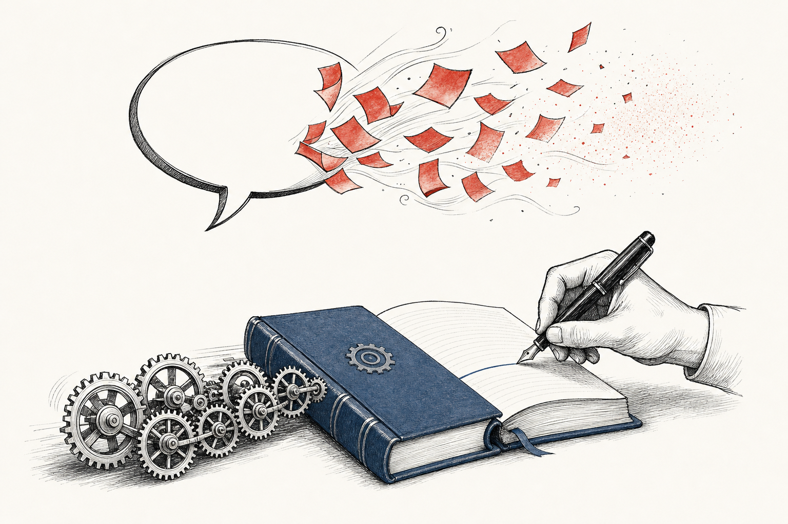
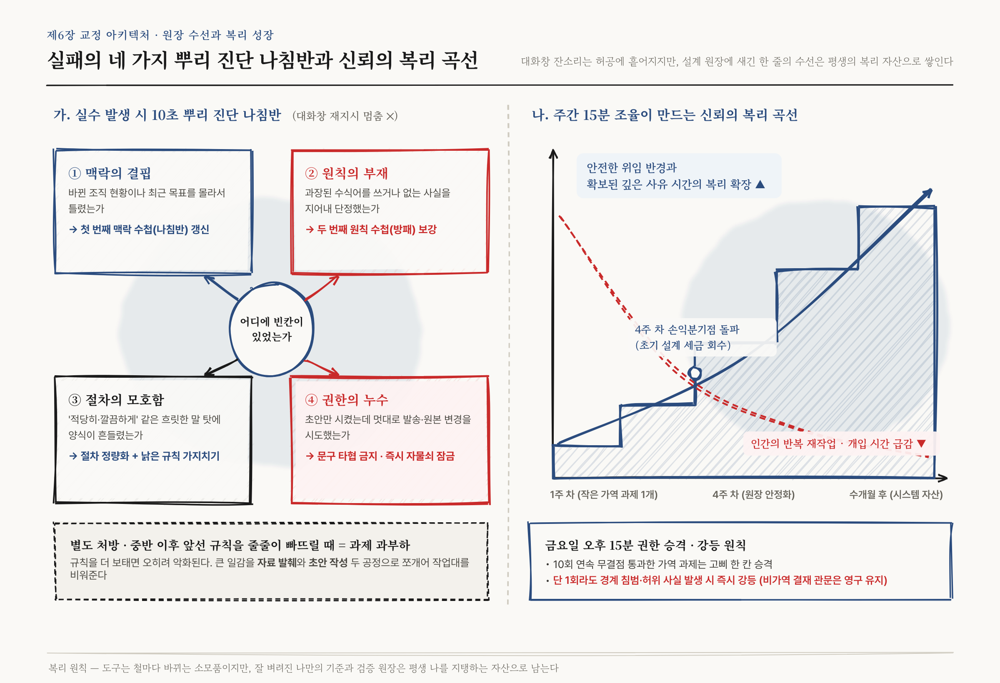

# 6장. 잔소리 대신 설계도를 고쳐라 — 실패를 복리로 바꾸는 교정 아키텍처

처음부터 한 치의 오차도 없이 맞물려 돌아가는 기계는 세상에 없다.
아무리 세 겹의 맥락을 정성껏 적어두고, 권한의 관문을 세우고, 작업장의 경계를 반듯하게 구획했더라도 현실의 거친 일감을 흘려보내면 예상치 못한 모퉁이에서 반드시 첫 번째 오차가 발생한다.

위임의 성패는 첫 번째 실패를 피하는 데 있지 않다.
그 실패를 마주한 순간 인간 설계자가 어디에 손을 대느냐에 달려 있다.

한 부류의 사람은 한숨을 쉬며 "설명할 시간에 내가 직접 고치고 만다"라며 다시 예전의 실행자 자리로 주저앉거나, 대화창에 대고 매번 똑같은 타박을 되풀이한다.
다른 부류의 사람은 삐끗한 결과물을 가만히 들여다보며 "내 설계도의 어느 칸이 비어 있었기에 이런 해석이 나왔을까"를 묻고, 조용히 원장을 열어 단 한 줄의 규칙을 새로 새긴다.

일 년 뒤 두 사람의 풍경은 극적으로 갈린다.
전자는 일 년 뒤에도 똑같은 서식 오류를 손으로 고치며 야근하고 있지만, 후자의 대리인은 한 번 겪은 실수를 두 번 다시 되풀이하지 않는 정교한 분신으로 자라난다.
마지막 장에서는 눈앞의 실패를 흘려보내지 않고 시스템의 영구적인 근육으로 바꾸는 **교정 루프**의 원리와 신뢰의 복리 곡선을 살펴본다.

---

## 6.1 대화창에 남기는 잔소리는 퇴근하면 바람에 날아가는 포스트잇이다

대리인이 가져온 보고서의 어조가 들떠 있거나 표의 항목이 기대와 다를 때, 대다수 실무자의 손가락은 본능적으로 지금 열려 있는 대화창으로 향한다.
서론은 빼라고 했지 않느냐고, 금액 단위는 백만 단위로 맞추어 다시 뽑아오라고 즉석에서 지시를 덧붙인다.

대리인은 즉시 정중하게 사과하며 고쳐진 결과물을 내놓는다.
당장 눈앞의 급한 불은 꺼졌으니 사람은 문제가 해결되었다고 믿고 창을 닫는다.
착각이다.

왜 내일 아침 새 작업실을 열면 대리인은 어제 혼났던 바로 그 실수를 똑같이 되풀이할까.
이유는 단순하다.
어제 그 대화창에서 오간 수많은 지적과 교정은 그 방의 불을 끄고 나오는 순간 허공으로 흩어지는 일회성 연기이기 때문이다.
매번 백지상태의 기억으로 새로 출근하는 대리인에게 대화창 속 잔소리는 유리창에 붙였다가 퇴근길에 바람에 날려 보내는 얇은 포스트잇 쪽지와 다를 바가 없다.

월요일 아침마다 두 작업실의 풍경이 갈리는 이유가 여기에 있다.
한 실무자는 매주 월요일 새 창을 열 때마다 지난주에 했던 서식 주의사항 네 줄을 기억에 의존해 다시 타이핑하며 대리인이 왜 이렇게 말귀를 못 알아듣느냐고 투덜댄다.
반면 옆자리의 아키텍트는 아무런 부연 설명 없이 날것의 재료만 작업대 위에 툭 올려놓고도 단번에 정돈된 초안을 받아든다.
그의 대리인이 더 영리해서가 아니라, 지난달에 겪었던 시행착오들이 어제의 대화창이 아닌 책상 위 영구 원장 속에 이미 새겨져 있기 때문이다.

고전적인 수석비서 운용 철학에는 이를 꿰뚫는 오랜 격언이 있다.
**"사람을 붙잡고 훈계하지 말고, 업무 원장을 고쳐라."**
결과물에 결함이 생겼다면 그것은 대리인의 성의가 부족해서가 아니라, 설계자인 내가 건네준 기준서에 해석의 구멍이 뚫려 있었기 때문이라는 관점이다.
인간 조수를 다룰 때도 유효했던 이 격언은 기억이 휘발되는 인공지능 대리인 앞에서는 비유가 아니라 엄연한 물리 법칙이 된다.
대리인의 내일 행동을 바꾸는 유일한 수단은 오늘의 훈계가 아니라 오늘 고쳐 쓴 설계도의 한 줄뿐이다.

*그림 6-1. 대화창에 붙인 잔소리 쪽지는 창을 닫으면 바람에 날아가지만, 원장에 새겨 넣은 규칙 한 줄은 영구적인 톱니가 되어 돌아간다*

따라서 설계자는 스스로에게 단호한 멈춤 규칙 하나를 부여해야 한다.
**똑같은 수정 지시를 대화창에 두 번째 입력하고 있는 자신을 발견한다면, 그 즉시 자판에서 손을 떼라.**

눈앞의 문서를 내 손으로 직접 고쳐 쓰는 데는 삼 분이면 족할지 모른다.
반면 원장을 열어 빠진 기준 한 줄을 찾아 적고, 깨끗한 새 작업실에서 다시 일을 시켜 제대로 나오는지 확인하는 데는 오 분이 걸린다.
당장 오늘 하루만 놓고 보면 직접 고치는 삼 분이 이 분 더 빠른 것처럼 보인다.
하지만 그 이 분을 아끼려다 앞으로 일 년 동안 백 번 넘게 반복될 삼백 분의 재작업을 스스로 떠안게 된다.
오늘의 결과물이 아니라 내일의 원장을 고치는 그 오 분의 우회가 일회성 노동을 복리 자산으로 바꾸는 유일한 분기점이다.

---

## 6.2 대리인을 탓하지 말고 설계도의 빈칸을 찾아라

결과물이 기대에서 벗어났다고 해서 아무 원장이나 펼쳐 들고 금지 조항을 길게 늘어놓아서는 안 된다.
열이 난다고 원인을 가리지 않고 온갖 약을 한꺼번에 삼키면 몸만 상하듯, 엉뚱한 자리에 얹힌 규칙은 기존의 멀쩡한 지침들과 충돌해 대리인의 판단력을 흐려놓는다.

오류가 발생했을 때는 대리인을 탓하기 전에 차가운 기사의 눈으로 **실패의 네 가지 구조적 뿌리** 중 어디에서 균열이 시작되었는지 십 초 만에 가려내야 한다.

첫 번째 뿌리는 **맥락의 결핍**이다.
아무리 유능한 인간 동료에게 똑같은 원재료만 건네주고 시켰더라도 우리 조직의 최근 사정이나 바뀐 우선순위를 몰라서 똑같이 틀렸을 문제인가.
그렇다면 대리인의 추론 능력이나 절차서가 잘못된 것이 아니다.
나와 내 주변의 현황을 담아두는 첫 번째 맥락 수첩이 낡아 있을 뿐이다.
규칙을 늘릴 것이 아니라 바뀐 목표와 최신 배경 사실 한 줄을 갱신해 주면 오차는 즉시 사라진다.

두 번째 뿌리는 **원칙의 부재**다.
문장에 과장된 수식어가 잔뜩 끼어들었거나, 확인되지도 않은 수치를 대리인이 어림짐작으로 지어내어 단정적으로 서술했는가.
이것은 개별 업무의 순서 문제가 아니라 모든 업무를 관통하는 태도와 경계선이 흔들린 신호다.
이때는 두 번째 원칙 수첩을 열어 어조의 절제 기준과 모르는 사실을 대하는 불확실성 처리 헌법을 또렷한 경계선으로 그어주어야 한다.

세 번째 뿌리는 **절차의 모호함**이다.
배경도 알고 태도도 단정한데, 요약의 길이가 매번 들쑥날쑥하거나 예외적인 항목을 만났을 때 처리 방식이 기대와 어긋나는 경우다.
원인은 십중팔구 내 절차 수첩 속에 숨어 있는 '적당히', '중요한 것 위주로', '깔끔하게' 같은 흐릿한 형용사에 있다.
세 번째 절차 수첩에서 주관적인 형용사를 모두 지워내고, 몇 줄 이내라는 정량적 천장과 어떤 조건일 때 어떻게 처리한다는 분기 기준, 그리고 내가 합격점을 주었던 모범 결과물 견본 하나를 나란히 붙여주어야 한다.

네 번째 뿌리는 **권한의 누수**다.
초안만 만들어 두라고 일렀는데 대리인이 멋대로 외부 발송 단추를 건드렸거나 원본 장부를 덮어쓰려 시도했는가.
이 앞에서는 절대 문서를 고쳐 쓰며 타협해서는 안 된다.
말로 타일러서 지킬 선이었다면 애초에 넘지도 않았을 것이다.
이것은 지침서의 문구 문제가 아니라 작업장의 문단속 실패다.
즉시 작업장 바깥의 물리적 관문으로 나가 열려 있던 실행 통로의 자물쇠를 잠그고 권한 단계를 강등해야 한다.

여기에 한 가지 특별한 증상을 더 구분할 줄 알아야 한다.
세 권의 수첩에 이미 기준이 명확히 적혀 있는데도, 긴 일감을 처리하다 중반 이후부터 앞에서 지킨 규칙들을 줄줄이 빠뜨리는 현상이다.
많은 사람이 이를 절차 부족으로 오진해 지침서에 강조 문구를 열 줄 더 보태지만, 결과는 오히려 더 나빠진다.
원인은 규칙 부족이 아니라 한 번에 너무 큰 덩어리를 삼키게 한 **과제 과부하**다.
이때의 처방은 원장 수정이 아니라 일감 쪼개기다.
하나의 거대한 주문을 자료 발췌와 초안 작성이라는 두 개의 독립된 공정으로 나누고, 공정 사이에 작업대 위를 깨끗이 비워주기만 하면 대리인은 거짓말처럼 다시 모든 기준을 정확히 지켜낸다.

어느 수첩의 어느 문장을 고쳐야 할지 단번에 떠오르지 않을 때는 **대리인에게 역으로 부검을 시키는 기술**이 큰 힘을 발휘한다.
틀린 결과물을 내 손으로 고쳐 주기 전에 먼저 두 가지를 묻는 것이다.
"내가 건넨 기준서의 어느 표현이 모호했기에 네가 이런 판단을 내렸는가."
"다음번에 백지상태에서 일을 시작할 때 처음부터 바른 결과가 나오려면, 내 원장의 어느 자리에 어떤 한 문장을 보태야 하겠는가."

자신이 어떤 추론 경로를 거쳐 그 결론에 도달했는지 가장 잘 아는 쪽은 대리인 자신이다.
이렇게 물으면 대리인은 기준서 속에서 서로 부딪히던 두 조항이나 빈틈이 있던 형용사를 정확히 짚어내고, 원장에 새로 새겨 넣을 규칙 초안 한 줄까지 단정하게 빚어 바친다.
인간 아키텍트는 그 한 줄이 내 의도와 맞는지 살피고 군더더기만 다듬어 원장에 옮겨 적기만 하면 된다.
실패의 수습조차 대리인의 손을 빌려 설계도를 벼리는 지렛대로 삼는 셈이다.

---

## 6.3 규칙의 비대화와 주의력 희석

교정 루프를 수개월 동안 성실히 돌리다 보면 뜻밖의 두 번째 함정이 찾아온다.
오차가 생길 때마다 원장 끝에 예외 조항을 두 줄씩 덧붙이다 보니, 어느새 얇고 명쾌하던 기준서가 수백 줄짜리 두꺼운 법전으로 불어나는 **규칙의 비대화** 현상이다.

경제학자 허버트 사이먼이 통찰했듯, 정보가 넘쳐나는 세계에서 가장 희소해지는 자원은 정보가 아니라 그것을 받아들이는 **주의력**이다.
이 법칙은 인간의 뇌에만 해당되지 않는다.
대리인이 한 번에 읽어들일 수 있는 글자의 총량이 아무리 넓어져도, 동시에 똑같은 무게로 긴장감을 유지하며 따를 수 있는 지침의 밀도에는 엄연한 한계가 존재한다.

사소한 예외 규칙과 감정 섞인 당부, 그리고 이미 끝난 옛날 과제의 지침들이 수백 줄씩 겹겹이 쌓이면 어떤 일이 벌어질까.
정작 목숨처럼 지켜야 할 첫 줄의 핵심 원칙까지 그 소음 속에 파묻혀 무게감을 잃어버리는 **주의력 희석**이 일어난다.
모든 문장에 밑줄이 그어진 책에서는 단 한 문장도 눈에 들어오지 않는 것과 같은 이치다.

따라서 훌륭한 아키텍트는 새 규칙을 더하는 일만큼이나 **낡은 규칙을 덜어내는 문서 위생**을 엄격히 챙긴다.

첫째, 모든 작업에 상시 펼쳐 두는 기본 원장에는 절대 타협할 수 없는 최상위 헌법만 남기고 분량의 천장을 단단히 묶어둔다.
둘째, 특정 업무에만 필요한 세세한 절차들은 평소에는 서랍 속에 넣어두었다가 그 업무를 실행하는 순간에만 꺼내 보여주는 지연 노출 구조를 지킨다.
수신함을 분류하는 조수에게 정량 장부 집계 규칙까지 한꺼번에 읽힐 이유는 없다.
셋째, 새로운 규칙 한 줄을 새겨 넣을 때는 반드시 원장 전체를 훑어 서로 겹치는 두 문장을 한 문장으로 압축하거나 시효가 끝난 과거의 지침을 솎아낸다.

조각가가 돌을 덧붙여 형상을 만들지 않고 불필요한 돌조각을 정으로 쪼아내어 본질을 드러내듯, 오래 살아남는 설계도는 더할 곳이 없는 문서가 아니라 더 이상 뺄 것이 없는 단단하고 얇은 원장이다.

이 간결한 원장의 힘은 개인의 책상을 넘어 동료들과 호흡을 맞출 때 더욱 선명해진다.
시스템 사상가 도넬라 메도스가 설파했듯, 시스템을 바꾸는 가장 강력한 지렛대는 개별 산출물을 다그치는 데 있지 않고 시스템이 따르는 규칙과 되먹임 고리를 고치는 데 있다.
개인의 취향과 배경을 담은 맥락 수첩은 각자의 서랍에 두되, 우리 조직의 품질 헌법과 업무 절차 원장을 팀의 공유 자산으로 묶어두면 교정의 복리는 팀 전체로 번져 나간다.
화요일 오전에 한 동료가 겪은 쓰라린 시행착오와 그로 인해 보태진 단 한 줄의 검증 규칙이, 화요일 오후부터는 나머지 열 명의 동료 모두를 똑같은 함정에서 지켜주는 공동의 방패가 되기 때문이다.

---

## 6.4 신뢰의 복리 곡선 — 작고 되돌릴 수 있는 위임 하나에서 출발하는 법

지금까지 우리는 실행자에서 설계자로 시선을 옮기는 법부터 머릿속 암묵지를 세 겹의 맥락으로 꺼내는 법, 권한의 사다리와 물리적 관문을 세우는 법, 격리된 작업장과 열 가지 실무 패턴, 그리고 실패를 자산화하는 교정 루프까지 위임 아키텍처의 전모를 함께 걸어왔다.

이 모든 구조를 한눈에 본 독자라면 마음 한구석에 거대한 집을 한꺼번에 지어야 한다는 부담감이 일지도 모른다.
그 부담감을 내려놓는 것이 마지막 설계 원칙이다.
위대한 시스템은 처음부터 거대하게 설계되어 작동하지 않는다.
언제나 **작고 단순하며 완벽히 작동하는 하나의 고리**에서 출발해 스스로 자라난다.

돌아오는 월요일 아침, 책상에 앉아 거창한 마스터플랜을 그리려 애쓰지 마라.
따뜻한 커피 한 잔을 내려놓고, 내 하루 중 가장 자주 집중력을 끊어놓으면서도 설령 실수가 나더라도 바깥세상에 아무런 해를 끼치지 않는 작고 가역적인 일감 딱 하나만 골라내라.
다가올 회의의 지난 기록을 한 장으로 추리는 일이어도 좋고, 흩어진 원천 자료에서 사실만 발췌하는 조사여도 좋다.

백지 위에 나를 설명하는 핵심 맥락과 절대 넘어선 안 될 금지선 열 줄만 담백하게 적어 전용 작업대 위에 올려두어라.
그리고 첫 일감을 건넨 뒤 돌아온 결과물을 삼십 초 동안 검수하며 첫 번째 빈칸을 찾아 원장에 한 줄을 보태 보아라.
단지 그 삼십 분의 순환 한 바퀴면 충분하다.

그 작은 고리가 돌아가기 시작하면 매주 금요일 오후 십오 분의 조율 시간을 달력에 고정해 두면 된다.
한 주 동안 대리인이 남긴 기록을 돌아보며 가장 거슬렸던 반복 오차 딱 하나만 골라 원장을 수리하고, 성적표에 따라 권한의 사다리를 조정하는 조용한 의식이다.
열 번 연속 내 손질 없이 합격선을 통과한 안전한 가역 과제는 고삐를 한 칸 풀어주어 내 검토 부담을 덜어내고, 반대로 단 한 번이라도 경계를 넘보거나 없는 사실을 지어낸 과제는 주저 없이 권한을 한 단계 내려 자물쇠를 다시 채운다.
다만 바깥세상으로 편지를 띄우거나 원본을 지우는 비가역의 문턱 앞에서는 백 번을 잘했더라도 영원히 인간의 최종 결재 관문을 거두지 않는다.

이 단순한 주간 조율이 열 번, 스무 번 쌓일 때 **신뢰의 복리 곡선**이 그려진다.
첫 주에 아낀 이십 분의 여유가 둘째 주에 두 번째 업무의 기준서를 깎는 시간이 되고, 한 달 뒤 아낀 세 시간이 내 본업의 가장 깊은 문제를 파고드는 몰입의 시간으로 되돌아온다.

*그림 6-2. 실수의 뿌리를 네 갈래로 가려내어 설계도를 한 줄씩 고쳐 나가면, 작은 수선이 쌓여 위임 반경이 넓어지는 신뢰의 복리가 작동한다*

앤디 그로브는 훌륭한 리더의 진정한 산출물이란 자기 손으로 직접 쳐낸 타자 수가 아니라, 자신이 설계하고 조율하는 조직 전체가 빚어내는 결과물의 총합이라고 정의했다.
오늘날에는 거느린 부하 직원이 단 한 명도 없는 일인 실무자라 할지라도 작업실에 대리인을 들이는 순간 똑같은 경영자의 지렛대 위에 올라서게 된다.
내가 기준서 한 줄을 정교하게 다듬는 데 들인 십 분의 사유가 앞으로 수백 번 반복될 실행의 품질을 한꺼번에 끌어올리는 고배율의 지렛대다.

평생 비서를 부려본 적 없는 성실한 실무자일수록 내 손끝을 떠나보내는 일을 두려워한다.
내 땀방울이 묻지 않은 결과물은 온전히 내 실력이 아닌 것 같고, 남의 손을 빌리면 품질이 무너질 것만 같기 때문이다.
하지만 도구의 지능이 임계점을 넘은 시대에 모든 밑바닥 실행까지 내 두 손으로 움켜쥐고 있는 것은 책임감이 아니라 내 가장 귀한 사유의 시간을 헐값에 태우는 일이다.

반복되는 분류와 검색, 서식 정돈과 초안 작성을 대리인의 작업대로 넘긴다고 해서 인간의 전문성이 설 자리를 잃지 않는다.
오히려 그 분주한 손발의 노동이 빠져나간 자리에, 비로소 기계는 영원히 대신할 수 없는 인간의 진짜 본령이 선명하게 모습을 드러낸다.
무엇이 풀어야 할 진짜 문제인지 정의하는 안목, 어떤 선은 절대 넘어서는 안 되는지 긋는 윤리적 기준, 그리고 완성된 결과물 앞에 내 이름을 걸고 서명하는 최종 책임이다.

기술의 파도는 해마다 새로운 이름의 도구를 몰고 와 어제의 숙련을 낡은 것으로 만들 것이다.
그러나 특정 도구의 사용법이 아니라 **내 일머리와 판단 기준을 정교한 언어로 벼려낸 설계 원장**을 가진 사람은 어떤 파도 앞에서도 흔들리지 않는다.
도구는 철마다 갈아 끼우는 소모품이지만, 잘 깎아둔 기준과 검증의 아키텍처는 평생 나를 지탱하는 고유의 자산으로 남는다.

설령 내일 아침 더 뛰어난 새 대리인이 작업실 문을 열고 들어온다 해도 처음부터 다시 길을 들일 필요가 없다.
책상 위에 놓인 그 얇고 단단한 세 권의 원장을 건네는 순간, 수개월 동안 쌓아 올린 당신의 기준과 분별력이 첫날부터 온전히 이어지기 때문이다.

이제 책장을 덮고 당신의 첫 번째 작업대에 백묵으로 경계를 그을 시간이다.
기억해야 할 단 하나의 나침반은 첫 장을 열 때와 조금도 다르지 않다.

> **"일의 실행은 위임하되, 기준의 설계와 검증의 책임은 절대 위임하지 마라."**
