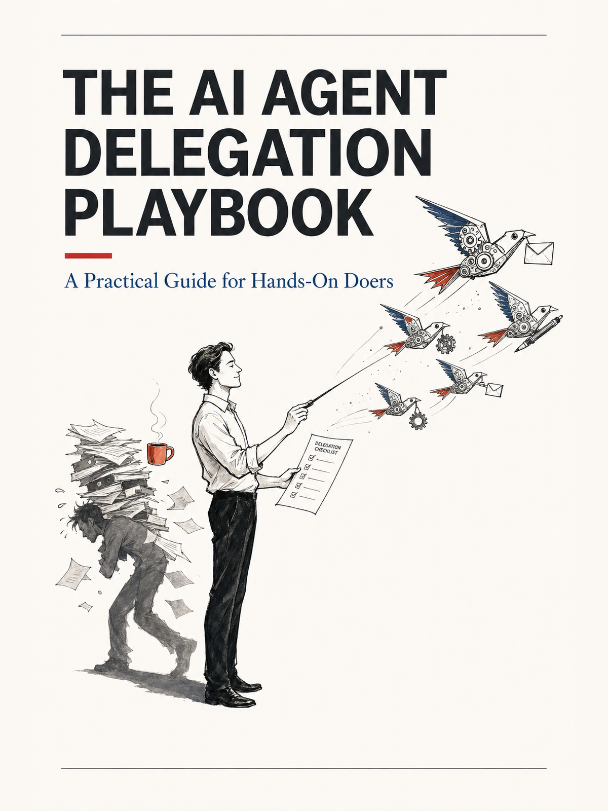

# 평생 비서를 부려본 적 없는 실무자를 위한 AI 에이전트 위임 플레이북

**직접 해버리는 습관을 버리고, 기준표와 검수만으로 일하는 개인 시스템 설계서**



> **"일의 실행(Execution)은 위임하되, 기준의 설계(Specification)와 검증의 책임(Verification)은 절대 위임하지 마라."**

---

## 서문: 왜 일 잘하는 실무자일수록 AI에게 일을 못 맡길까

일 잘하는 실무자일수록 남에게 일을 못 맡긴다.
기획자든, 마케터든, 리서처든, 디자이너든, 개발자든, 1인 창업가든 마찬가지다.
구구절절 설명할 시간에 내가 직접 해치우는 게 훨씬 빠르고 결과물도 깔끔하기 때문이다.

문제는 내 하루가 24시간뿐이라는 점이다.
자료를 찾고, 초안을 쓰고, 숫자를 맞추고, 줄 간격을 다듬는 일을 혼자 다 끌어안으면 어떻게 될까.
내가 깨어 있는 시간이 곧 내 생산성의 천장이 된다.
내 손이 멈추는 순간 내 일도 멈춘다.

그래서 큰마음 먹고 AI 에이전트를 켠다.
빈 채팅창에 한 줄을 던진다.
돌아온 결과물을 읽고 한숨을 쉰다.
"역시 아직 멀었네. 고쳐 쓰는 데 시간이 더 걸리겠다. 그냥 내가 하자."
그러고는 창을 닫는다.

냉정하게 말하자.
AI가 멍청해서 망한 게 아니다.
내 머릿속에만 있는 작업 기준을 한 줄도 안 적어주고, 첫 출근한 인턴에게 인수인계서 한 장 없이 "눈치껏 잘 해와"라고 던졌기 때문에 망한 것이다.

일을 잘하는 사람의 머릿속에는 수년간 부딪히며 쌓은 '일머리'가 압축되어 있다.
어떤 메일부터 답해야 하는지, 보고서 첫 줄에 뭘 적어야 임원이 읽는지, 어떤 숫자는 절대 틀리면 안 되는지 몸이 먼저 안다.
혼자 일할 때는 이 기준을 굳이 말로 꺼낼 필요가 없다.
하지만 AI에게는 눈치가 없다.
내가 글로 꺼내 적지 않은 기준은 AI의 세계에 아예 존재하지 않는다.

빈 채팅창을 열어 매번 말로 일을 시키는 사람은 평생 '챗봇 사용자'에 머문다.
반면 내 머릿속 일머리를 문서로 적어두고, 사고가 날 만한 길목에 안전 잠금장치를 걸어둔 뒤 손발이 되는 실행만 AI에게 넘기는 사람은 '시스템 설계자(아키텍트)'가 된다.
이 책은 평생 비서나 부하 직원을 부려본 적 없는 실무자가 자기만의 위임 시스템을 짓는 가장 현실적인 공사 매뉴얼이다.

| 비교 항목 | 챗봇 사용자 (매번 말로 시키는 사람) | 시스템 설계자 (문서와 잠금장치로 맡기는 사람) |
| :--- | :--- | :--- |
| **일 시키는 법** | 매번 빈 채팅창에 생각나는 대로 한 줄 지시를 친다. | 내 기준을 적어둔 `USER.md`·`SOUL.md`·`PLAYBOOK.md`를 항상 먼저 읽힌다. |
| **사고 막는 법** | 지시문 끝에 "실수하지 말고 조심해"라고 말로 당부한다. | 발송 버튼을 아예 빼앗아 초안만 쓰게 하고, 삭제 명령은 설정 파일로 잠근다. |
| **결과물 확인** | AI가 길게 써온 글을 처음부터 끝까지 읽으며 직접 뜯어고친다. | 표 양식과 원본 위치를 꼭 찍어오게 시켜서 30초 만에 눈으로 대조하고 끝낸다. |
| **틀렸을 때** | 채팅창에 대고 "다시 해"라고 화내고 창을 닫는다. (내일 또 틀린다.) | 왜 틀렸는지 찾아서 매뉴얼 파일에 규칙 두 줄을 보탠다. (다시는 안 틀린다.) |

### [나쁜 지시 vs 좋은 지시] 첫 출근 인턴에게 던지기 vs 제대로 된 업무 지시

> **[나쁜 지시 — 기준도 없고 안전장치도 없는 한 줄 지시]**
> "오늘 들어온 메일들 보고 급한 거 정리해서 답장 좀 써줘."
>
> - **왜 망할까:** 누구 메일이 급한 건지 기준(`USER.md`)이 없다. 내 평소 말투(`SOUL.md`)도 모른다. 무엇보다 답장 초안만 써둘지, 아니면 고객에게 실제로 발송 버튼을 눌러버릴지 선을 안 그어줬다. 오발송 사고와 재작업을 동시에 부르는 지시다.

> **[좋은 지시 — 기준 문서·멈춤 선·검수 양식을 딱 정해준 지시]**
> "`@USER.md`에 적힌 핵심 고객사 명단과 `@PLAYBOOK.md`의 메일 4분류 규칙대로 최근 24시간 안 읽은 메일을 나눠라.
> 늘 오던 정형 문의는 임시보관함(`Draft`)에만 답장 초안을 만들어두고, 실제 발송(`Send`)은 절대 누르지 마라.
> 끝나면 `[보낸 사람 | 분류 등급 | 초안 작성 여부 | 분류 이유 1줄]` 표만 찍고 내 확인을 기다려라."

---

## 이 책의 뼈대: 검증된 인간 비서 운영법 × AI 안전 설계

위임하는 법을 밑바닥부터 새로 발명할 필요는 없다.
지난 수십 년 동안 바쁜 최고경영자(CEO)와 유능한 수석 비서(EA) 사이에서 이미 검증이 끝난 위임 공식이 있기 때문이다.
다만 사람 비서와 AI 에이전트는 결정적으로 다른 구석이 네 가지 있다.
이 책은 고전 비서 운영 원칙 세 가지를 가져와 AI의 실제 성질에 맞게 다시 짰다.

| 고전 인간 비서(EA) 원칙 | 원래 핵심 내용 | AI 에이전트의 실제 성질 | 이 책의 실전 해법 |
| :--- | :--- | :--- | :--- |
| **마이클 하얏트 (Michael Hyatt)**<br>위임의 5단계 | "어디까지 네가 결정할지" 권한 크기를 1~5단계로 미리 합의한다. | **눈치 제로 & 상식 브레이크 없음:** 말 그대로만 알아듣고, 권한만 열려 있으면 운영 DB 삭제도 1초 만에 실행한다. | 말로 재량권을 주는 대신, AI가 만질 수 있는 **도구 범위(읽기 전용 / 초안 전용 / 조건부 쓰기)**로 권한을 쪼갠다. |
| **맷 모카리 (Matt Mochary)**<br>비서 메일·일정 매뉴얼 | 메일함을 4갈래로 정리하되, 답장은 임시보관함에만 넣어둔다(`Draft, Don't Send`). | **빠른 양산 & 해킹 노출:** 10초 만에 스무 장을 쏟아내 읽는 사람을 지치게 하고, 외부 악성 메일을 읽으면 해커 명령에 속아 넘어간다. | 발송 권한을 아예 뺀 **초안 전용 모드**와 **30초 검수 양식**으로 시간 낭비와 정보 유출을 한꺼번에 막는다. |
| **아테나 (Athena)**<br>위임 플레이북 | 반복 업무는 작업 절차서(SOP)로 적고, 실수가 나면 사람이 아니라 문서를 고친다. | **새 창을 열면 기억 리셋:** 어제 채팅창에서 혼낸 내용은 오늘 새 창을 열면 깨끗이 잊어버린다. 오직 파일로 읽힌 글만 기억한다. | 내 맥락과 규칙을 `USER.md`·`SOUL.md`·`PLAYBOOK.md` 파일 3개로 적어두고, 채팅 잔소리 대신 **파일을 고친다.** |

---

## 내 직무에 맞게 읽는 법 (두 가지 트랙)

코딩을 전혀 모르는 기획자·마케터와 매일 검은 터미널 창을 띄워놓고 사는 개발자는 쓰는 도구가 다르다.
본인의 평소 작업 환경에 맞는 길을 골라 따라오면 된다.

| 구분 | 트랙 A. 비개발 비즈니스 실무자 트랙 | 트랙 B. 개발자 · 데이터 · 엔지니어 트랙 |
| :--- | :--- | :--- |
| **누구를 위한 길인가** | 기획자(PM/PO), 마케터, 리서처, 디자이너, 운영·CS·재무 담당자, 1인 창업가 | 소프트웨어 개발자, 데이터 분석가, 인프라 엔지니어, 옵시디언·로컬 문서 사용자 |
| **주로 쓰는 도구** | Claude 앱(Projects·Cowork), ChatGPT(Projects·Tasks·Agent), Perplexity, Notion AI, Lindy AI | Claude Code, OpenClaw, OpenAI Codex CLI, Cursor/Cline, MCP 서버, 로컬 n8n |
| **추천 독서 코스** | **Ch 1** → **Ch 2**(2.1~2.3, **2.5 상용 앱 적용법**) → **Ch 3**(3.1~3.3, **3.5 사내 보안망 팁**) → **Ch 4**(상용 UI 가이드 위주) → **Ch 5** → **Ch 6** | **Ch 1 ~ Ch 6 전 구간** (특히 **Ch 2.4** 폴더별 규칙 로딩, **Ch 3.4** `settings.json`·차단 훅 스크립트, **Ch 4.1** 샌드박스 세팅 집중) |
| **첫날 목표** | 평소 쓰는 AI 프로젝트 설정창에 `USER.md`·`SOUL.md`를 붙여넣고 초안 업무 1건 돌려보기 | 전용 작업 폴더에 `starter-kit/`을 복사해 넣고 삭제 차단 잠금장치 테스트하기 |

---

## 전체 목차와 각 장에서 챙겨갈 무기

빈손으로 설명만 읽고 끝나는 장은 하나도 없다.
모든 개념 뒤에는 **`[나쁜 지시 vs 좋은 지시]`** 비교와 내 컴퓨터나 AI 설정창에 바로 복사해 붙여넣을 수 있는 **실전 파일·프롬프트**가 붙어 있다.

1. **[Chapter 1. 멘탈 모델의 전환 — 실무자(IC)에서 시스템 아키텍트로](./01_mental_model.md)**
   - 혼자 다 해치우던 습관을 버리고 '기준 짜기 → AI 실행 → 내 검수'로 일을 쪼개는 법, 사람 비서와 AI의 결정적 차이 4가지, 본전 뽑는 시간 계산법, 절대 AI에게 맡기면 안 되는 금지 영역 4가지를 다룬다.
   - **챙겨갈 무기:** 5줄 최소 지시 틀(`MINIMAL_SPEC_PROMPT`), 위임 손익분기 계산식, 내 업무 점수표(`task_audit_sheet.md`).

2. **[Chapter 2. 나를 문서화하기 (Personal OS)](./02_personal_os.md)**
   - 내 머릿속에만 있던 일머리를 3단계로 끄집어내어, 도구를 갈아타도 평생 써먹는 '나만의 설명서 파일 3종'을 만든다.
   - **챙겨갈 무기:** `USER.md`(내 상황), `SOUL.md`(원칙과 금지선), `PLAYBOOK.md`(업무 절차서) 완성본 템플릿, `CLAUDE.md` / `AGENTS.md`, 상용 AI 앱 이식 가이드.

3. **[Chapter 3. 위임의 기술과 게이트 설계](./03_delegation_gates.md)**
   - 마이클 하얏트의 위임 5단계를 AI 도구 권한으로 바꾸고, 주워 담을 수 없는 사고(오발송, 파일 삭제, 해킹 유출)를 설정 파일과 잠금 스크립트로 원천 봉쇄한다.
   - **챙겨갈 무기:** 위임 브리핑 5요소 카드(`DELEGATION_BRIEF_TEMPLATE.md`), `.claude/settings.json`, 위험 명령 차단 스크립트(`block_irreversible.py`), 사내 보안망 마스킹 팁.

4. **[Chapter 4. 실전 환경 구축 및 업무 위임 시나리오 10선](./04_setup_and_cases.md)**
   - 로컬 설치형과 상용 서비스형 중 내게 맞는 작업장을 고르고, 메일 정리·일정 방어·회의 브리핑·리서치·경쟁사 감시·엑셀 정제·기획서·코드 리뷰·티켓 분류·주간 회고까지 10가지 핵심 실무를 바로 돌아가게 세팅한다.
   - **챙겨갈 무기:** 작업 폴더 자동 생성 스크립트, 읽기 전용 `.mcp.json`, 10대 업무별 복붙용 절차서(`SOP-01`~`SOP-10`)와 30초 검수표.

5. **[Chapter 5. 교정과 진화 (Calibration)](./05_calibration_loop.md)**
   - 채팅창에 대고 같은 잔소리를 반복하는 퇴근 전 노동을 끝내고, AI가 틀릴 때마다 문서 두 줄을 고쳐 쓸수록 똑똑해지는 시스템을 만든다.
   - **챙겨갈 무기:** 10초 원인 찾기 지도, 자동 패치 제안 명령어(`/calibrate`), `PLAYBOOK.md` 수정 전후 예시, 금요일 15분 점검표(`WEEKLY_AGENT_AUDIT.md`).

6. **[Chapter 6. 실전 부트스트랩 — 월요일 오전 30분 세팅 가이드 & 원페이지 치트시트](./06_quickstart_cheatsheet.md)**
   - 책을 덮자마자 월요일 오전 딱 30분 타이머를 맞춰놓고 첫 위임 업무를 돌리는 시간대별 행동 지침과 현업 단골 질문 7문 7답을 담았다.
   - **챙겨갈 무기:** 월요일 30분 실행표, 모니터 옆에 붙여두는 원페이지 요약표, 막힐 때 펼쳐보는 FAQ 7선.

7. **[Appendix. 실전 도구, 프레임워크 원전 및 레퍼런스](./appendix_references.md)**
   - 비개발자도 5초 만에 이해하는 핵심 용어 18개 쉬운 풀이와 본문에 인용된 실제 사건·공식 문서 출처 38곳을 모았다.

---

## 바로 복사해 쓰는 `starter-kit/` 안내와 5단계 실행 순서

본문에 나오는 파일들을 일일이 복사해 만들기 귀찮다면, 함께 들어 있는 `starter-kit/` 폴더를 통째로 내 작업 폴더(예: `~/agent-workspace/`)에 복사해서 시작하면 된다.
그 안에 `USER.md`, `SOUL.md`, `PLAYBOOK.md`, `CLAUDE.md`, `AGENTS.md`부터 위험 명령 차단 스크립트(`block_irreversible.py`)까지 빈칸만 채우면 바로 돌아가는 파일 12개가 다 들어 있다.

이 책은 밑줄 치며 읽는 교양서가 아니다.
화면 반쪽에 띄워두고 아래 순서대로 하나씩 내 컴퓨터에 심는 작업 지시서다.

- **1단계 — 첫 타깃 딱 1개 고르기 (Chapter 1):** 지난주 내가 한 일들을 적고 점수표(`task_audit_sheet.md`)로 매겨본다. 자주 반복되면서 실수해도 되돌리기 쉬운 일 딱 하나만 고른다.
- **2단계 — 내 설명서 빈칸 채우기 (Chapter 2):** 전용 폴더(또는 상용 AI 지침창)에 `USER.md`, `SOUL.md`, `PLAYBOOK.md`를 넣고 대괄호(`[ ]`) 칸에 내 실제 상황을 적어 넣는다.
- **3단계 — 사고 방지 자물쇠 채우기 (Chapter 3):** 일을 시키기 전에 메일 발송 권한을 빼고 파일 삭제 방지 설정(`settings.json`)부터 걸어 잠근다.
- **4단계 — 월요일 30분 동안 1건만 개통하기 (Chapter 4 & 6):** 욕심내서 열 개를 한꺼번에 만들지 마라. 골라둔 업무 하나만 먼저 연결해 일주일 동안 돌려본다.
- **5단계 — 금요일 15분 문서 손보기 (Chapter 5):** 일주일 동안 AI가 헤맸던 부분만 모아서 금요일 오후 15분 동안 문서 규칙으로 보탠다. 열 번 연속 손댈 곳 없이 통과하면 그때 두 번째 업무를 늘린다.

```text
# 일 시키기 전 1분 점검 (하나라도 비어 있다면 Chapter 1~3부터 먼저 챙길 것)
[ ] 1. AI 전용 작업 폴더(또는 전용 프로젝트 창)가 내 개인 문서함 전체와 분리되어 있는가?
[ ] 2. 내 우선순위와 절대 금지선을 적은 USER.md와 SOUL.md를 읽혔는가?
[ ] 3. 외부 메일 발송(Send)과 원본 파일 삭제(rm)가 설정 차원에서 잠겨 있는가?
[ ] 4. 결과물을 30초 안에 눈으로 확인할 수 있게 출력 양식(표, 원본 위치 표기)을 못 박았는가?
```
